# TasteOps
### Turn Cultural Taste into Physical Space

[](https://www.python.org/)
[](https://fastapi.tiangolo.com/)
[](tests/)
[](https://astral.sh/ruff)
[](https://mypy-lang.org/)
[](LICENSE)

An operations system that transforms Qloo cultural intelligence into explainable, governed, venue-ready decisions.

<p align="center">
  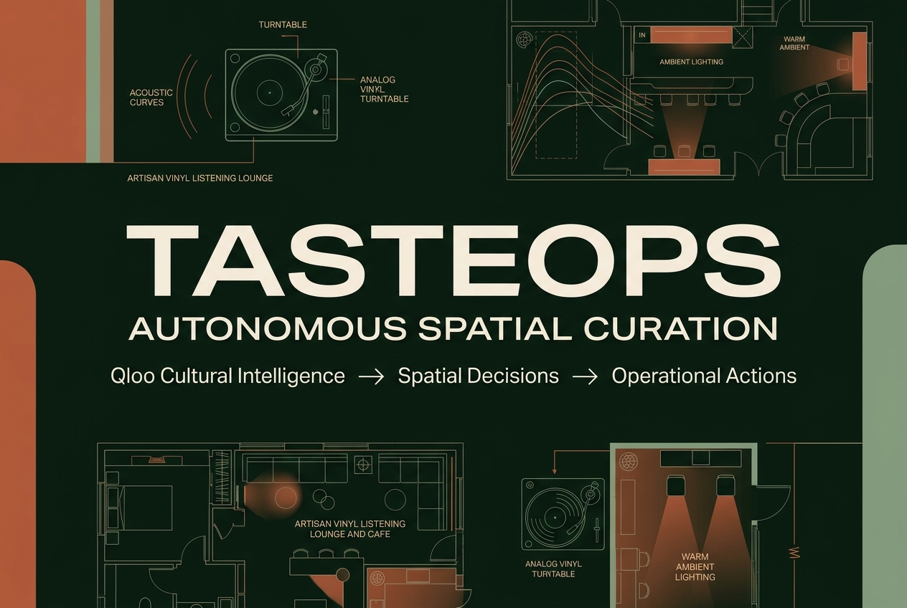
</p>

TasteOps turns creative venue briefs and spatial context into mathematically grounded physical activations. By combining Qloo's cultural taste graph with a deterministic multi-agent mesh, TasteOps curates acoustics, literary catalogs, and brand partnerships with human approval and truthful operational staging.

---

## Live Deployments

| Component | Target URL | Description |
| :--- | :--- | :--- |
| **Frontend Application** | [https://tasteops.vercel.app](https://tasteops.vercel.app) | Single-page application hosted on Vercel Edge CDN |
| **Backend API** | [https://tasteops-backend.onrender.com](https://tasteops-backend.onrender.com) | FastAPI service executing the workflow engine |
| **Interactive API Documentation** | [https://tasteops-backend.onrender.com/docs](https://tasteops-backend.onrender.com/docs) | Interactive OpenAPI/Swagger documentation |
| **Standby Catalyst Deployment** | [https://tasteops-60093332190.development.catalystserverless.in/app/index.html#/home](https://tasteops-60093332190.development.catalystserverless.in/app/index.html#/home) | Standby deployment on Zoho Catalyst Web Client |
| **Source Code Repository** | [https://github.com/maitray-agrawal/TasteOps](https://github.com/maitray-agrawal/TasteOps) | Verified GitHub repository with 322 passing tests |

> **Note on Service Latency:** The production API runs as a web service on Render. Warm requests complete in under 50ms. When waking from an idle state, initial startup takes approximately 30 seconds. The frontend includes an automated health probe that indicates when the backend is connecting.

---

## The Problem

Designing and operating physical spaces—listening lounges, boutique hotels, specialty cafes, and cultural retail pop-ups—demands dozens of interconnected decisions across sound, literature, tableware, retail, and brand partnerships.

In practice, this process faces four core challenges:
1. **Subjective Curation:** Venue operators frequently rely on personal intuition or disconnected playlists, leading to inconsistent patron experiences.
2. **Category Silos:** A venue's audio profile rarely shares a coherent lineage with its design library, tableware, or commercial partnerships.
3. **Plausibility vs. Affinity:** Existing generative AI can produce plausible recommendations, but plausibility is not the same as culturally grounded affinity. Generic models cannot compute true cross-category correlation.
4. **Unchecked Automation:** Automatically dispatching purchase orders or partner outreach without human review creates operational and brand risks.

---

## The Solution

TasteOps bridges high-dimensional audience taste data with physical venue operations through a governed pipeline:

```
Venue Brief ──▶ Qloo Cultural Signals ──▶ Entity Resolution ──▶ Multi-Agent Reasoning ──▶ Cultural Twin ──▶ Execution Plan ──▶ Human Approval ──▶ Operational Artifacts
```

The fundamental distinction: **Qloo provides cultural and taste evidence; TasteOps orchestrates multi-agent reasoning and converts that evidence into operational decisions.**

- **Spatial Ingestion:** Ingests venue typology, geographic coordinates, cultural district, vibe keywords, and brand identity.
- **Empirical Grounding:** Resolves taste anchors against Qloo's knowledge graph, discarding ungrounded entities.
- **Cross-Domain Synthesis:** Evaluates 6 cultural matrix categories (`artists`, `books`, `brands`, `places`, `movies`, `destinations`) mapped into 5 spatial curation verticals.
- **Specialized Multi-Agent Mesh:** Sonic, Procurement, and Brand agents synthesize acoustic curves, purchase orders, and partner outreach in parallel.
- **Cryptographic Gate:** Locks execution behind a mandatory SHA-256 plan fingerprint requiring signed human curator approval.
- **Truthful Staged Execution:** Connectors without production credentials remain transparently staged, producing verified operational artifacts.

---

## Why Qloo Matters

TasteOps relies on Qloo's cultural intelligence API to provide empirical affinity data across disparate cultural domains:

| Generic LLM | TasteOps + Qloo |
| :--- | :--- |
| Generates plausible recommendations | Grounds recommendations in cultural affinity |
| Primarily text-driven | Entity and taste graph driven |
| Can hallucinate cultural relationships | Uses retrieved cultural signals as evidence |
| Produces suggestions | Converts evidence into operational decisions |
| Weak provenance | Explicit evidence $\rightarrow$ inference $\rightarrow$ decision chain |

### Implemented Endpoints & Integration
TasteOps interacts with Qloo via the following verified endpoints:
- `GET /v2/insights`: Retrieves cross-domain affinity scores and entity rankings based on input signals and radial geographic coordinates (`POINT(lon lat)`).
- `GET /v2/tags`: Queries hierarchical cultural taxonomy tags for categorization.

Per developer guidelines, legacy `/recs` endpoints are explicitly avoided. When running offline or without an active API key, representative reference data is clearly labeled as sample data in the UI.

---

## How TasteOps Works

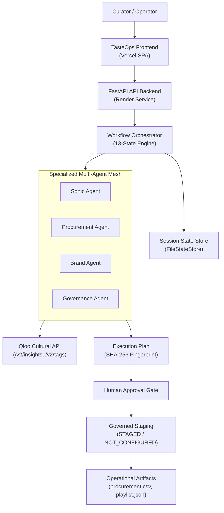

### Workflow Lifecycle
The workflow progresses through 13 validated states:
`CREATED` $\rightarrow$ `INTENT_PARSED` $\rightarrow$ `CULTURAL_TWIN_CREATED` $\rightarrow$ `QLOO_RESOLVED` $\rightarrow$ `CULTURAL_MATRIX_READY` $\rightarrow$ `AGENTS_RUNNING` $\rightarrow$ `PLAN_GENERATED` $\rightarrow$ `VALIDATED` $\rightarrow$ `AWAITING_APPROVAL` $\rightarrow$ `APPROVED` $\rightarrow$ `EXECUTING` $\rightarrow$ `COMPLETED` (or terminal `FAILED`).

Standard execution records 12 sequential transitions in the append-only session audit log.

---

## Cultural Twin: Evidence to Decision

The Cultural Twin screen makes the reasoning process inspectable by separating facts from derived recommendations across three epistemic tiers:

```
SOURCE EVIDENCE ──▶ AGENT INFERENCE ──▶ RECOMMENDATION ──▶ GOVERNED EXECUTION
```

- **SOURCE EVIDENCE:** Ground-truth entities and quantitative affinity scores retrieved from Qloo (e.g., entity URNs with affinity $> 0.85$).
- **AGENT INFERENCE:** Domain-specialist models deducing spatial requirements (e.g., decibel thresholds, reading room lighting, brand alignment index).
- **RECOMMENDATION:** Concrete operational specifications chosen for the venue (e.g., 3-phase day-part curve, 8-title curated library, acoustic booth specs).
- **GOVERNED EXECUTION:** Operational dispatch held at the curator sign-off gate before staging.

---

## Multi-Agent Architecture

Rather than relying on a single general-purpose prompt, TasteOps assigns distinct responsibilities to four specialized agents operating over typed FastMCP tools:

### 1. Sonic Agent (`SonicAgent`)
- **Responsibility:** Translates musical affinities into calibrated day-part acoustic curves and spatial sound requirements.
- **Output:** 3-phase listening schedule (Morning Focus 90 BPM $\rightarrow$ Afternoon Warmth 105 BPM $\rightarrow$ Evening Audiophile 118 BPM), target decibels, track selections, and equipment specifications.

### 2. Procurement Agent (`ProcurementAgent`)
- **Responsibility:** Converts literary, visual, and architectural affinities into validated physical inventory.
- **Output:** 8-column purchase order (`procurement.csv`) containing ISBNs, titles, authors, publishers, quantities, and wholesale pricing.

### 3. Brand Agent (`BrandAgent`)
- **Responsibility:** Identifies aligned retail, lifestyle, and audio brands for co-marketing and spatial sponsorship.
- **Output:** Partnership dossiers (`brand_dossiers.json`) detailing partner fit scores, commercial tiers, and outreach briefs.

### 4. Governance Agent (`GovernanceAgent`)
- **Responsibility:** Audits budget allocations, verifies precondition rules, and computes the cryptographic SHA-256 plan hash binding the approval.

---

## Governance & Truthful Execution

TasteOps enforces truthful operational staging. It strictly rejects simulated execution:

```
Recommendation ──▶ Execution Plan ──▶ Human Approval ──▶ Precondition Checks ──▶ Execution / Staging
```

The system uses three explicit execution statuses:
- **`STAGED`:** An action has been generated and validated, but cannot be externally dispatched because live third-party API credentials are not provisioned in the current environment.
- **`NOT_CONFIGURED`:** The connector adapter is present, but lacks active production credentials (e.g., Spotify OAuth, SendGrid SMTP).
- **`READY`:** An operational artifact satisfies all schema validation rules and is ready for inspection or manual fulfillment.

TasteOps never claims an external mutation succeeded (`SENT`, `PUBLISHED`, `ORDERED`) unless a verified HTTP 200/201 response was received from that external provider.

---

## Demo Walkthrough

Judges can explore the complete workflow using the pre-configured **Kitsuné Musique Lab** scenario:

1. **Open Application:** Navigate to [https://tasteops.vercel.app](https://tasteops.vercel.app).
2. **Select Scenario Preset:** On the Home or Create Space screen, click **Kitsuné Musique Lab — Mumbai** to populate coordinates (`72.8311, 18.9272`), typology, and vibe tags.
3. **Review Curatorial Space Brief:** Confirm spatial context and parameters.
4. **Run Analysis:** Click **Analyze Space & Generate →** to trigger Qloo resolution and the multi-agent mesh.
5. **Inspect Cultural Twin:** View the 4-part causal matrix with `SOURCE EVIDENCE`, `AGENT INFERENCE`, and `RECOMMENDATION` badges.
6. **Inspect Specialized Agents:** Review concurrent execution metrics and active signal pills.
7. **Review Execution Plan:** Examine tasks, budget allocations, and the SHA-256 plan fingerprint.
8. **Approve as Curator:** Click **Sign & Approve Plan** to record the curator sign-off.
9. **Inspect Results:** Review final venue decisions and truthful connector execution states (`STAGED`).
10. **Inspect Generated Artifacts:** Download or view the generated CSV purchase order and JSON dossiers.

---

## Product Gallery

All assets are located in [docs/project-gallery/](docs/project-gallery/) and reflect the live application:

| Preview | Screen & Description |
| :--- | :--- |
| 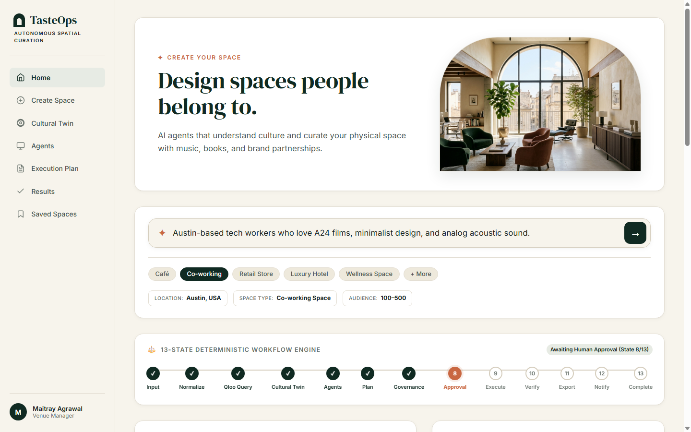 | **01 — Home Dashboard:** System telemetry, curatorial scenario presets, and pipeline status. |
| 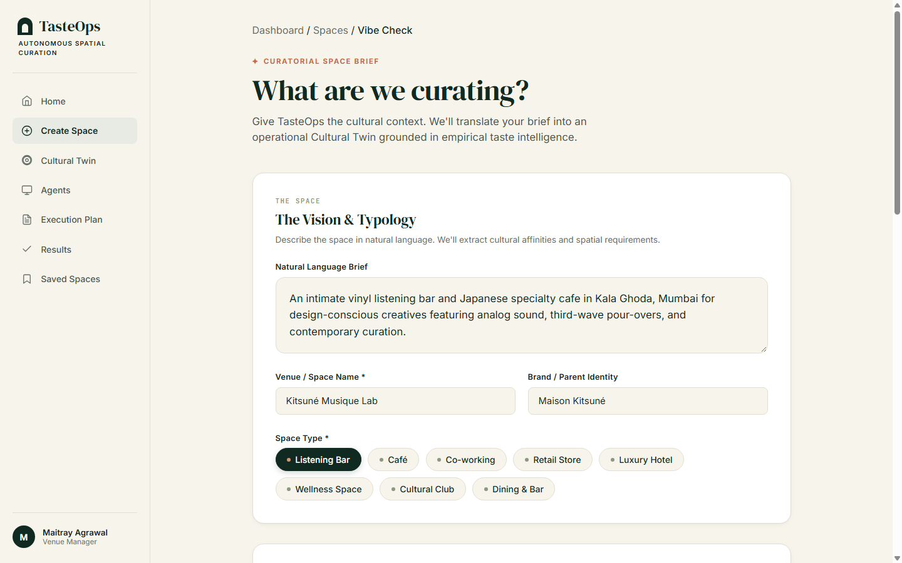 | **02 — Create Space:** Curatorial brief configuration with spatial coordinates and vibe tags. |
| 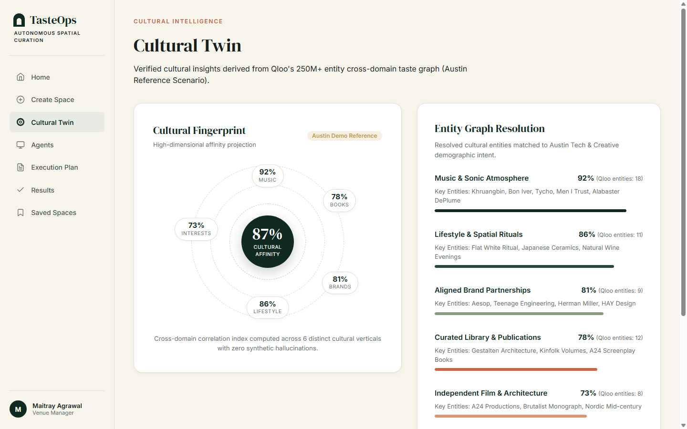 | **03 — Cultural Twin:** 3-tier epistemic architecture with Qloo evidence and causal reasoning. |
| 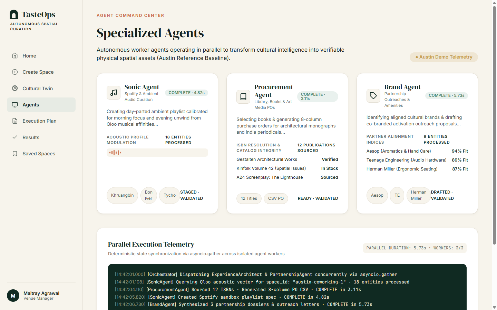 | **04 — Specialized Agents:** Sonic, Procurement, and Brand agents with live telemetry and signal pills. |
| 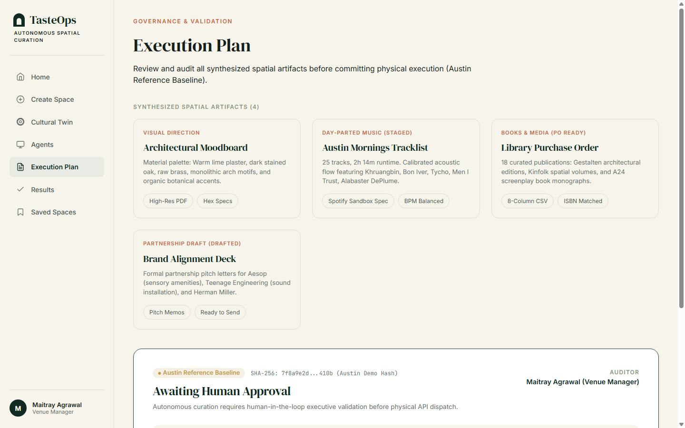 | **05 — Execution Plan:** Operational tasks bound to the SHA-256 plan fingerprint. |
| 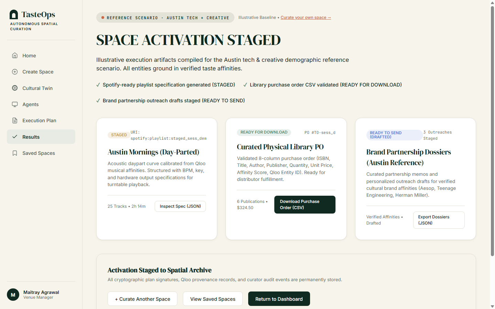 | **06 — Results:** Venue decisions with truthful `STAGED` execution status. |
| 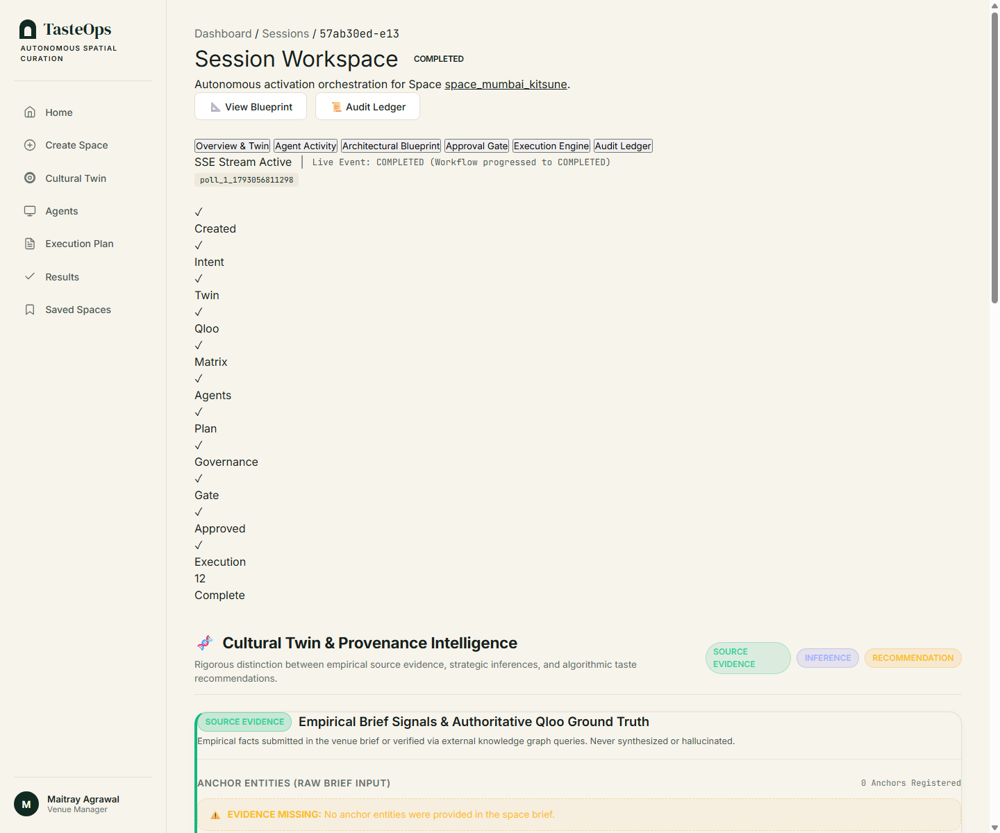 | **07 — Session Workspace:** Full session lifecycle detail and provenance inspector. |
| 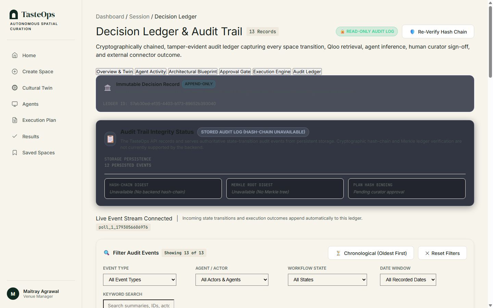 | **08 — Audit Ledger:** Append-only log recording 12 persisted transitions and curator sign-offs. |
| 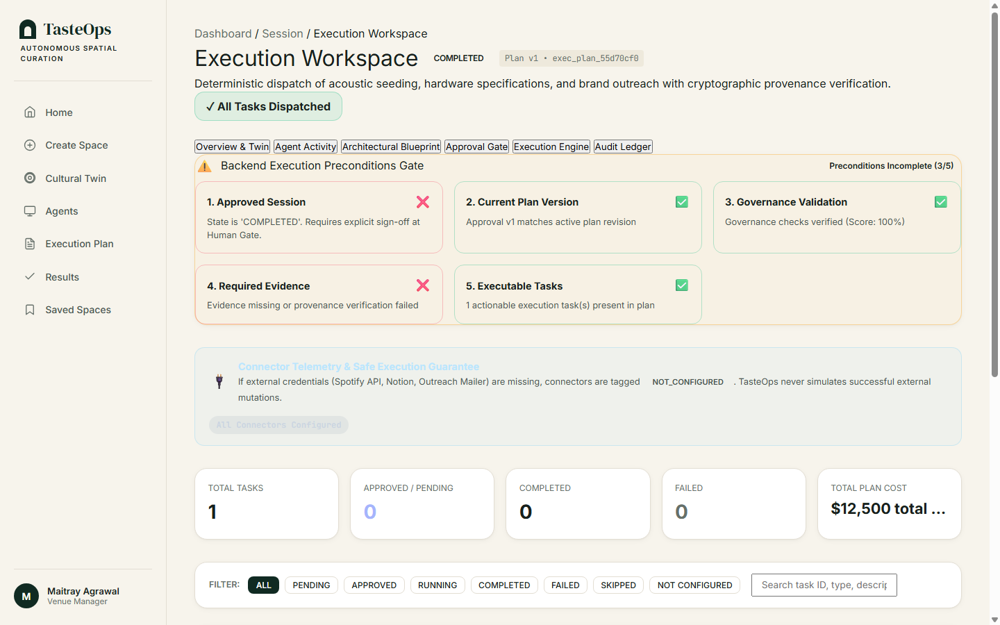 | **09 — Operational Preconditions:** 5-point precondition check preventing simulated execution. |
| 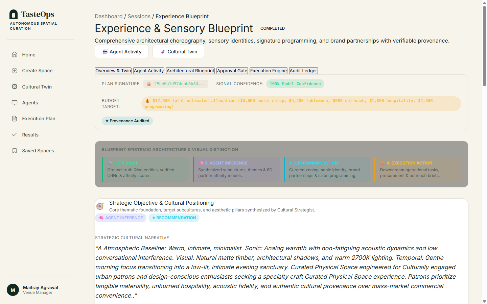 | **10 — Experience Blueprint:** Final sealed spatial activation blueprint and budget breakdown. |

---

## Operational Artifacts

During execution, TasteOps generates concrete, downloadable operational artifacts:

| Artifact | Format | Description | Execution Status |
| :--- | :---: | :--- | :--- |
| **`procurement.csv`** | CSV (8 cols) | Purchase order with Title, Author, Publisher, ISBN, Quantity, Unit Price, Affinity, and Qloo Entity ID. | `READY` (Draft for fulfillment) |
| **`spotify_playlist.json`** | JSON | Calibrated acoustic day-part curve specifying tracks, artists, BPM ranges, and acoustic targets. | `STAGED` (Requires Spotify OAuth) |
| **`brand_dossiers.json`** | JSON | Partnership dossiers detailing partner compatibility indices, commercial tiering, and outreach briefs. | `STAGED` (Requires Outreach SMTP) |

Artifacts can be inspected directly through the UI or via `/api/v1/sessions/{session_id}/artifacts/{artifact_name}`.

---

## Technical Stack

- **Backend:** Python 3.12+, FastAPI 0.115+, Pydantic v2, Uvicorn
- **Package Management:** Astral uv
- **Code Quality:** Ruff (linter & formatter), Mypy (strict type checking), Pytest
- **Agent Protocol:** FastMCP (exposing 10 typed tools)
- **Frontend:** Vanilla JavaScript (ES Modules), CSS custom properties, zero client-side build step
- **Hosting:** Vercel (Frontend CDN), Render (Backend Web Service), Zoho Catalyst (Standby)
- **Cultural AI:** Qloo Cultural Intelligence API (`/v2/insights`, `/v2/tags`)

---

## Quality Gates & Verification

TasteOps enforces continuous integration quality standards across linting, formatting, type checking, and automated tests:

```bash
# Lint checking
uv run ruff check src tests scripts

# Format checking
uv run ruff format --check src tests scripts

# Static type analysis
uv run mypy src

# Test execution
uv run pytest -q
```

### Verified Test Results
- **Ruff Linter:** `PASS` (0 warnings, 0 errors)
- **Ruff Formatter:** `PASS` (78 files checked, 100% compliant)
- **Mypy Static Typing:** `PASS` (47 source files checked, 0 errors)
- **Pytest Suite:** `PASS` (**322 passed**)
- **Live Smoke Test:** `PASS` (Session creation, pipeline execution, approval gate, staged execution, and artifact generation verified against Render backend)

---

## Known Limitations

- **Render Cold-Start Latency:** The backend is hosted on Render's web tier. When resuming from idle, initial spin-up takes approximately 30 seconds. Warm requests execute in under 50ms.
- **Staged External Connectors:** Dispatching live third-party mutations (e.g., Spotify playlist publishing, SendGrid mail delivery) requires production enterprise API keys. In demo and test environments, these remain safely in `STAGED` status.
- **Rate Limits & Caching:** The Qloo Hackathon tier enforces concurrency limits. TasteOps implements an in-memory TTL cache (3600 seconds) and exponential retry logic to avoid redundant upstream calls.

---

## Contributors

- **Maitray Agrawal** — Lead Backend Architecture, Qloo Integration, DevOps ([maitrayagrawal1705@gmail.com](mailto:maitrayagrawal1705@gmail.com))
- **Satwik Jaiswal** — Domain Agent Architecture & Frontend Client ([satwikj9@gmail.com](mailto:satwikj9@gmail.com))
- **TasteOps Team** — Autonomous Spatial Curation Research

---

## License

This project is licensed under the **MIT License** — see the [LICENSE](LICENSE) file for details.
