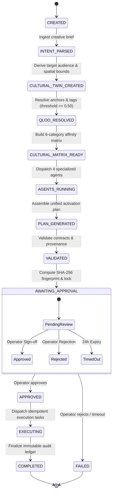

# TasteOps
### AI-Powered Cultural Intelligence & Activation Engine

[](https://github.com/maitray-agrawal/TasteOps/actions/workflows/ci.yml)
[](tests/)
[](https://www.python.org/)
[](https://fastapi.tiangolo.com/)
[](https://github.com/astral-sh/uv)
[](https://astral.sh/ruff)
[](https://mypy-lang.org/)
[](https://render.com)
[](LICENSE)

> **Transform a creative brief into a culturally grounded activation plan using Qloo cultural intelligence, deterministic orchestration, specialized agents, governance, human approval, and auditable execution.**

---

## Table of Contents

1. [Hero & Project Summary](#1-hero--project-summary)
2. [Live Backend & Status](#2-live-backend--status)
3. [The Problem](#3-the-problem)
4. [The Solution](#4-the-solution)
5. [Why TasteOps? (Why Qloo is Essential)](#5-why-tasteops-why-qloo-is-essential)
6. [Key Capabilities](#6-key-capabilities)
7. [System Architecture](#7-system-architecture)
8. [End-to-End Workflow (13-State Pipeline)](#8-end-to-end-workflow-13-state-pipeline)
9. [Qloo Integration](#9-qloo-integration)
10. [Cultural Matrix](#10-cultural-matrix)
11. [Agent Architecture & MCP Layer](#11-agent-architecture--mcp-layer)
12. [Human Approval Gate](#12-human-approval-gate)
13. [Governance and Provenance](#13-governance-and-provenance)
14. [Audit Ledger & Persistence](#14-audit-ledger--persistence)
15. [API Endpoints & Contracts](#15-api-endpoints--contracts)
16. [Tech Stack](#16-tech-stack)
17. [Local Setup](#17-local-setup)
18. [Environment Variables](#18-environment-variables)
19. [Docker Deployment](#19-docker-deployment)
20. [Render Production Deployment](#20-render-production-deployment)
21. [Testing & Quality Verification](#21-testing--quality-verification)
22. [Security & Isolation](#22-security--isolation)
23. [Hackathon Context](#23-hackathon-context)
24. [Roadmap](#24-roadmap)
25. [Contributors](#25-contributors)
26. [License](#26-license)

---

## 1. Hero & Project Summary

**TasteOps** is an autonomous Cultural Intelligence Operating System for physical venues—boutique hotels, vinyl listening bars, specialty restaurants, and experiential retail spaces. 

Instead of relying on subjective human guesswork or ungrounded generative LLM hallucinations, TasteOps binds mathematical cultural affinity data from **Qloo's Taste AI™** to a **deterministic 13-state multi-agent pipeline**. It accepts venue briefs, resolves high-confidence cultural anchors, builds 6-category affinity matrices, orchestrates domain-specialist agents, enforces a cryptographic human-approval gate, and outputs an auditable, idempotent execution ledger.

---

## 2. Live Backend & Status

TasteOps is architected with a decoupled backend-first model. The backend service is containerized, tested, and configured for deployment on Render:

| Component | Target URL / Reference | Status |
| :--- | :--- | :--- |
| **Backend Web Service** | [`https://tasteops-backend.onrender.com`](https://tasteops-backend.onrender.com) | **Configured on Render (via Blueprint)** |
| **Interactive API Docs (Swagger)** | [`https://tasteops-backend.onrender.com/docs`](https://tasteops-backend.onrender.com/docs) | **Operational** |
| **Liveness Probe** | [`https://tasteops-backend.onrender.com/health`](https://tasteops-backend.onrender.com/health) | **Operational (in-memory probe, 0 upstream calls)** |
| **Readiness Probe** | [`https://tasteops-backend.onrender.com/ready`](https://tasteops-backend.onrender.com/ready) | **Operational (verifies key & storage writability)** |
| **Frontend Web App** | `https://<frontend-domain>.vercel.app` | *Under Active Development (`feature/member-3-tasks`)* |

> **Deployment Distinction:** The backend HTTP API and MCP server are verified against all automated integration gates. The frontend UI is currently being developed on branch `feature/member-3-tasks` and remains pending until merged and deployed.

---

## 3. The Problem

Curating the cultural identity and live activations of physical spaces faces critical operational challenges:
- **Disjointed Guesswork:** Venue curators rely on subjective personal tastes or fragmented playlists, resulting in disjointed brand identities and inconsistent guest experiences.
- **Cross-Category Silos:** A venue's soundscape, literature, wine list, design aesthetic, and brand pop-ups rarely share a mathematically coherent cultural lineage.
- **LLM Hallucinations:** Generic generative AI invents plausible-sounding cultural pairings that have zero actual correlation with target demographic audiences.
- **Lack of Governance & Auditability:** Real-world venue operations require signed human approval, budgetary limits, and immutable execution records before physical resources are committed.

---

## 4. The Solution

TasteOps solves this by turning creative briefs into **provenance-verified execution specifications**:
1. Ingests spatial parameters (venue category, location coordinates/WKT radius, vibe keywords, target demographics).
2. Queries Qloo's cultural knowledge graph to resolve verified entities and taxonomy tags with confidence scores $\ge 0.50$.
3. Constructs a 6-category **Cultural Matrix** across `artist`, `book`, `brand`, `place`, `movie`, and `destination`.
4. Orchestrates four domain agents via typed **Model Context Protocol (MCP)** tools to draft a unified activation plan.
5. Locks the plan behind a **cryptographic SHA-256 Human Approval Gate**.
6. Emits an immutable, idempotent execution ledger ready for real-world operations.

---

## 5. Why TasteOps? (Why Qloo is Essential)

```
┌────────────────────────────────────────────────────────────────────────┐
│                        Why TasteOps & Qloo?                            │
├────────────────────────────────┬───────────────────────────────────────┤
│ Without Qloo (Generic AI)      │ With TasteOps (Qloo Cultural AI)      │
├────────────────────────────────┼───────────────────────────────────────┤
│ ❌ Subjective vibe guesswork   │ ✅ Real cultural affinity correlation  │
│ ❌ Hallucinated entity names   │ ✅ Verified Qloo entity & tag IDs     │
│ ❌ Siloed category assumptions │ ✅ 6-category cross-cultural matrices │
│ ❌ Unchecked automated actions │ ✅ Mandatory SHA-256 human approval   │
│ ❌ No audit trail or lineage   │ ✅ Immutable cryptographic audit logs │
└────────────────────────────────┴───────────────────────────────────────┘
```

**Qloo is the indispensable cultural engine of TasteOps:**
- **Real Cultural Affinity:** Qloo connects disparate cultural domains through high-dimensional affinity graphs without demographic bias.
- **Entity & Tag Grounding:** Every cultural anchor is mapped to an authoritative Qloo entity (`ent_...`) or taxonomy tag (`tag_...`).
- **Grounded Agent Actions:** Agents operate on structured affinity data; suggestions are bound to verified Qloo scores.
- **Spatial Radius Filtering:** Qloo enables spatial radius filtering (`POINT(lon lat)` with radial meters) to anchor cultural recommendations in local physical reality.
- **Strict Provenance & Verification:** Every recommendation contains its source entity, tag, confidence score, and query lineage.

---

## 6. Key Capabilities

- **Strict Confidence Gating:** Anchor entity and tag resolvers enforce strict $\ge 0.50$ confidence thresholds. If Qloo returns sub-threshold matches, TasteOps degrades safely rather than synthesizing ungrounded IDs.
- **Deterministic 13-State Machine:** State transitions are strictly validated. Out-of-order execution is rejected by the workflow engine.
- **Cryptographic Plan Gating:** Approval records bind the SHA-256 fingerprint of the plan to ensure that human operators approve the exact generated specification.
- **Idempotent Task Execution:** Each executable task generates a deterministic idempotency key (`task_id:plan_hash:attempt`). Duplicate execution calls return cached results without re-triggering operations.
- **Model Context Protocol (FastMCP):** A standards-compliant FastMCP server exposes 10 typed tools for AI agent tool calling with strict Pydantic schemas.
- **Lightweight Health Probes:** Pure in-memory `/health` liveness probe guarantees zero upstream Qloo queries, avoiding deployment timeouts.
- **Persistent State Store:** File-based state persistence (`FileStateStore`) stores full session state snapshots and audit trails.

---

## 7. System Architecture

The following diagram illustrates the complete end-to-end TasteOps architecture from client interfaces down to the Qloo Cultural API:

```mermaid
graph TD
    Client["Client / Frontend<br/>(React / Next.js / CLI)"]
    
    subgraph TasteOps_Core ["TasteOps Application Core"]
        FastAPI["FastAPI Web Service<br/>(src/tasteops/api)"]
        Orchestrator["Workflow Orchestrator<br/>(TasteOpsOrchestrator)"]
        Engine["Deterministic Engine<br/>(13 Validated States)"]
        Store["State Persistence<br/>(FileStateStore / Snapshots)"]
        
        subgraph Agent_Layer ["Specialized Agent Layer"]
            A1["Cultural Strategist"]
            A2["Experience Architect"]
            A3["Partnership Agent"]
            A4["Governance Agent"]
        end
        
        MCP["FastMCP Tool Server<br/>(10 Typed Tools)"]
        
        subgraph Services ["Cultural Intelligence Services"]
            S1["EntityResolver"]
            S2["TagResolver"]
            S3["InsightsService"]
            S4["CulturalMatrixService"]
        end
        
        ClientWrapper["QlooClient<br/>(Async HTTP + TTL Cache + Retries)"]
    end
    
    QlooAPI[("Qloo Hackathon Cultural API<br/>https://hackathon.api.qloo.com")]

    Client -->|HTTP / JSON| FastAPI
    FastAPI --> Orchestrator
    Orchestrator --> Engine
    Orchestrator --> Store
    Engine --> Agent_Layer
    Agent_Layer -->|Tool Invocations| MCP
    MCP --> Services
    Services --> ClientWrapper
    ClientWrapper -->|Signed REST API (X-Api-Key)| QlooAPI
```

---

## 8. End-to-End Workflow (13-State Pipeline)

TasteOps implements a strict 13-state deterministic workflow. State transitions are strictly validated by the workflow engine, preventing execution without transitioning through the required validation and approval states:



### Detailed State Transitions

1. **`CREATED`**: Session initialized with unique `session_id` and raw creative brief.
2. **`INTENT_PARSED`**: Structured brief extracted, identifying venue category, vibe keywords, and geographic location.
3. **`CULTURAL_TWIN_CREATED`**: Target demographic profiles, spatial coordinates, and venue boundaries formalized.
4. **`QLOO_RESOLVED`**: Entity and tag resolvers query Qloo. Anchor entities must score $\ge 0.50$ confidence.
5. **`CULTURAL_MATRIX_READY`**: Parallel Qloo Insights queries populate the 6-category cultural affinity matrix.
6. **`AGENTS_RUNNING`**: Domain agents synthesize music curation, literature selections, design aesthetics, and brand pop-ups.
7. **`PLAN_GENERATED`**: Aggregated into a unified `CulturalActivationPlan` with an executable task DAG.
8. **`VALIDATED`**: Pydantic contracts and provenance references verified.
9. **`AWAITING_APPROVAL`**: Plan hashed with SHA-256; workflow pauses for mandatory human review.
10. **`APPROVED`**: Authorized operator submits signed approval matching the exact plan hash.
11. **`EXECUTING`**: Tasks dispatched with idempotency keys (`task_id:plan_hash:attempt`).
12. **`COMPLETED`**: All tasks executed; session snapshot and audit ledger sealed.
13. **`FAILED`**: Error, validation rejection, or operator decline recorded with structured error context.

---

## 9. Qloo Integration

TasteOps interacts with Qloo through a dedicated, isolated HTTP layer (`src/tasteops/client.py`) that strictly adheres to the Hackathon API contracts:

- **Isolated Client Architecture:** All HTTP transport is encapsulated within `QlooClient`. No domain agent or service directly calls `httpx`.
- **API Key Protection:** The key is stored as a Pydantic `SecretStr`, preventing leakage in logs, stack traces, or string representations.
- **Exponential Backoff & Retries:** Automatic retries on HTTP `429` (rate limit) and `5xx` server errors with configurable exponential backoff (`QLOO_RETRY_BACKOFF_FACTOR=0.5`).
- **Non-Retriable Auth Errors:** HTTP `401` and `403` fail fast without wasteful retries.
- **In-Memory TTL Caching:** Deterministic GET queries are cached in memory (default TTL: 3600 seconds), ensuring low latency and respecting API limits.
- **Parallel Domain Fetching:** `CulturalMatrixService` issues concurrent `asyncio.gather` requests across all 6 supported categories.

---

## 10. Cultural Matrix

The **Cultural Matrix** (`src/tasteops/services/cultural_matrix_service.py`) is the quantitative foundation of every venue activation. It represents cross-domain affinity scores between the venue's cultural twin and the **six categories natively supported by Qloo**:

| Category | Qloo Entity Type | User-Facing Meaning & Venue Activation |
| :--- | :--- | :--- |
| **`artist`** | Musical artists, bands, composers | Soundscape programming, vinyl curation, live performance bookings |
| **`book`** | Books, literature, authors | Reading room selection, library curation, intellectual atmosphere |
| **`brand`** | Fashion, lifestyle, and apparel brands | Brand collaborations, retail pop-ups, uniform aesthetics |
| **`place`** | Dining, specialty venues, hospitality | Food & beverage concepts, local neighborhood affinity pairings |
| **`movie`** | Films, cinema movements, directors | Ambient visual projections, screening nights, aesthetic tone |
| **`destination`** | Travel destinations, cultural epicenters | Geographic and travel inspirations, interior aesthetic heritage |

> **Note on Sample Data:** The example entity identifiers (e.g. `ent_sample_...`), tag IDs, and affinity scores below are illustrative sample data to demonstrate schema structure. They do not represent live Qloo query results.

```json
{
  "artists": [
    {
      "id": "ent_sample_artist_01",
      "name": "Sample Jazz Quartet",
      "type": "artist",
      "affinity": 0.94,
      "source_query": "/v2/insights",
      "explainability": ["High co-affinity with specialty coffee and vinyl culture."]
    }
  ],
  "books": [
    {
      "id": "ent_sample_book_01",
      "name": "Sample Architectural Monograph",
      "type": "book",
      "affinity": 0.88,
      "source_query": "/v2/insights",
      "explainability": ["Aesthetic affinity with minimalist physical space design."]
    }
  ],
  "brands": [
    {
      "id": "ent_sample_brand_01",
      "name": "Sample Audio Hardware",
      "type": "brand",
      "affinity": 0.91,
      "source_query": "/v2/insights"
    }
  ],
  "places": [
    {
      "id": "ent_sample_place_01",
      "name": "Sample Specialty Roastery",
      "type": "place",
      "affinity": 0.85,
      "source_query": "/v2/insights"
    }
  ],
  "movies": [
    {
      "id": "ent_sample_movie_01",
      "name": "Sample Cinema Classic",
      "type": "movie",
      "affinity": 0.82,
      "source_query": "/v2/insights"
    }
  ],
  "destinations": [
    {
      "id": "ent_sample_dest_01",
      "name": "Shibuya, Tokyo",
      "type": "destination",
      "affinity": 0.96,
      "source_query": "/v2/insights"
    }
  ],
  "evidence": [],
  "query_metadata": []
}
```

---

## 11. Agent Architecture & MCP Layer

TasteOps leverages four specialized domain agents (`src/tasteops/agents/`) orchestrated through the **Model Context Protocol (FastMCP)**:

```
┌────────────────────────────────────────────────────────┐
│                   Agent Specializations                │
├───────────────────────┬────────────────────────────────┤
│ Agent                 │ Primary Responsibility         │
├───────────────────────┼────────────────────────────────┤
│ Cultural Strategist   │ Analyzes demographic affinity  │
│ Experience Architect  │ Curates soundscape, lighting   │
│ Partnership Agent     │ Sources brand collaborations   │
│ Governance Agent      │ Validates provenance & budget  │
└───────────────────────┴────────────────────────────────┘
```

### The 10 MCP Tools (`src/tasteops/mcp/server.py`)

The FastMCP server exposes 10 typed tools for AI agent tool calling:
1. **`resolve_entity`**: Searches and resolves cultural entities against Qloo with confidence scoring.
2. **`resolve_tag`**: Searches and resolves taxonomy tags against Qloo.
3. **`get_cultural_profile`**: Retrieves multi-category affinity profiles across supported domains for an entity.
4. **`get_related_artists`**: Fetches affinity-correlated musical artists for a specific entity.
5. **`get_related_books`**: Fetches affinity-correlated books and literary works.
6. **`get_related_brands`**: Fetches affinity-correlated lifestyle and fashion brands.
7. **`get_related_places`**: Fetches affinity-correlated physical venues and culinary destinations.
8. **`get_related_movies`**: Fetches affinity-correlated cinema and motion pictures.
9. **`get_cultural_matrix`**: Generates a complete 6-category cultural matrix for a CulturalTwin.
10. **`health_check`**: Runs diagnostic health checks on the MCP server and Qloo connection.

---

## 12. Human Approval Gate

To prevent rogue agent actions and enforce operational governance, TasteOps implements a **Cryptographic Approval Gate**:

1. Once the `CulturalActivationPlan` is assembled, TasteOps generates a SHA-256 fingerprint of the canonical plan payload:
   $$\text{Fingerprint} = \text{SHA-256}(\text{Canonical JSON}(\text{Plan}))$$
2. The workflow enters state `AWAITING_APPROVAL` and pauses.
3. The human operator reviews the plan and calls `POST /api/v1/sessions/{id}/approve` or `POST /api/v1/sessions/{id}/reject`.
4. The approval record binds the verified plan hash to prevent post-generation plan substitution.
5. Direct execution calls are blocked by the state machine unless the session has reached the `APPROVED` state.

---

## 13. Governance and Provenance

Every recommendation in TasteOps carries strict **data provenance**:
- **Source Verification:** Every recommended artist, author, or brand includes its Qloo entity ID (`ent_...`) or taxonomy tag ID (`tag_...`).
- **Confidence Scoring:** Entities below a $0.50$ confidence threshold are rejected during initial resolution.
- **Affinity Thresholding:** Activation recommendations cite quantitative affinity scores from Qloo.
- **Audit Trails:** Governance agents flag ungrounded suggestions and block invalid plans during the `VALIDATED` state.

---

## 14. Audit Ledger & Persistence

TasteOps records every state change, agent action, approval decision, and task execution in an immutable audit ledger:
- **`FileStateStore`**: Persists session states as JSON files under `storage/workflows/{session_id}.json`.
- **Audit Trail Entries**: Each log entry records:
  - Timestamp (ISO 8601 UTC)
  - State transition (`from_state` $\rightarrow$ `to_state`)
  - Actor (`system`, `agent:<name>`, or `user:<id>`)
  - Cryptographic payload fingerprint
  - Success status and error metadata (if applicable)

---

## 15. API Endpoints & Contracts

The FastAPI backend (`src/tasteops/api/routes.py`) exposes clean, fully typed endpoints:

| Method | Endpoint | Description | Health/Auth |
| :--- | :--- | :--- | :--- |
| `GET` | `/health` | Lightweight liveness probe (in-memory, 0 external calls) | Public |
| `GET` | `/ready` | Readiness probe (verifies key & storage writability) | Public |
| `GET` | `/api/v1/config` | Safe public runtime configuration (masked secrets) | Public |
| `POST` | `/api/v1/sessions` | Initialize a new workflow session from a brief | Public |
| `GET` | `/api/v1/sessions/{session_id}` | Retrieve complete session state snapshot | Public |
| `POST` | `/api/v1/sessions/{session_id}/pipeline` | Run pipeline forward until the Human Approval Gate | Public |
| `POST` | `/api/v1/sessions/{session_id}/approve` | Submit human curator approval | Public |
| `POST` | `/api/v1/sessions/{session_id}/reject` | Submit human curator rejection with reason | Public |
| `POST` | `/api/v1/sessions/{session_id}/execute` | Dispatch approved tasks for execution | Public |
| `GET` | `/api/v1/sessions/{session_id}/audit` | Retrieve persisted immutable audit event log | Public |

### 1. Initializing a Session

The session initialization payload accepts `raw_intent` (required), optional `space_id`, and optional `hints` (`src/tasteops/api/schemas.py`):

```bash
curl -X POST "https://tasteops-backend.onrender.com/api/v1/sessions" \
  -H "Content-Type: application/json" \
  -d '{
    "raw_intent": "Design an analog listening bar in Shibuya for specialty coffee enthusiasts and indie vinyl collectors.",
    "space_id": "venue_shibuya_001",
    "hints": {
      "business_type": "Listening Bar & Cafe",
      "neighborhood": "Shibuya, Tokyo",
      "location": {
        "latitude": 35.6580,
        "longitude": 139.7016,
        "radius_meters": 3000
      }
    }
  }'
```

*Illustrative Sample Response (`201 Created`):*
```json
{
  "session_id": "sess_sample_8f2b1a3e",
  "space_id": "venue_shibuya_001",
  "current_state": "CREATED",
  "user_input": "Design an analog listening bar in Shibuya...",
  "parsed_intent": {},
  "cultural_twin": null,
  "cultural_matrix": null,
  "plan": null,
  "execution_plan": null,
  "approval": null,
  "audit_events": [
    {
      "event_id": "evt_sample_01",
      "session_id": "sess_sample_8f2b1a3e",
      "from_state": "CREATED",
      "to_state": "CREATED",
      "reason": "Session initialized"
    }
  ]
}
```

### 2. Driving Pipeline to Approval Gate

```bash
curl -X POST "https://tasteops-backend.onrender.com/api/v1/sessions/sess_sample_8f2b1a3e/pipeline" \
  -H "Content-Type: application/json" \
  -d '{
    "take_per_category": 10,
    "hints": null
  }'
```

### 3. Approving a Generated Plan

```bash
curl -X POST "https://tasteops-backend.onrender.com/api/v1/sessions/sess_sample_8f2b1a3e/approve" \
  -H "Content-Type: application/json" \
  -d '{
    "approver": "curator_elena"
  }'
```

### 4. Executing an Approved Plan

```bash
curl -X POST "https://tasteops-backend.onrender.com/api/v1/sessions/sess_sample_8f2b1a3e/execute" \
  -H "Content-Type: application/json"
```

### 5. Inspecting Audit Events

```bash
curl -X GET "https://tasteops-backend.onrender.com/api/v1/sessions/sess_sample_8f2b1a3e/audit"
```

---

## 16. Tech Stack

| Layer | Technology | Rationale |
| :--- | :--- | :--- |
| **Language** | Python 3.12+ | Native async support, typing features, robust ecosystem |
| **Package Manager** | [Astral uv](https://github.com/astral-sh/uv) | 10–100x faster dependency resolution, deterministic `uv.lock` |
| **Web Framework** | [FastAPI](https://fastapi.tiangolo.com/) | High performance, automatic OpenAPI documentation, Pydantic v2 integration |
| **ASGI Server** | [Uvicorn](https://www.uvicorn.org/) | Standard ASGI server |
| **Validation & Settings** | [Pydantic v2](https://docs.pydantic.dev/) | Strict data contracts, schema generation, secret masking |
| **Agent Protocol** | [FastMCP](https://github.com/jlowin/fastmcp) | Standardized Model Context Protocol for typed tool calling |
| **HTTP Client** | [HTTPX](https://www.python-httpx.org/) | Modern async HTTP client with connection pooling and timeouts |
| **Mocking & Testing** | [pytest](https://pytest.org/) & [respx](https://lundberg.github.io/respx/) | 192 tests with mock isolation and live Qloo support |
| **Code Quality** | [Ruff](https://astral.sh/ruff) & [Mypy](https://mypy-lang.org/) | Sub-second linting, formatting, and static type checking |
| **Containerization** | Docker (Multi-stage) | Lean production container running as non-root `appuser` |
| **Cloud Hosting** | Render Web Service | Declarative Blueprint deployment via `render.yaml` |

---

## 17. Local Setup

### Prerequisites

- [uv](https://github.com/astral-sh/uv) (recommended) or Python 3.12+
- A valid **Qloo Hackathon API Key**

### 1. Clone & Install

```bash
# Clone the repository
git clone https://github.com/maitray-agrawal/TasteOps.git
cd TasteOps

# Install dependencies using uv
uv sync --frozen
```

### 2. Configure Environment

```bash
# Create local environment configuration
cp .env.example .env

# Edit .env and supply your QLOO_API_KEY
```

### 3. Start Development Server

```bash
uv run uvicorn tasteops.api.main:app --host 0.0.0.0 --port 8000 --reload
```

### 4. Run MCP Server (Optional)

```bash
uv run tasteops-mcp
```

---

## 18. Environment Variables

| Variable | Type | Default | Required | Description |
| :--- | :--- | :--- | :---: | :--- |
| `QLOO_API_KEY` | `SecretStr` | — | **Yes** | Qloo Hackathon API Key (masked in representations). |
| `QLOO_BASE_URL` | `str` | `https://hackathon.api.qloo.com` | No | Qloo Hackathon API endpoint. |
| `QLOO_TIMEOUT_SECONDS` | `float` | `15.0` | No | HTTP timeout in seconds (range: 1.0–120.0). |
| `QLOO_MAX_RETRIES` | `int` | `3` | No | Retries for transient 429/5xx errors. |
| `QLOO_RETRY_BACKOFF_FACTOR`| `float` | `0.5` | No | Exponential backoff factor. |
| `QLOO_CACHE_ENABLED` | `bool` | `true` | No | Enables in-memory async TTL caching. |
| `QLOO_CACHE_TTL_SECONDS` | `int` | `3600` | No | Cache TTL in seconds (1 hour). |
| `ENVIRONMENT` | `str` | `development` | No | Deployment mode (`development`, `production`). |
| `HOST` | `str` | `0.0.0.0` | No | Host interface for server binding. |
| `PORT` | `int` | `8000` | No | Port for server binding (supplied by Render). |
| `CORS_ORIGINS` | `str` | `http://localhost:3000,...` | No | Comma-delimited list of allowed browser origins. |
| `TASTEOPS_STORAGE_DIR` | `str` | `storage/workflows` | No | Directory path for session snapshots and audit logs. |
| `LOG_LEVEL` | `str` | `INFO` | No | Logging level (`DEBUG`, `INFO`, `WARNING`, `ERROR`). |

---

## 19. Docker Deployment

TasteOps features a multi-stage Docker build running under a dedicated non-root user (`appuser`, UID 1000).

### Build Container

```bash
docker build -t tasteops-backend .
```

### Run Container

```bash
docker run -d --name tasteops \
  -p 8000:8000 \
  -e ENVIRONMENT=production \
  -e QLOO_API_KEY="your_qloo_hackathon_api_key_here" \
  -e PORT=8000 \
  tasteops-backend
```

### Healthcheck Verification

```bash
# Liveness probe
curl -f http://localhost:8000/health

# Readiness probe
curl -f http://localhost:8000/ready
```

---

## 20. Render Production Deployment

TasteOps is pre-configured for **Render Web Service** deployment using the included [render.yaml](render.yaml) Blueprint:

1. Connect this repository to your **Render Dashboard**.
2. Create a **New Blueprint Instance**.
3. Render automatically provisions the service via `Dockerfile`.
4. Supply your secret `QLOO_API_KEY` under the service environment variables.
5. Render uses `/health` as the automated zero-downtime healthcheck path.

---

## 21. Testing & Quality Verification

TasteOps maintains strict CI quality gates with **192 passing tests**:

```bash
# 1. Lint checking (Ruff)
uv run ruff check src tests

# 2. Format checking (Ruff format)
uv run ruff format --check src tests

# 3. Static type analysis (Mypy)
uv run mypy src

# 4. Full test suite (pytest)
uv run pytest -q
```

**Quality Summary:**
- **Linting:** 0 warnings, 0 errors.
- **Formatting:** 58 files checked, 100% compliant.
- **Type Safety:** 38 source files checked, 0 type errors.
- **Test Coverage:** 192 tests passed.

---

## 22. Security & Isolation

- **Secret Protection:** API keys are never stored in plain text or logged. Handled strictly via Pydantic `SecretStr`.
- **Non-Root Execution:** The production container runs strictly under non-privileged `appuser`.
- **CORS Protection:** Configurable origin whitelisting with automatic credential stripping when wildcards are detected.
- **Cryptographic Gate:** Plans cannot be modified post-generation without invalidating the SHA-256 fingerprint.
- **Pure In-Memory Liveness Probe:** The `/health` endpoint isolates monitoring from external dependencies, eliminating failure amplification via health checks.

---

## 23. Hackathon Context

TasteOps was engineered for the **Qloo Hackathon** to demonstrate how **Taste AI™** can power autonomous, culturally coherent physical space activations.

### Key Hackathon Innovations
- **Cross-Domain Synthesis:** Unifies 6 supported cultural categories (`artist`, `book`, `brand`, `place`, `movie`, `destination`) into a single quantitative affinity matrix.
- **Grounding Against Drift:** Anchors recommendations in verified Qloo knowledge graph entities and taxonomy tags.
- **Production-Grade Engineering:** Built with strict type safety, deterministic state machine architecture, 192 unit/integration tests, and automated multi-stage containerization.

---

## 24. Roadmap

- [x] **Phase 1: Core Engine & Architecture**
  - [x] Isolated Qloo HTTP client with caching & retries.
  - [x] 13-state deterministic workflow machine.
  - [x] 4 specialized domain agents with 10 FastMCP tools.
  - [x] Cryptographic human approval gate with SHA-256 fingerprinting.
  - [x] Production Docker container & Render Blueprint.
  - [x] 192 automated unit and integration tests.
- [ ] **Phase 2: Frontend Client Integration** *(Branch `feature/member-3-tasks` in progress)*
  - [ ] Interactive venue brief builder UI.
  - [ ] Real-time 6-category cultural matrix visualization.
  - [ ] Human approval dashboard with one-click signing.
- [ ] **Phase 3: Physical Operations & IoT**
  - [ ] Automated Spotify / Sonos playlist synchronization.
  - [ ] Smart lighting & DMX controller presets.
  - [ ] Digital display menu & visual art triggers.

---

## 25. Contributors

- **Maitray Agrawal** — Core Backend Architecture, Qloo Integration, DevOps & Release Engineering ([maitrayagrawal1705@gmail.com](mailto:maitrayagrawal1705@gmail.com))
- **TasteOps Team** — Domain Agent Design & Frontend Client Integration

---

## 26. License

This project is licensed under the **MIT License** — see the [LICENSE](LICENSE) file for details.
