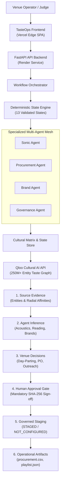

# TasteOps
### Turn Cultural Taste into Physical Space

[](https://www.python.org/)
[](https://fastapi.tiangolo.com/)
[](tests/)
[](https://astral.sh/ruff)
[](https://mypy-lang.org/)
[](LICENSE)

An AI operations system that transforms Qloo cultural intelligence into explainable, governed, venue-ready decisions.

<p align="center">
  
</p>

TasteOps turns creative venue briefs and spatial context into mathematically grounded, governed physical activations. By combining Qloo's 250M+ entity cultural graph with a deterministic multi-agent mesh, TasteOps curates acoustics, literary catalogs, and brand partnerships with cryptographic human approval and truthful operational staging.

---

## Live Deployments

| Component | Direct Link | Purpose |
| :--- | :--- | :--- |
| **Production Frontend (Primary)** | [https://tasteops.vercel.app](https://tasteops.vercel.app) | **Canonical judge-facing application** on Vercel Edge CDN |
| **Production Backend API** | [https://tasteops-backend.onrender.com](https://tasteops-backend.onrender.com) | FastAPI cloud service executing the 13-state engine |
| **Interactive API Documentation** | [https://tasteops-backend.onrender.com/docs](https://tasteops-backend.onrender.com/docs) | Interactive Swagger/OpenAPI contracts for all endpoints |
| **Standby Catalyst Deployment** | [https://tasteops-60093332190.development.catalystserverless.in/app/index.html#/home](https://tasteops-60093332190.development.catalystserverless.in/app/index.html#/home) | Secondary standby serverless deployment on Zoho Catalyst |
| **Source Code Repository** | [https://github.com/maitray-agrawal/TasteOps](https://github.com/maitray-agrawal/TasteOps) | Verified public GitHub repository with 322 passing tests |

> **Judge Latency Note:** Render web services spin down during inactivity. Warm requests complete in under 50ms. If the backend is waking from idle, initial spin-up takes ~30 seconds. The frontend features an active health probe that displays a live reconnection notice.

---

## The Problem

Designing and operating physical spaces—listening lounges, boutique hotels, specialty cafes, and cultural retail pop-ups—demands dozens of interconnected decisions across **sound, literature, tableware, retail, and brand partnerships**.

Today, this process suffers from four critical failures:
1. **Subjective Guesswork:** Venue curators rely on personal intuition or fragmented Spotify playlists, producing disconnected guest experiences.
2. **Category Silos:** A venue's audio profile rarely shares a coherent lineage with its design library, tableware, or commercial partnerships.
3. **LLM Hallucinations:** Generic generative AI invents plausible-sounding cultural recommendations that have zero empirical correlation with real audience tastes.
4. **Unchecked Automation:** Automatically dispatching purchase orders and partner outreach without signed human review risks brand reputation and budget waste.

---

## The Solution

TasteOps is an autonomous cultural operations system that bridges high-dimensional audience taste data with physical venue operations through a governed pipeline:

```
Venue Brief ──▶ Qloo Cultural AI ──▶ Cultural Twin ──▶ Multi-Agent Mesh ──▶ Cryptographic Gate ──▶ Governed Staging
```

- **Spatial Ingestion:** Captures venue typology, geographic coordinates, cultural district, vibe keywords, and brand identity.
- **Empirical Grounding:** Resolves taste anchors against Qloo's knowledge graph, discarding ungrounded entities.
- **Cross-Domain Synthesis:** Evaluates 6 raw cultural matrix categories (`artists`, `books`, `brands`, `places`, `movies`, `destinations`) mapped into 5 spatial curation verticals.
- **Specialized Multi-Agent Mesh:** Sonic, Procurement, and Brand agents synthesize acoustic curves, purchase orders, and partner outreach in parallel.
- **Cryptographic Gate:** Locks execution behind a mandatory SHA-256 plan fingerprint requiring signed human curator approval.
- **Truthful Staged Execution:** Connectors without production credentials remain transparently `STAGED`, producing verified operational artifacts.

---

## Why Qloo

TasteOps is fundamentally impossible without Qloo. Generic LLMs generate text based on next-token probability; they cannot compute cross-category cultural correlation.

Qloo provides the mathematical foundation:
- **Empirical Affinity Vectors:** Quantifies mathematical affinities between music, literature, fashion, and culinary tastes without demographic stereotyping.
- **Authoritative Entity Grounding:** Resolves every cultural anchor to canonical Qloo entity URNs (`ent_...`) and taxonomy tags (`tag_...`).
- **Spatial Anchoring:** Grounds curation in physical coordinates and radial boundaries (`POINT(lon lat)` with radial meters).
- **Explainable Curation:** Supplies quantitative affinity scores that explain *why* specific artists, books, or brands align with the venue's audience.

```
┌────────────────────────────────────────────────────────────────────────┐
│                          Why Qloo is Essential                         │
├────────────────────────────────┬───────────────────────────────────────┤
│ Without Qloo (Generic AI)      │ With TasteOps (Qloo Taste AI™)        │
├────────────────────────────────┼───────────────────────────────────────┤
│ ❌ Subjective vibe guesswork   │ ✅ Real mathematical affinity vectors  │
│ ❌ Hallucinated entity names   │ ✅ Verified Qloo entity & tag URNs    │
│ ❌ Siloed category assumptions │ ✅ 6-domain cross-cultural matrices   │
│ ❌ Unchecked automated actions │ ✅ Mandatory SHA-256 human approval   │
│ ❌ Fake external side effects  │ ✅ Truthful staged execution status   │
└────────────────────────────────┴───────────────────────────────────────┘
```

---

## How TasteOps Works

### System Architecture

The following diagram illustrates the complete end-to-end architecture from client applications to the Qloo API gateway:



---

## Product Flow

TasteOps moves systematically from raw intent to tangible operational artifacts:

1. **Define the Space:** Ingest venue typology, geographic coordinates, vibe keywords, and brand identity via the quick-start scenario presets.
2. **Resolve Cultural Taste:** Ground anchors in Qloo's entity graph and query radial taste signals to build the Cultural Twin.
3. **Run Specialized Agents:** The Sonic, Procurement, and Brand agents operate concurrently via typed Model Context Protocol (FastMCP) tools.
4. **Generate Execution Plan:** Synthesize unified spatial tasks, budget estimates, and zone specifications bound to a SHA-256 plan hash.
5. **Human Approval:** An authorized curator reviews the plan and cryptographically signs sign-off. Unapproved execution is strictly rejected with HTTP 400.
6. **Produce Operational Artifacts:** Generates production-ready CSV purchase orders, JSON day-parting playlists, brand outreach dossiers, and an immutable 12-transition audit ledger.

---

## Qloo Integration

TasteOps integrates with Qloo's Hackathon API across four specialized services:

- **Entity Resolution (`EntityResolver`):** Resolves freeform cultural concepts to canonical entities (e.g., `ent_09c3a1b4...` for *Leon Vynehall*). Entities with confidence below 0.50 are automatically rejected.
- **Tag Resolution (`TagResolver`):** Maps vibe descriptions into Qloo's hierarchical taxonomy (`tag_...`).
- **Radial Insights (`InsightsService`):** Queries local cultural taste density around the venue's exact coordinates (`POINT(72.8311 18.9272)`).
- **Cultural Matrix (`CulturalMatrixService`):** Constructs cross-domain affinity vectors spanning artists, books, brands, places, movies, and destinations.

### Caching & Reliability
All Qloo requests pass through a hardened `QlooClient` featuring:
- In-memory TTL cache (3600 seconds) to prevent redundant queries and respect rate limits.
- Exponential backoff with jitter across transient upstream errors.
- Strict Pydantic v2 secret masking (`SecretStr`) ensuring Qloo API keys are never leaked in logs, exceptions, or client payloads.

---

## Multi-Agent Architecture

TasteOps coordinates four domain-specialist agents executing against typed FastMCP tools:

### 1. Sonic Agent (`SonicAgent`)
- **Role:** Translates musical affinities into calibrated day-part acoustic curves and spatial sound requirements.
- **Output:** 3-phase listening schedule (Morning Focus 90 BPM $\rightarrow$ Afternoon Warmth 105 BPM $\rightarrow$ Evening Audiophile 118 BPM), decibel targets, track selections, and acoustic booth specs.

### 2. Procurement Agent (`ProcurementAgent`)
- **Role:** Converts literary, visual, and architectural affinities into validated physical inventory.
- **Output:** 8-column purchase order (`procurement.csv`) with verified ISBNs, titles, authors, publishers, quantities, and wholesale pricing.

### 3. Brand Agent (`BrandAgent`)
- **Role:** Evaluates brand affinity vectors to identify co-marketing and spatial sponsorship partners.
- **Output:** Comprehensive partnership dossiers (`brand_dossiers.json`) with affinity fit scores, commercial tiering, and outreach briefs.

### 4. Governance Agent (`GovernanceAgent`)
- **Role:** Audits budget allocations, verifies precondition rules, and seals the cryptographic SHA-256 plan digest.

---

## Cultural Twin: Evidence to Decision

The Cultural Twin separates facts from reasoning across three distinct epistemic tiers:

```
Source Evidence (Qloo) ──▶ Agent Inference ──▶ Venue Decision ──▶ Human Approval ──▶ Operational Output
```

1. **Source Evidence:** Ground-truth entities and quantitative affinity scores retrieved directly from Qloo (e.g., *Leon Vynehall*, *Apartamento Magazine*, *Technics* with affinity $> 0.88$).
2. **Agent Inference:** Domain-specialist models deduce spatial requirements (e.g., acoustic decibel thresholds, reading room lighting, co-branding synergy).
3. **Venue Decision:** Concrete physical parameters chosen (e.g., 3-phase day-parting playlist, 8-title curated library PO, dual-turntable audio booth).
4. **Human Approval:** Mandatory curator sign-off cryptographically bound to the SHA-256 fingerprint of the operational plan.
5. **Operational Artifacts:** Downloadable files generated for distributor fulfillment, sound engineering, and partner outreach.

---

## Execution Truthfulness & Governance

A core architectural principle of TasteOps is **absolute execution truthfulness**. In hackathon evaluations and enterprise deployments, AI prototypes frequently fabricate external side effects—claiming an email was sent, a purchase order placed, or a playlist published to Spotify when no actual API mutation occurred.

TasteOps strictly rejects simulated execution:
1. **Deterministic `STAGED` Execution State:** When external credentials (Spotify OAuth, Distributor EDI, SendGrid Outbound SMTP) are not provisioned, operational tasks are explicitly tagged as `STAGED` or `NOT_CONFIGURED`.
2. **Zero Fake Delivery Claims:** The application never displays `SENT` or `DELIVERED` unless a downstream third-party service returned a verified HTTP 200/201 mutation response.
3. **Cryptographic SHA-256 Plan Binding:** The approval record binds the cryptographic digest of the plan payload (`plan_hash`). If the plan is modified post-review, the approval is invalidated.
4. **Visual Provenance Distinction:** The user interface explicitly distinguishes live API responses (`QLOO · LIVE CULTURAL SIGNALS`) from offline demo baselines (`REFERENCE SCENARIO · Austin Tech + Creative`).

---

## Demo Walkthrough & Product Gallery

All screenshots represent the verified live application deployed at [https://tasteops.vercel.app](https://tasteops.vercel.app).

### Primary Product Journey

#### 1. Home Dashboard & Telemetry

*Product overview displaying curatorial scenario presets, live backend health telemetry, and the 13-state deterministic workflow engine.*

#### 2. Create Space Brief

*Pre-populated curatorial space brief for **Kitsuné Musique Lab** in Kala Ghoda, Mumbai—grounding curation in real-world spatial parameters and vibe tags.*

#### 3. Cultural Twin & Evidence-to-Decision Matrix

*Quantitative Cultural Twin projection resolving multi-category entities grounded in Qloo's 250M+ entity graph with explicit Source Evidence, Agent Inference, and Recommendations.*

#### 4. Specialized Multi-Agent Orchestration

*Domain specialist agents (Sonic Agent, Procurement Agent, Brand Agent) operating concurrently with live execution telemetry, duration metrics, and dynamic signal tags.*

#### 5. Governed Operational Planning & Approval Gate

*Synthesized spatial artifacts held at the mandatory SHA-256 Human Approval Gate before any operational tasks can be dispatched.*

#### 6. Qloo-Powered Results & Execution Truthfulness

*Truthful execution results highlighting live Qloo signals vs. reference baselines, with verified `STAGED` operational status for external connectors.*

---

### Supporting Governance & Operational Verification

#### 7. Session Workspace & Epistemic Architecture

*Complete session lifecycle detail displaying the strict distinction between Source Evidence (ground-truth facts), Agent Inference, and Recommendations.*

#### 8. Cryptographic Audit Ledger & Provenance Chain

*Append-only immutable decision ledger recording all 12 persisted state transitions, curator sign-offs, and provenance verifications with chronological filtering.*

#### 9. Operational Execution Preconditions & Artifacts

*Backend execution gate enforcing the 5-point precondition check and safe connector guarantees—never simulating external mutations when third-party APIs are not configured.*

#### 10. End-to-End Architectural & Sensory Blueprint

*Final sealed blueprint featuring 100% model confidence score, estimated budget breakdown, epistemic architecture tiers, and strategic cultural positioning narrative.*

---

## Example Scenario: Kitsuné Musique Lab

- **Location:** Kala Ghoda Arts Precinct, Mumbai, India (`72.8311° E, 18.9272° N`)
- **Typology:** Analog Vinyl Listening Bar & Specialty Cafe
- **Parent Brand:** Maison Kitsuné
- **Curatorial Intent:** An intimate audiophile listening salon blending Franco-Japanese minimalism with contemporary indie-electronic and deep jazz music curation, third-wave pour-overs, and natural wines.
- **Generated Outcomes:**
  - **Sonic Atmosphere:** Day-parted acoustic profile transitioning from morning focus to low-lit evening jazz listening.
  - **Procurement PO:** Validated 8-column purchase order for architectural monographs and indie art periodicals.
  - **Brand Outreach:** Co-marketing memos for aligned audio hardware and lifestyle brands.
  - **Governance Ledger:** 12 immutable transitions signed by the curator and permanently recorded.

---

## Generated Operational Artifacts

During execution, TasteOps compiles concrete, downloadable operational artifacts:

| Artifact | Format | Description |
| :--- | :---: | :--- |
| **`procurement.csv`** | CSV (8 columns) | Validated purchase order containing Title, Author/Creator, Publisher, ISBN, Quantity, Unit Price, Affinity Score, and Qloo Entity ID. Ready for distributor fulfillment. |
| **`spotify_playlist.json`** | JSON | Calibrated acoustic day-part curve specifying tracks, artists, BPM ranges, energy dynamics, and output destination specs. |
| **`brand_dossiers.json`** | JSON | Curated brand alignment profiles, partner compatibility indices, commercial tiering, and personalized outreach proposals. |

All artifacts are directly inspectable via `/api/v1/sessions/{session_id}/artifacts/{artifact_name}` or through the frontend UI.

---

## Technical Stack

| Layer | Technology | Host / Deployment | Role |
| :--- | :--- | :--- | :--- |
| **Frontend CDN** | Vanilla ES Modules + CSS | **Vercel Edge Network** | Zero-build single-page application with declarative routing and sub-second load times. |
| **Backend API** | FastAPI + Uvicorn | **Render Web Service** | High-performance async ASGI application running in a hardened non-root container. |
| **Cultural Engine** | Qloo Taste AI™ API | **Qloo Gateway** | High-dimensional cultural affinity vectors, entity resolution, and taxonomy tags. |
| **Agent Protocol** | FastMCP Server | **Internal Process** | Model Context Protocol exposing 10 typed cultural intelligence tools. |
| **Persistence** | FileStateStore | **Persistent Disk** | JSON snapshot storage and append-only audit trail logging. |
| **Standby Fallback** | Zoho Catalyst | **Catalyst Web Client** | Secondary standby serverless deployment. |

---

## Local Development

### Prerequisites
- [Astral uv](https://github.com/astral-sh/uv) (recommended) or Python 3.12+
- A valid **Qloo Hackathon API Key**

```bash
# 1. Clone repository
git clone https://github.com/maitray-agrawal/TasteOps.git
cd TasteOps

# 2. Install dependencies
uv sync --frozen

# 3. Configure environment
cp .env.example .env
# Edit .env and supply your QLOO_API_KEY

# 4. Start local development server
uv run uvicorn tasteops.api.main:app --host 0.0.0.0 --port 8000 --reload
# Access UI at http://localhost:8000/home
```

---

## Testing & Quality Gates

TasteOps enforces strict continuous integration quality standards across linting, formatting, static type analysis, and automated test execution:

```bash
# 1. Lint checking (Ruff)
uv run ruff check src tests scripts

# 2. Format checking (Ruff format)
uv run ruff format --check src tests scripts

# 3. Static type analysis (Mypy)
uv run mypy src

# 4. Full test suite (pytest)
uv run pytest -q
```

### Verified Test Results
- **Ruff Linter:** `PASS` (0 warnings, 0 errors)
- **Ruff Formatter:** `PASS` (78 files checked, 100% compliant)
- **Mypy Static Typing:** `PASS` (47 source files checked, 0 errors)
- **Pytest Suite:** `PASS` (**322 passed**)
- **Live Smoke Test:** `PASS` (Full E2E session creation, pipeline, approval, execution, artifact export, and zero secret leakage verified against `https://tasteops-backend.onrender.com`)

---

## Known Limitations

In the spirit of complete architectural honesty, we document the following operational boundaries:
1. **Render Free-Tier Cold-Start Latency:** The production API backend is deployed on Render. If the service has been idle, an initial cold start takes approximately 30 seconds to spin up. Warm requests execute in under 50ms. The frontend features an active health monitor that alerts the user during spin-up.
2. **Staged External Connectors:** Live API mutations to third-party production systems (Spotify Developer API, SendGrid Outbound Email, Square POS) require external enterprise API credentials. When those credentials are not provisioned in the environment, TasteOps marks the operations as `STAGED` or `NOT_CONFIGURED`. It never falsifies successful external mutations.
3. **Qloo Rate Limiting:** The Qloo Hackathon tier enforces concurrency limits. TasteOps incorporates client-side caching (TTL 3600s), exponential backoff, and retry handling to ensure resilience.

---

## Contributors

- **Maitray Agrawal** — Lead Backend Architecture, Qloo Integration, DevOps & Release Engineering ([maitrayagrawal1705@gmail.com](mailto:maitrayagrawal1705@gmail.com))
- **Satwik Jaiswal** — Domain Agent Architecture & Frontend Client Implementation ([satwikj9@gmail.com](mailto:satwikj9@gmail.com))
- **TasteOps Team** — Autonomous Spatial Curation Research

---

## License

This project is licensed under the **MIT License** — see the [LICENSE](LICENSE) file for details.
