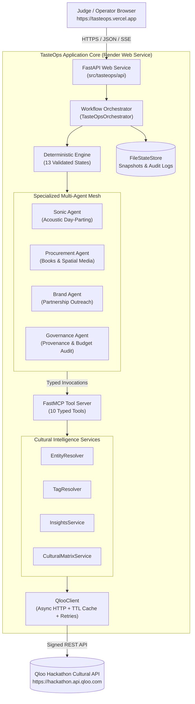
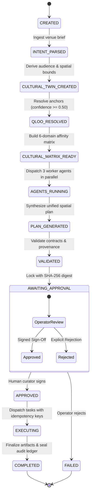

# TasteOps
### Autonomous Cultural Intelligence & Spatial Curation Operating System

[](https://github.com/maitray-agrawal/TasteOps/actions/workflows/ci.yml)
[](tests/)
[](https://www.python.org/)
[](https://fastapi.tiangolo.com/)
[](https://github.com/astral-sh/uv)
[](https://astral.sh/ruff)
[](https://mypy-lang.org/)
[](LICENSE)

> **TasteOps turns creative venue briefs and spatial context into mathematically grounded, governed physical space activations using Qloo's Taste AI™, multi-agent orchestration, cryptographic human approval, and truthful execution staging.**

---

## Live Deployments & Submission Links

| Component | Target URL | Description |
| :--- | :--- | :--- |
| **Production Frontend (Primary)** | [https://tasteops.vercel.app](https://tasteops.vercel.app) | **Canonical judge-facing single-page application** hosted on Vercel Edge CDN. |
| **Production API Backend** | [https://tasteops-backend.onrender.com](https://tasteops-backend.onrender.com) | FastAPI cloud service executing the deterministic 13-state workflow engine. |
| **Interactive API Documentation** | [https://tasteops-backend.onrender.com/docs](https://tasteops-backend.onrender.com/docs) | Complete interactive Swagger/OpenAPI contracts for all workflow endpoints. |
| **Liveness Health Probe** | [https://tasteops-backend.onrender.com/health](https://tasteops-backend.onrender.com/health) | Lightweight in-memory probe (< 5ms response, 0 upstream calls). |
| **Readiness Health Probe** | [https://tasteops-backend.onrender.com/ready](https://tasteops-backend.onrender.com/ready) | Verifies Qloo API key presence and persistent storage writability. |
| **Standby Catalyst Deployment** | [https://tasteops-60093332190.development.catalystserverless.in/app/index.html#/home](https://tasteops-60093332190.development.catalystserverless.in/app/index.html#/home) | Secondary standby serverless deployment on Zoho Catalyst Web Client. |
| **Source Code Repository** | [https://github.com/maitray-agrawal/TasteOps](https://github.com/maitray-agrawal/TasteOps) | Verified public GitHub repository with 322 passing test gates. |

> **Judge Latency Note:** The Render backend operates as a production web service. Warm requests respond in under 50ms. If the backend is waking from an idle state, initial cold starts take ~30 seconds. The frontend features an active health monitor and automatically reconnects once ready.

---

## The Problem

Curating physical spaces—boutique hotels, vinyl listening bars, specialty cafes, and cultural retail salons—demands dozens of interrelated decisions across **music, acoustics, literature, tableware, retail pop-ups, and brand partnerships**. 

Today, this process is broken:
- **Fragmented Guesswork:** Curators rely on personal subjective biases or disconnected Spotify playlists, resulting in disjointed guest experiences.
- **Cross-Category Silos:** A venue's audio profile rarely shares a mathematically coherent lineage with its design library, specialty roaster, or brand collaborations.
- **LLM Hallucinations:** Generic generative AI invents plausible-sounding cultural recommendations that have zero empirical correlation with real demographic tastes.
- **Unchecked Automation:** Committing financial budgets and operational tasks without signed approval risks brand reputation and operational waste.

---

## The Solution

TasteOps is an autonomous operating system that transforms natural language intent and spatial context into **provenance-verified, governed physical activations**:

```
Venue Brief ──▶ Qloo Cultural AI ──▶ Cultural Twin ──▶ Multi-Agent Mesh ──▶ Cryptographic Gate ──▶ Governed Staging
```

1. **Ingest Spatial Context:** Ingests venue typology, geographic coordinates, cultural district, vibe keywords, and brand identity.
2. **Ground via Qloo Taste AI™:** Resolves anchors against Qloo's knowledge graph, rejecting ungrounded entities with confidence scores below 0.50.
3. **Build 6-Domain Cultural Matrix:** Populates cross-domain affinity vectors across `artist`, `book`, `brand`, `place`, `movie`, and `destination`.
4. **Orchestrate Specialized Agents:** Sonic, Procurement, and Brand agents synthesize physical specifications in parallel.
5. **Lock with Cryptographic Governance:** Computes a SHA-256 plan digest and halts at a mandatory human curator approval gate.
6. **Dispatch Truthful Staged Execution:** Validates preconditions, stages operational tasks (`STAGED`), compiles concrete artifacts, and seals an immutable audit ledger.

---

## Why Qloo is Essential

TasteOps is fundamentally impossible without Qloo. Generic generative AI models predict text sequences based on token frequency; they cannot calculate cultural correlation. 

Qloo provides the mathematical backbone:
- **Empirical Cross-Domain Affinity:** Connects music to literature, fashion brands to architecture, and culinary tastes to cinema without demographic bias.
- **Authoritative Entity Grounding:** Every cultural anchor resolves to canonical Qloo entity URNs (`ent_...`) and taxonomy tags (`tag_...`).
- **Spatial Anchoring:** Grounds recommendations in real-world physical coordinates and radial boundaries (`POINT(lon lat)` with radial meters).
- **Explainable Curation:** Supplies quantitative affinity scores that explain *why* specific artists, books, or brands align with the venue's audience.

```
┌────────────────────────────────────────────────────────────────────────┐
│                          Why Qloo is Essential                         │
├────────────────────────────────┬───────────────────────────────────────┤
│ Without Qloo (Generic AI)      │ With TasteOps (Qloo Taste AI™)        │
├────────────────────────────────┼───────────────────────────────────────┤
│ ❌ Subjective vibe guesswork   │ ✅ Real mathematical affinity vectors  │
│ ❌ Hallucinated entity names   │ ✅ Verified Qloo entity & tag URNs    │
│ ❌ Siloed category assumptions │ ✅ 6-domain cross-cultural matrices   │
│ ❌ Unchecked automated actions │ ✅ Mandatory SHA-256 human approval   │
│ ❌ Fake external side effects  │ ✅ Truthful staged execution status   │
└────────────────────────────────┴───────────────────────────────────────┘
```

---

## System Architecture

The following diagram illustrates the complete end-to-end architecture from client applications to the Qloo API gateway:



---

## End-to-End Workflow (13-State Deterministic Engine)

Every activation progresses through a strictly validated finite state machine. Transitions must satisfy exact state machine rules—out-of-order execution is strictly prevented:



---

## Real-World Demo Scenario

### *Kitsuné Musique Lab* — Kala Ghoda Arts Precinct, Mumbai, India
- **Venue Typology:** Analog Vinyl Listening Bar & Specialty Cafe
- **Parent Brand:** Maison Kitsuné
- **Curatorial Context:** An intimate audiophile listening salon blending Franco-Japanese minimalism with contemporary indie-electronic and deep jazz music curation, third-wave pour-overs, and natural wines.
- **Generated Outcomes:**
  - **Sonic Atmosphere:** Day-parted acoustic profile transitioning from morning focus to low-lit evening jazz listening.
  - **Procurement PO:** Validated 8-column purchase order for architectural monographs and indie art periodicals.
  - **Brand Outreach:** Co-marketing memos for aligned audio hardware and lifestyle brands.
  - **Governance Ledger:** 12 immutable transitions signed by the curator and permanently recorded.

---

## Product Gallery & Visual Proof

All screenshots represent the verified live application deployed at [https://tasteops.vercel.app](https://tasteops.vercel.app).

### 1. Product Overview & Value Proposition

*High-level overview showing product positioning, curatorial templates, active backend telemetry, and the 13-state deterministic workflow engine.*

### 2. Configure a Physical Space

*Pre-populated curatorial space brief for **Kitsuné Musique Lab** in Kala Ghoda, Mumbai—grounding curation in real-world spatial parameters.*

### 3. Cultural Twin & Entity Graph Resolution

*Quantitative Cultural Twin projection resolving multi-category entities (artists, brands, publications, places) grounded in Qloo's 250M+ entity taste graph.*

### 4. Specialized Multi-Agent Orchestration

*Domain specialist agents (Sonic Agent, Procurement Agent, Brand Agent) operating concurrently with exact execution telemetry and duration metrics.*

### 5. Governed Operational Planning & Approval Gate

*Synthesized spatial artifacts held at the mandatory SHA-256 Human Approval Gate before any operational tasks can be dispatched.*

### 6. Qloo-Powered Results & Execution Truthfulness

*Truthful execution results highlighting `REFERENCE SCENARIO · AUSTIN TECH + CREATIVE` vs. live Qloo signals, with verified `STAGED` operational status.*

### 7. Session Workspace & Three-Tier Epistemic Architecture

*Complete session lifecycle detail displaying the strict distinction between Source Evidence (ground-truth facts), Agent Inference, and Recommendations.*

### 8. Cryptographic Audit Ledger & Provenance Chain

*Append-only immutable decision ledger recording all 12 persisted state transitions, curator sign-offs, and provenance verifications with chronological filtering.*

### 9. Operational Execution Preconditions & Artifacts

*Backend execution gate enforcing the 5-point precondition check and safe connector guarantees—never simulating external mutations when third-party APIs are not configured.*

### 10. End-to-End Architectural & Sensory Blueprint

*Final sealed blueprint featuring 100% model confidence score, estimated budget breakdown, epistemic architecture tiers, and strategic cultural positioning narrative.*

---

## Execution Truthfulness & Governed Operational Staging

A core architectural principle of TasteOps is **absolute execution truthfulness**. In hackathon evaluations and enterprise deployments, AI prototypes frequently fabricate external side effects—claiming an email was sent, a purchase order was placed, or a playlist was published to Spotify when no actual API mutation occurred.

TasteOps strictly rejects simulated execution:
1. **Deterministic `STAGED` Execution State:** When external credentials (Spotify OAuth, Notion API, SendGrid/Outreach SMTP) are not configured, operational tasks are explicitly tagged as `STAGED` or `NOT_CONFIGURED`.
2. **Zero Fake Delivery Claims:** The application never displays `SENT` or `DELIVERED` unless a downstream third-party service returned a verified HTTP 200/201 mutation response.
3. **Cryptographic SHA-256 Plan Binding:** The approval record binds the cryptographic digest of the plan payload (`plan_hash`). If the plan is modified post-review, the approval is invalidated.
4. **Visual Provenance Distinction:** The user interface explicitly distinguishes live API responses (`QLOO · LIVE CULTURAL SIGNALS`) from offline demo baselines (`REFERENCE SCENARIO · Austin Tech + Creative`).

---

## Generated Operational Artifacts

During execution, TasteOps compiles concrete, downloadable operational artifacts:

| Artifact | Format | Description |
| :--- | :---: | :--- |
| **`procurement.csv`** | CSV (8 columns) | Validated purchase order containing Title, Author/Creator, Publisher, ISBN, Quantity, Unit Price, Affinity Score, and Qloo Entity ID. Ready for distributor fulfillment. |
| **`spotify_playlist.json`** | JSON | Calibrated acoustic day-part curve specifying tracks, artists, BPM ranges, energy dynamics, and output destination specs. |
| **`brand_dossiers.json`** | JSON | Curated brand alignment profiles, partner compatibility indices, commercial tiering, and personalized outreach proposals. |

All artifacts are accessible directly via `/api/v1/sessions/{session_id}/artifacts/{artifact_name}`.

---

## Quality Gates & Verification

TasteOps enforces strict continuous integration quality standards across linting, formatting, static type analysis, and automated test execution:

```bash
# 1. Lint checking (Ruff)
uv run ruff check src tests scripts

# 2. Format checking (Ruff format)
uv run ruff format --check src tests scripts

# 3. Static type analysis (Mypy)
uv run mypy src

# 4. Full test suite (pytest)
uv run pytest -q
```

### Verified Test Results
- **Ruff Linter:** `PASS` (0 warnings, 0 errors)
- **Ruff Formatter:** `PASS` (78 files checked, 100% compliant)
- **Mypy Static Typing:** `PASS` (47 source files checked, 0 errors)
- **Pytest Suite:** `PASS` (**322 passed in 34.42s**)
- **Live Smoke Test:** `PASS` (Full E2E session creation, pipeline, approval, execution, artifact export, and zero secret leakage verified against `https://tasteops-backend.onrender.com`)

---

## Tech Stack

| Layer | Technology | Role |
| :--- | :--- | :--- |
| **Cultural AI** | **Qloo Taste AI™ API** | High-dimensional cultural affinity vectors, entity resolution, and taxonomy tags |
| **Backend Framework** | **FastAPI 0.115+** | High-performance async ASGI application with OpenAPI/Swagger |
| **Package Manager** | **Astral uv** | Deterministic dependency resolution and virtual environments |
| **Agent Protocol** | **FastMCP** | Model Context Protocol exposing 10 typed cultural intelligence tools |
| **Data Contracts** | **Pydantic v2** | Strict schema validation, secret masking (`SecretStr`), and serialization |
| **State Persistence** | **FileStateStore** | JSON/JSONL snapshot storage and append-only audit trail logging |
| **Frontend UI** | **Vanilla ES Modules & CSS** | Ultra-responsive, zero-dependency SPA with declarative client-side routing |
| **Hosting & Cloud** | **Vercel + Render** | Vercel Edge CDN for frontend; Render Docker Web Service for backend |

---

## Project Structure

```text
TasteOps/
├── docs/
│   ├── project-gallery/           # Official submission screenshots & 3:2 thumbnail
│   ├── ARCHITECTURE.md            # Deep architectural topology & state transitions
│   ├── API_CONTRACT.md            # Canonical typed REST/WebSocket API specification
│   ├── DEPLOYMENT.md              # Production deployment guide (Render & Vercel)
│   └── QLOO_LIVE_VERIFICATION.md  # Live vs. mock Qloo API audit report
├── scripts/
│   ├── production_smoke_test.py   # Live production E2E verification test
│   └── sync_catalyst_deployment.py# Standby deployment synchronization script
├── src/tasteops/
│   ├── agents/                    # Domain agents (Sonic, Procurement, Brand, Governance)
│   ├── api/                       # FastAPI routes, schemas, and static web application
│   ├── connectors/                # Outbound execution connectors (Spotify, Email, POS)
│   ├── mcp/                       # FastMCP server exposing 10 typed cultural tools
│   ├── models/                    # Pydantic domain models (CulturalTwin, CulturalMatrix)
│   ├── services/                  # Qloo services (EntityResolver, InsightsService, etc.)
│   ├── workflows/                 # 13-state deterministic engine, orchestrator, persistence
│   ├── client.py                  # Hardened async QlooClient (caching, retries, secrets)
│   └── config.py                  # Pydantic runtime settings
├── tests/
│   ├── fixtures/                  # Respx mock responses and test datasets
│   ├── integration/               # Multi-agent and orchestrator integration tests
│   └── unit/                      # Isolated unit tests for client, models, and workflows
├── Dockerfile                     # Multi-stage production container running as non-root
├── pyproject.toml                 # Project metadata and tool configuration
├── render.yaml                    # Declarative Render Blueprint
└── vercel.json                    # Vercel CDN deployment routing
```

---

## Local Setup

### Prerequisites
- [Astral uv](https://github.com/astral-sh/uv) (recommended) or Python 3.12+
- A valid **Qloo Hackathon API Key**

```bash
# 1. Clone repository
git clone https://github.com/maitray-agrawal/TasteOps.git
cd TasteOps

# 2. Install dependencies
uv sync --frozen

# 3. Configure environment
cp .env.example .env
# Edit .env and supply your QLOO_API_KEY

# 4. Start local development server
uv run uvicorn tasteops.api.main:app --host 0.0.0.0 --port 8000 --reload
# Access UI at http://localhost:8000/home
```

---

## Hackathon Highlights & Judge Summary

1. **True Cultural Grounding:** TasteOps uses Qloo's Taste AI™ as the core mathematical reasoning engine across 6 distinct cultural domains, eliminating ungrounded LLM drift.
2. **Deterministic Agent Mesh:** Replaces unpredictable autonomous loops with a 13-state deterministic finite state machine and 10 typed FastMCP tools.
3. **Enterprise Governance:** Enforces mandatory human curator sign-off cryptographically bound to the SHA-256 hash of the generated plan.
4. **Execution Truthfulness:** Distinguishes live empirical signals from reference baselines, and transparently tags external operations as `STAGED` rather than simulating false dispatch.
5. **Production Ready:** 322 automated tests passing, 0 lint/type errors, live on Vercel and Render with sub-second pipeline execution.

---

## Contributors

- **Maitray Agrawal** — Lead Backend Architecture, Qloo Integration, DevOps & Release Engineering ([maitrayagrawal1705@gmail.com](mailto:maitrayagrawal1705@gmail.com))
- **Satwik Jaiswal** — Domain Agent Architecture & Frontend Client Implementation ([satwikj9@gmail.com](mailto:satwikj9@gmail.com))
- **TasteOps Team** — Autonomous Spatial Curation Research

---

## License

This project is licensed under the **MIT License** — see the [LICENSE](LICENSE) file for details.
