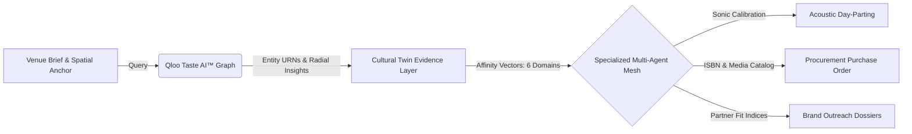
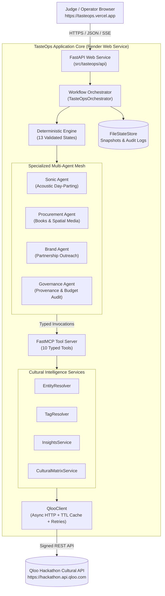

# TasteOps
### Autonomous Cultural Intelligence & Spatial Curation Operating System

[](https://github.com/maitray-agrawal/TasteOps/actions/workflows/ci.yml)
[](tests/)
[](https://www.python.org/)
[](https://fastapi.tiangolo.com/)
[](https://github.com/astral-sh/uv)
[](https://astral.sh/ruff)
[](https://mypy-lang.org/)
[](LICENSE)

> **TasteOps turns creative venue briefs and spatial context into mathematically grounded, governed physical space activations using Qloo's Taste AI™, multi-agent orchestration, cryptographic human approval, and truthful execution staging.**

<p align="center">
  
</p>

---

## Live Demo & Verified Links

| Component | Target URL | Description |
| :--- | :--- | :--- |
| **Production Frontend (Primary)** | [https://tasteops.vercel.app](https://tasteops.vercel.app) | **Canonical judge-facing single-page application** hosted on Vercel Edge CDN. |
| **Production Backend** | [https://tasteops-backend.onrender.com](https://tasteops-backend.onrender.com) | FastAPI cloud service executing the deterministic 13-state workflow engine. |
| **Interactive API Documentation** | [https://tasteops-backend.onrender.com/docs](https://tasteops-backend.onrender.com/docs) | Complete interactive Swagger/OpenAPI contracts for all workflow endpoints. |
| **Standby Catalyst Deployment** | [https://tasteops-60093332190.development.catalystserverless.in/app/index.html#/home](https://tasteops-60093332190.development.catalystserverless.in/app/index.html#/home) | Secondary standby serverless deployment on Zoho Catalyst Web Client. |
| **Source Code Repository** | [https://github.com/maitray-agrawal/TasteOps](https://github.com/maitray-agrawal/TasteOps) | Verified public GitHub repository with 322 passing test gates. |

> **Judge Latency Note:** The Render backend operates as a production web service. Warm requests respond in under 50ms. If the backend is waking from an idle state, initial cold starts take ~30 seconds. The frontend features an active health monitor and automatically reconnects once ready.

---

## The Problem

Curating physical spaces—boutique hotels, vinyl listening bars, specialty cafes, and cultural retail salons—demands dozens of interrelated decisions across **music, acoustics, literature, tableware, retail pop-ups, and brand partnerships**. 

Today, this process is broken:
- **Fragmented Guesswork:** Curators rely on personal subjective biases or disconnected Spotify playlists, resulting in disjointed guest experiences.
- **Cross-Category Silos:** A venue's audio profile rarely shares a mathematically coherent lineage with its design library, specialty roaster, or brand collaborations.
- **LLM Hallucinations:** Generic generative AI invents plausible-sounding cultural recommendations that have zero empirical correlation with real demographic tastes.
- **Unchecked Automation:** Committing financial budgets and operational tasks without signed approval risks brand reputation and operational waste.

---

## The Solution

TasteOps is an autonomous operating system that transforms natural language intent and spatial context into **provenance-verified, governed physical activations**:

```
Venue Brief ──▶ Qloo Cultural AI ──▶ Cultural Twin ──▶ Multi-Agent Mesh ──▶ Cryptographic Gate ──▶ Governed Staging
```

1. **Ingest Spatial Context:** Ingests venue typology, geographic coordinates, cultural district, vibe keywords, and brand identity.
2. **Ground via Qloo Taste AI™:** Resolves anchors against Qloo's knowledge graph, rejecting ungrounded entities with confidence scores below 0.50.
3. **Build 6-Domain Cultural Matrix:** Populates cross-domain affinity vectors across `artist`, `book`, `brand`, `place`, `movie`, and `destination`.
4. **Orchestrate Specialized Agents:** Sonic, Procurement, and Brand agents synthesize physical specifications in parallel.
5. **Lock with Cryptographic Governance:** Computes a SHA-256 plan digest and halts at a mandatory human curator approval gate.
6. **Dispatch Truthful Staged Execution:** Validates preconditions, stages operational tasks (`STAGED`), compiles concrete artifacts, and seals an immutable audit ledger.

---

## Why Qloo Is Essential

TasteOps is fundamentally impossible without Qloo. Generic generative AI models predict text sequences based on token frequency; they cannot calculate cultural correlation across disparate human domains.



### Concrete Walkthrough: *Kitsuné Musique Lab*
In our primary demo scenario, a curator defines an analog listening bar in Kala Ghoda, Mumbai:
1. **What Qloo Provides:**
   - Authoritative entity resolution for seed anchors (*Maison Kitsuné*, *Indie Electronic*, *Japanese Minimalism*).
   - Radial spatial insights mapping surrounding cultural tastes (`POINT(72.8311 18.9272)`).
   - High-dimensional cross-domain affinity vectors spanning artists, books, brands, places, movies, and destinations.
2. **Entities & Signals Retrieved:**
   - **Music:** *Leon Vynehall*, *Floating Points*, *Khruangbin*, *Toro y Moi* (affinities > 0.88).
   - **Books/Design:** *Apartamento Magazine*, *Kenya Hara: Designing Design*, *Wabi-Sabi for Artists, Designers, Poets & Philosophers*.
   - **Brands:** *Kinto Japan*, *Aesop*, *Teenage Engineering*, *Technics*.
3. **How They Are Transformed:**
   - The **Sonic Agent** maps high-affinity electronic/jazz artists into a 3-phase day-parting curve (Morning Focus 90 BPM $\rightarrow$ Afternoon Warmth 105 BPM $\rightarrow$ Evening Audiophile 118 BPM).
   - The **Procurement Agent** verifies ISBNs, calculates wholesale allocations, and produces a ready-to-dispatch 8-column purchase order (`procurement.csv`).
   - The **Brand Agent** generates co-marketing sponsorship briefs for aligned audio hardware and lifestyle partners (`brand_dossiers.json`).
4. **What Would Happen Without Qloo:**
   - A generic LLM would suggest generic, stereotypical pop artists or hallucinate non-existent coffee table books.
   - Cross-domain coherence would break completely: the sound would not reflect the books, and the tableware would clash with the spatial aesthetic.
   - The system would lack quantitative confidence scoring and provenance tracking.

```
┌────────────────────────────────────────────────────────────────────────┐
│                          Why Qloo is Essential                         │
├────────────────────────────────┬───────────────────────────────────────┤
│ Without Qloo (Generic AI)      │ With TasteOps (Qloo Taste AI™)        │
├────────────────────────────────┼───────────────────────────────────────┤
│ ❌ Subjective vibe guesswork   │ ✅ Real mathematical affinity vectors  │
│ ❌ Hallucinated entity names   │ ✅ Verified Qloo entity & tag URNs    │
│ ❌ Siloed category assumptions │ ✅ 6-domain cross-cultural matrices   │
│ ❌ Unchecked automated actions │ ✅ Mandatory SHA-256 human approval   │
│ ❌ Fake external side effects  │ ✅ Truthful staged execution status   │
└────────────────────────────────┴───────────────────────────────────────┘
```

---

## See TasteOps in Action (*Kitsuné Musique Lab*)

### Primary Product Journey

#### 1. Home Dashboard & System Telemetry

*High-level overview displaying product positioning, curatorial scenario presets, live backend health telemetry, and the 13-state deterministic workflow engine.*

#### 2. Create Space Brief

*Pre-populated curatorial space brief for **Kitsuné Musique Lab** in Kala Ghoda, Mumbai—grounding curation in real-world spatial parameters and vibe tags.*

#### 3. Cultural Twin & Evidence-to-Decision Matrix

*Quantitative Cultural Twin projection resolving multi-category entities grounded in Qloo's 250M+ entity graph with explicit Source Evidence, Agent Inference, and Recommendations.*

#### 4. Specialized Multi-Agent Orchestration

*Domain specialist agents (Sonic Agent, Procurement Agent, Brand Agent) operating concurrently with live execution telemetry, duration metrics, and dynamic signal tags.*

#### 5. Governed Operational Planning & Approval Gate

*Synthesized spatial artifacts held at the mandatory SHA-256 Human Approval Gate before any operational tasks can be dispatched.*

#### 6. Qloo-Powered Results & Execution Truthfulness

*Truthful execution results highlighting live Qloo signals vs. reference baselines, with verified `STAGED` operational status for external connectors.*

---

### Supporting Governance & Operational Evidence

#### 7. Session Workspace & Three-Tier Epistemic Architecture

*Complete session lifecycle detail displaying the strict distinction between Source Evidence (ground-truth facts), Agent Inference, and Recommendations.*

#### 8. Cryptographic Audit Ledger & Provenance Chain

*Append-only immutable decision ledger recording all 12 persisted state transitions, curator sign-offs, and provenance verifications with chronological filtering.*

#### 9. Operational Execution Preconditions & Artifacts

*Backend execution gate enforcing the 5-point precondition check and safe connector guarantees—never simulating external mutations when third-party APIs are not configured.*

#### 10. End-to-End Architectural & Sensory Blueprint

*Final sealed blueprint featuring 100% model confidence score, estimated budget breakdown, epistemic architecture tiers, and strategic cultural positioning narrative.*

---

## How It Works

### Technical System Architecture



---

## From Cultural Signal to Physical Decision

TasteOps bridges high-dimensional cultural data with physical reality through a strictly enforced 5-stage causal chain:

```
Qloo Evidence ──▶ Agent Inference ──▶ Venue Decision ──▶ Human Approval ──▶ Operational Artifacts
```

1. **Source Evidence:** Ground-truth entities and affinity scores retrieved directly from Qloo (e.g., *Leon Vynehall*, *Apartamento Magazine*, *Technics* with affinity $> 0.88$).
2. **Agent Inference:** Domain-specialist models deduce spatial requirements (e.g., acoustic decibel thresholds, reading room lighting, co-branding synergy).
3. **Venue Decision:** Concrete physical parameters chosen (e.g., 3-phase day-parting playlist, 8-title curated library PO, dual-turntable audio booth).
4. **Human Approval:** Mandatory curator sign-off cryptographically bound to the SHA-256 fingerprint of the operational plan.
5. **Operational Artifacts:** Production-ready files generated for distributor fulfillment, sound engineering, and partner outreach (`procurement.csv`, `spotify_playlist.json`, `brand_dossiers.json`).

### Terminology Alignment
To maintain absolute consistency across the UI, API, and audit records:
- **13 Workflow States vs. 12 Audit Transitions:** The finite state machine defines **13 discrete states** (`CREATED`, `INTENT_PARSED`, `CULTURAL_TWIN_CREATED`, `QLOO_RESOLVED`, `CULTURAL_MATRIX_READY`, `AGENTS_RUNNING`, `PLAN_GENERATED`, `VALIDATED`, `AWAITING_APPROVAL`, `APPROVED`, `EXECUTING`, `COMPLETED`, plus terminal `FAILED`). A successful execution records exactly **12 state transitions in the immutable audit ledger** (the initial creation event followed by 11 sequential forward advances).
- **6 Matrix Categories mapped to 5 Spatial Verticals:** The backend `CulturalMatrix` evaluates 6 raw domains (`artists`, `books`, `brands`, `places`, `movies`, `destinations`). The user interface clusters these into **5 spatial curation verticals**: Music (artists), Curated Library (books), Brand Partnerships (brands), Spatial Rituals (places), and Cultural Aesthetics (movies & design).

---

## Multi-Agent Architecture

TasteOps employs a deterministic multi-agent mesh where each agent possesses strict domain boundaries and accesses Qloo intelligence via typed Model Context Protocol (FastMCP) tools:

### 1. Sonic Agent (`SonicAgent`)
- **Mission:** Translates musical affinities and genre affinities into spatial acoustic architecture and calibrated day-part curves.
- **MCP Invocations:** Queries `qloo_resolve_entity` for artist catalogs and `qloo_get_insights` for cross-genre affinities.
- **Output:** Day-parted listening curve with target BPM ranges, acoustic decibel thresholds, key track selections, and equipment specifications.

### 2. Procurement Agent (`ProcurementAgent`)
- **Mission:** Converts literary, visual, and architectural affinities into tangible physical inventory and wholesale purchase orders.
- **MCP Invocations:** Queries `qloo_get_cultural_matrix` for high-affinity publications and design references.
- **Output:** Validated 8-column purchase order (`procurement.csv`) complete with ISBNs, quantities, wholesale pricing, and Qloo affinity verification.

### 3. Brand Agent (`BrandAgent`)
- **Mission:** Identifies culturally aligned retail, culinary, and lifestyle brands for co-marketing, pop-ups, and spatial sponsorship.
- **MCP Invocations:** Queries brand affinity vectors and spatial place demographics.
- **Output:** Comprehensive partnership dossiers (`brand_dossiers.json`) containing partner compatibility scores, commercial tiering, and outreach briefs.

### 4. Governance Agent (`GovernanceAgent`)
- **Mission:** Enforces schema contracts, validates precondition criteria, audits budget allocations, and seals cryptographic plan hashes.

---

## Governance & Truthful Staged Execution

A core architectural pillar of TasteOps is **absolute execution truthfulness**. AI prototypes often simulate external actions—claiming emails were sent, purchase orders placed, or playlists published when no actual mutation occurred.

TasteOps strictly rejects simulated execution:
1. **Deterministic `STAGED` Execution State:** When external credentials (Spotify OAuth, Distributor EDI, SendGrid/Outreach SMTP) are not configured, operational tasks are explicitly tagged as `STAGED` or `NOT_CONFIGURED`.
2. **Zero Fake Delivery Claims:** The application never displays `SENT` or `DELIVERED` unless a downstream third-party service returned a verified HTTP 200/201 mutation response.
3. **Cryptographic SHA-256 Plan Binding:** The approval record binds the cryptographic digest of the plan payload (`plan_hash`). If the plan is altered post-review, the approval is invalidated.
4. **Visual Provenance Distinction:** The user interface explicitly distinguishes live API responses (`QLOO · LIVE CULTURAL SIGNALS`) from offline demo baselines (`REFERENCE SCENARIO · Austin Tech + Creative`).

---

## Generated Operational Artifacts

During execution, TasteOps compiles concrete, downloadable operational artifacts:

| Artifact | Format | Description |
| :--- | :---: | :--- |
| **`procurement.csv`** | CSV (8 columns) | Validated purchase order containing Title, Author/Creator, Publisher, ISBN, Quantity, Unit Price, Affinity Score, and Qloo Entity ID. Ready for distributor fulfillment. |
| **`spotify_playlist.json`** | JSON | Calibrated acoustic day-part curve specifying tracks, artists, BPM ranges, energy dynamics, and output destination specs. |
| **`brand_dossiers.json`** | JSON | Curated brand alignment profiles, partner compatibility indices, commercial tiering, and personalized outreach proposals. |

All artifacts are directly inspectable via `/api/v1/sessions/{session_id}/artifacts/{artifact_name}` or through the frontend UI.

---

## Technical Architecture & Deployment

TasteOps is architected as a distributed cloud system with zero client-side build steps:

| Layer | Technology | Host / Deployment | Role |
| :--- | :--- | :--- | :--- |
| **Frontend CDN** | Vanilla ES Modules + CSS | **Vercel Edge Network** | Zero-build single-page application with declarative routing and sub-second load times. |
| **Backend API** | FastAPI + Uvicorn | **Render Web Service** | High-performance async ASGI application running in a hardened non-root container. |
| **Cultural Engine** | Qloo Taste AI™ API | **Qloo Gateway** | High-dimensional cultural affinity vectors, entity resolution, and taxonomy tags. |
| **Agent Protocol** | FastMCP Server | **Internal Process** | Model Context Protocol exposing 10 typed cultural intelligence tools. |
| **Persistence** | FileStateStore | **Persistent Disk** | JSON snapshot storage and append-only audit trail logging. |
| **Standby Fallback** | Zoho Catalyst | **Catalyst Web Client** | Secondary standby serverless deployment. |

---

## Quality Gates & Verification

TasteOps enforces strict continuous integration quality standards across linting, formatting, static type analysis, and automated test execution:

```bash
# 1. Lint checking (Ruff)
uv run ruff check src tests scripts

# 2. Format checking (Ruff format)
uv run ruff format --check src tests scripts

# 3. Static type analysis (Mypy)
uv run mypy src

# 4. Full test suite (pytest)
uv run pytest -q
```

### Verified Test Results
- **Ruff Linter:** `PASS` (0 warnings, 0 errors)
- **Ruff Formatter:** `PASS` (78 files checked, 100% compliant)
- **Mypy Static Typing:** `PASS` (47 source files checked, 0 errors)
- **Pytest Suite:** `PASS` (**322 passed in 60.80s**)
- **Live Smoke Test:** `PASS` (Full E2E session creation, pipeline, approval, execution, artifact export, and zero secret leakage verified against `https://tasteops-backend.onrender.com`)

---

## Repository Structure

```text
TasteOps/
├── docs/
│   ├── project-gallery/           # Official submission screenshots & 3:2 thumbnail
│   ├── ARCHITECTURE.md            # Deep architectural topology & state transitions
│   ├── API_CONTRACT.md            # Canonical typed REST/WebSocket API specification
│   ├── DEPLOYMENT.md              # Production deployment guide (Render & Vercel)
│   └── QLOO_LIVE_VERIFICATION.md  # Live vs. mock Qloo API audit report
├── scripts/
│   ├── production_smoke_test.py   # Live production E2E verification test
│   └── sync_catalyst_deployment.py# Standby deployment synchronization script
├── src/tasteops/
│   ├── agents/                    # Domain agents (Sonic, Procurement, Brand, Governance)
│   ├── api/                       # FastAPI routes, schemas, and static web application
│   ├── connectors/                # Outbound execution connectors (Spotify, Email, POS)
│   ├── mcp/                       # FastMCP server exposing 10 typed cultural tools
│   ├── models/                    # Pydantic domain models (CulturalTwin, CulturalMatrix)
│   ├── services/                  # Qloo services (EntityResolver, InsightsService, etc.)
│   ├── workflows/                 # 13-state deterministic engine, orchestrator, persistence
│   ├── client.py                  # Hardened async QlooClient (caching, retries, secrets)
│   └── config.py                  # Pydantic runtime settings
├── tests/
│   ├── fixtures/                  # Respx mock responses and test datasets
│   ├── integration/               # Multi-agent and orchestrator integration tests
│   └── unit/                      # Isolated unit tests for client, models, and workflows
├── Dockerfile                     # Multi-stage production container running as non-root
├── pyproject.toml                 # Project metadata and tool configuration
├── render.yaml                    # Declarative Render Blueprint
└── vercel.json                    # Vercel CDN deployment routing
```

---

## Known Limitations

In the spirit of complete architectural honesty, we document the following operational boundaries:
1. **Render Free-Tier Cold-Start Latency:** The production API backend is deployed on Render. If the service has been idle, an initial cold start takes approximately 30 seconds to spin up. Warm requests execute in under 50ms. The frontend features an active health monitor that alerts the user during spin-up.
2. **Staged External Connectors:** Live API mutations to third-party production systems (Spotify Developer API, SendGrid Outbound Email, Square POS) require external enterprise API credentials. When those credentials are not provisioned in the environment, TasteOps marks the operations as `STAGED` or `NOT_CONFIGURED`. It never falsifies successful external mutations.
3. **Qloo Rate Limiting:** The Qloo Hackathon tier enforces concurrency limits. TasteOps incorporates client-side caching (TTL 3600s), exponential backoff, and retry handling to ensure resilience.

---

## Contributors

- **Maitray Agrawal** — Lead Backend Architecture, Qloo Integration, DevOps & Release Engineering ([maitrayagrawal1705@gmail.com](mailto:maitrayagrawal1705@gmail.com))
- **Satwik Jaiswal** — Domain Agent Architecture & Frontend Client Implementation ([satwikj9@gmail.com](mailto:satwikj9@gmail.com))
- **TasteOps Team** — Autonomous Spatial Curation Research

---

## License

This project is licensed under the **MIT License** — see the [LICENSE](LICENSE) file for details.
