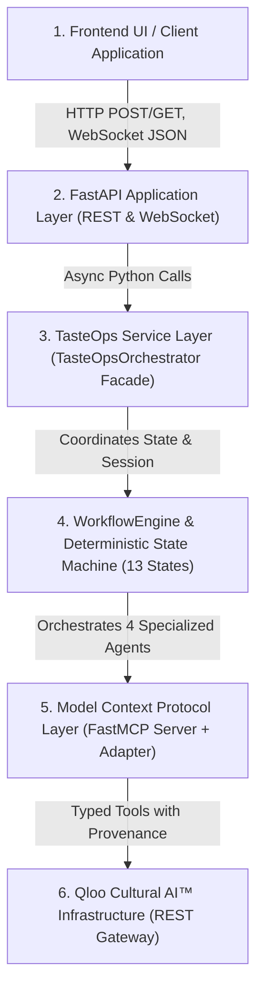
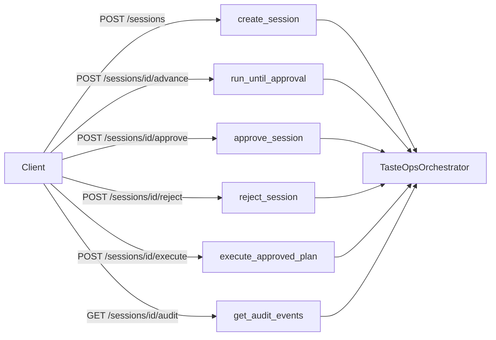

# TasteOps Application & API Contract Specification

**Document Version:** 1.0.0  
**Domain:** Application-Facing Contracts & REST/WebSocket API  
**Target Consumers:** Frontend Client, FastAPI Backend, Service Layer, External Consumers  
**Reference Implementations:** `src/tasteops/workflows/orchestrator.py`, `src/tasteops/workflows/engine.py`, `src/tasteops/workflows/schemas.py`, `src/tasteops/models/cultural_matrix.py`  
**Status:** Canonical Typed Specification  

---

## 1. Architectural Flow & Layer Boundaries

TasteOps enforces a strict, unidirectional 6-tier architectural pipeline for cultural activations in physical spaces. There is **exactly one** orchestration engine in the system (`TasteOpsOrchestrator` wrapping `WorkflowEngine`). Downstream layers must **never** implement shadow state machines, parallel agent coordinators, or direct external Qloo calls.



### Layer Responsibilities & Strict Boundaries

| Tier | Component | Responsibilities & Boundaries |
| :--- | :--- | :--- |
| **Tier 1** | **Frontend UI** | Renders brief studio, cultural matrix visualization, approval gate checklist, live task progress cards, and the immutable decision ledger. **Never calls MCP or Qloo directly.** |
| **Tier 2** | **FastAPI** | Validates HTTP payloads using Pydantic, injects authentication/CORS, provides SSE/WebSocket streams, and translates domain exceptions into standard HTTP error envelopes. |
| **Tier 3** | **Service Layer** | [`TasteOpsOrchestrator`](file:///c:/Users/Admin/Desktop/Tasteops/TasteOps-feature-cultural-intelligence-core/src/tasteops/workflows/orchestrator.py) acts as the single unified application facade. Manages session lifecycle, active memory caching, and delegating to persistence. |
| **Tier 4** | **WorkflowEngine** | Enforces the 13 deterministic workflow states, bounded retry loops, bounded validation corrective cycles, and human-in-the-loop approval gate. Invokes the 4 specialized agents. |
| **Tier 5** | **MCP Layer** | FastMCP server exposing 10 strict cultural tools. Ensures agents **never** make raw HTTP calls to Qloo; all interactions carry typed request IDs and confidence scores. |
| **Tier 6** | **Qloo Gateway** | [`QlooClient`](file:///c:/Users/Admin/Desktop/Tasteops/TasteOps-feature-cultural-intelligence-core/src/tasteops/client.py) handles HTTP transport, exponential backoffs, secret masking, and caching against `https://hackathon.api.qloo.com`. |

---

## 2. The 16 Core Typed Contracts

All contracts adapt and reuse existing models in `src/tasteops/` wherever possible. Each contract specifies fields, types, validation rules, lifecycle progression, error behavior, and provenance requirements.

---

### 1. `Space`
- **Purpose:** Entity representing a registered physical venue or hospitality space.
- **Underlying Models:** Derived from [`LocationInput`](file:///c:/Users/Admin/Desktop/Tasteops/TasteOps-feature-cultural-intelligence-core/src/tasteops/models/cultural_matrix.py#L14-L49) and venue metadata in `WorkflowContext.space_id`.
- **Fields & Types:**
  - `space_id` (`str`): Unique spatial identifier (e.g. `"space_mumbai_boutique_01"`).
  - `name` (`str`): Display name of the physical venue.
  - `business_type` (`str`): Venue typology (e.g. `"Analog Vinyl Listening Bar"`, `"Boutique Hotel"`).
  - `location` (`LocationInput`): Geographic coordinates, WKT point, and spatial search radius (meters).
  - `capacity` (`int | None`): Maximum physical guest occupancy.
  - `operating_hours` (`dict[str, str] | None`): Daypart schedule mapping (e.g. `{"morning": "07:00-12:00", "evening": "18:00-02:00"}`).
  - `active_session_id` (`str | None`): ID of the current active workflow session.
  - `created_at` (`datetime`): UTC creation timestamp.
  - `updated_at` (`datetime`): UTC last modified timestamp.
- **Validation:**
  - `space_id` must match regex `^space_[a-z0-9_-]{3,32}$`.
  - `name` must be non-empty (1–120 characters).
  - `location.radius_meters` must be between $10$ and $200,000$ meters.
- **Lifecycle:** Created prior to workflow activation. Persists across multiple activation sessions.
- **Error Behavior:** Duplicate `space_id` raises `SpaceAlreadyExistsError` (HTTP 409). Invalid coordinates raise `PydanticValidationError` (HTTP 422).
- **Provenance Requirements:** Holds geospatial ground truth for spatial Qloo queries (`filter.type=urn:entity:place`).

---

### 2. `SpaceBrief`
- **Purpose:** Client-submitted brief defining the user's intent, acoustic guardrails, and aesthetic anchors.
- **Underlying Models:** Direct alias of [`PhysicalSpaceBrief`](file:///c:/Users/Admin/Desktop/Tasteops/TasteOps-feature-cultural-intelligence-core/src/tasteops/models/cultural_matrix.py#L83-L118).
- **Fields & Types:**
  - `business_type` (`str`, required): Venue typology.
  - `location` (`LocationInput | str | dict[str, Any] | None`): Geolocation coordinates or WKT string.
  - `target_audience` (`str | None`): Demographic and psychographic patron profile.
  - `positioning` (`str | None`): Brand and cultural positioning statement.
  - `desired_mood` (`str | None`): Atmospheric vibe, sonic textures, lighting tempo.
  - `budget` (`str | None`): Budget tier or operating allocation.
  - `constraints` (`list[str] | dict[str, Any] | None`): Decibel limits, architectural constraints.
  - `anchor_entities` (`list[str]`): Natural language cultural anchors (brands, artists, venues).
  - `tags` (`list[str]`): Natural language motifs or vibes (e.g. `"Japanese minimalism"`, `"lo-fi"`).
- **Validation:**
  - `business_type` must be $\ge 3$ characters.
  - `anchor_entities` must not exceed 25 items per submission.
- **Lifecycle:** Submitted via `POST /api/v1/sessions`; immutable once workflow advances past `CREATED`.
- **Error Behavior:** Empty `business_type` fails with `PydanticValidationError` (HTTP 422).
- **Provenance Requirements:** Raw anchor strings are preserved in `WorkflowContext.raw_intent` for resolution verification.

---

### 3. `WorkflowSession`
- **Purpose:** Complete state container for an end-to-end physical space cultural activation lifecycle.
- **Underlying Models:** Direct adaptation of [`WorkflowContext`](file:///c:/Users/Admin/Desktop/Tasteops/TasteOps-feature-cultural-intelligence-core/src/tasteops/workflows/context.py#L34-L89).
- **Fields & Types:**
  - `session_id` (`str`): UUID4 session identifier (`sess_[a-f0-9]{12}`).
  - `space_id` (`str | None`): Associated physical venue ID.
  - `current_state` (`WorkflowState`): Active state in the 13-state deterministic machine.
  - `user_input` (`str`): Original natural language brief text.
  - `parsed_intent` (`dict[str, Any]`): Extracted domain hints and constraints.
  - `cultural_twin` (`CulturalTwin | None`): Synthesized cultural foundation.
  - `cultural_matrix` (`CulturalMatrix | None`): 6-domain verified affinity recommendations.
  - `strategy_output` (`CulturalStrategyOutput | None`): Pillars and positioning from Strategist.
  - `experience_output` (`ExperienceDesignOutput | None`): Multi-sensory blueprints from Architect.
  - `partnership_output` (`PartnershipOutput | None`): Brand scores and outreach drafts from Partnership Agent.
  - `governance_output` (`GovernanceValidationOutput | None`): 7-point compliance audit from Governance Agent.
  - `plan` (`CulturalActivationPlan | None`): Master activation plan.
  - `approval` (`ApprovalRecord | None`): Cryptographic sign-off record.
  - `execution_summary` (`ExecutionSummary | None`): Post-approval executed task reports.
  - `history` (`list[StateTransitionRecord]`): Chronological state transition audit log.
  - `audit_events` (`list[AuditEvent]`): Immutable audit events.
  - `error_message` (`str | None`): Detailed error narrative if state is `FAILED`.
  - `validation_cycle_count` (`int`): Bounded corrective loop counter (max 2).
  - `qloo_retry_count` (`int`): Bounded API retry counter (max 2).
  - `agent_retry_count` (`int`): Bounded agent retry counter (max 2).
- **Validation:**
  - Transitions must strictly satisfy the [`VALID_TRANSITIONS`](file:///c:/Users/Admin/Desktop/Tasteops/TasteOps-feature-cultural-intelligence-core/src/tasteops/workflows/states.py#L29-L59) graph.
- **Lifecycle:** `CREATED` $\rightarrow$ `INTENT_PARSED` $\rightarrow$ `CULTURAL_TWIN_CREATED` $\rightarrow$ `QLOO_RESOLVED` $\rightarrow$ `CULTURAL_MATRIX_READY` $\rightarrow$ `AGENTS_RUNNING` $\rightarrow$ `PLAN_GENERATED` $\rightarrow$ `VALIDATED` $\rightarrow$ `AWAITING_APPROVAL` $\rightarrow$ `APPROVED` $\rightarrow$ `EXECUTING` $\rightarrow$ `COMPLETED` (or `FAILED`).
- **Error Behavior:** Illegal transitions raise `InvalidStateTransitionError` (HTTP 409).
- **Provenance Requirements:** Every transition emits an immutable `AuditEvent` persisted to `FileStateStore`.

---

### 4. `WorkflowState`
- **Purpose:** Deterministic finite state machine enumerations.
- **Underlying Models:** Direct reuse of [`WorkflowState`](file:///c:/Users/Admin/Desktop/Tasteops/TasteOps-feature-cultural-intelligence-core/src/tasteops/workflows/states.py#L10-L25).
- **Values (13 States):**
  1. `CREATED`: Session initialized with raw brief.
  2. `INTENT_PARSED`: Brief structured into domain hints and anchors.
  3. `CULTURAL_TWIN_CREATED`: Initial cultural foundation instantiated.
  4. `QLOO_RESOLVED`: Anchors and tags verified via MCP tools.
  5. `CULTURAL_MATRIX_READY`: 6-domain Cultural Matrix assembled.
  6. `AGENTS_RUNNING`: Strategist, Architect, and Partnership agents executing.
  7. `PLAN_GENERATED`: Master activation plan synthesized.
  8. `VALIDATED`: 7-point governance compliance audit completed.
  9. `AWAITING_APPROVAL`: Pipeline halted at human curator gate.
  10. `APPROVED`: Human curator approved plan with cryptographic hash.
  11. `EXECUTING`: Post-approval task dispatch in progress.
  12. `COMPLETED`: Terminal success state; all tasks audited.
  13. `FAILED`: Terminal failure state; preserved audit log with root cause.
- **Validation:** Enforced via `validate_transition(current, target)`.
- **Lifecycle:** Monotonically progresses; only `VALIDATED` can loop back to `PLAN_GENERATED` (bounded $\le 2$).

---

### 5. `CulturalTwin`
- **Purpose:** Foundation model capturing the space's cultural DNA, demographic profile, and verified anchors.
- **Underlying Models:** Direct reuse of [`CulturalTwin`](file:///c:/Users/Admin/Desktop/Tasteops/TasteOps-feature-cultural-intelligence-core/src/tasteops/models/cultural_matrix.py#L120-L185).
- **Fields & Types:**
  - `business_type` (`str`): Typology descriptor.
  - `audience_profile` (`str`): Demographics and subcultural alignment.
  - `cultural_themes` (`list[str]`): Synthesized thematic axes.
  - `mood_profile` (`str`): Atmospheric, acoustic, and lighting texture description.
  - `location` (`LocationInput | None`): Coordinates and search radius.
  - `anchor_entities` (`list[str]`): Raw input anchor terms.
  - `resolved_entities` (`list[ResolvedEntity]`): Verified Qloo entities (ID, name, type, confidence, `why_it_matters`).
  - `resolved_tags` (`list[str]`): Verified Qloo taxonomy tag IDs.
  - `cultural_constraints` (`list[str]`): Sound ceiling (dB), lighting restrictions.
  - `exclusions` (`list[str]`): Anti-patterns (e.g. `"commercial_edm"`, `"plastic_materials"`).
  - `confidence` (`float`): Aggregate resolution confidence score ($0.0 \le c \le 1.0$).
- **Validation:** `confidence` bounded $[0.0, 1.0]$. Zero invented entity IDs allowed.
- **Lifecycle:** Created at `CULTURAL_TWIN_CREATED`; enriched at `QLOO_RESOLVED`.
- **Error Behavior:** If anchor confidence $< 0.50$, entity is rejected and excluded from `resolved_entities`.
- **Provenance Requirements:** Every `ResolvedEntity` stores raw query, match score, and Qloo URN.

---

### 6. `CulturalMatrix`
- **Purpose:** Holistic 6-domain cultural affinity matrix assembled from Qloo Insights.
- **Underlying Models:** Direct reuse of [`CulturalMatrix`](file:///c:/Users/Admin/Desktop/Tasteops/TasteOps-feature-cultural-intelligence-core/src/tasteops/models/cultural_matrix.py#L187-L280).
- **Fields & Types:**
  - `artists` (`list[CulturalRecommendation]`): Sonic / music recommendations.
  - `books` (`list[CulturalRecommendation]`): Literary and monograph recommendations.
  - `brands` (`list[CulturalRecommendation]`): Lifestyle, furniture, amenity brand candidates.
  - `places` (`list[CulturalRecommendation]`): Geographically-filtered venue recommendations.
  - `movies` (`list[CulturalRecommendation]`): Visual and cinematic references.
  - `destinations` (`list[CulturalRecommendation]`): Travel and contextual design references.
  - `evidence` (`list[CulturalMatrixEvidence]`): Provenance trace per category.
  - `query_metadata` (`list[CategoryQueryMetadata]`): Query latency, status, retry count, params.
- **Validation:** Spatial parameters (`latitude`, `longitude`, `radius`) **strictly restricted** to `places` and `destinations`.
- **Lifecycle:** Assembled concurrently at `CULTURAL_MATRIX_READY` via MCP tool `get_cultural_matrix`.
- **Error Behavior:** Category failure triggers a single deterministic fallback (broadened radius or relaxed tags). If exhausted, returns `[]` without hallucinating recommendations.
- **Provenance Requirements:** Every item has `id` (`ent_...`), `affinity` ($0.0-1.0$), `source_query`, and `explainability`.

---

### 7. `CulturalEvidence`
- **Purpose:** Verifiable audit trail certifying why a recommendation was made and grounding it in Qloo signals.
- **Underlying Models:** Unified adaptation of [`CulturalMatrixEvidence`](file:///c:/Users/Admin/Desktop/Tasteops/TasteOps-feature-cultural-intelligence-core/src/tasteops/models/cultural_matrix.py#L107-L118) and [`TaskProvenance`](file:///c:/Users/Admin/Desktop/Tasteops/TasteOps-feature-cultural-intelligence-core/src/tasteops/workflows/schemas.py#L750-L775).
- **Fields & Types:**
  - `evidence_id` (`str`): Unique evidence identifier (`ev_[a-f0-9]{8}`).
  - `category` (`str`): Domain (`artist`, `brand`, `place`, `book`, `movie`).
  - `source` (`str`): Data origin (`qloo_insights`, `qloo_search`, `qloo_tags`).
  - `source_id` (`str`): Verified Qloo Entity ID (e.g. `ent_a24_film`).
  - `source_type` (`str`): Entity category URN (`urn:entity:artist`).
  - `query` (`str`): Exact API request path with parameters.
  - `affinity` (`float`): Affinity score ($0.0-1.0$).
  - `explainability` (`list[str]`): Curatorial overlap explanation from Qloo.
  - `signals_used` (`list[str]`): List of input seed IDs driving the recommendation.
  - `timestamp` (`datetime`): Query timestamp in UTC.
- **Validation:** `source_id` must start with `ent_` or `tag_`. Never accepts `invalid_` or `unverified_`.
- **Lifecycle:** Emitted during Qloo resolution and preserved through post-execution audit.
- **Error Behavior:** Missing evidence fails Check 1 of Governance Agent validation.

---

### 8. `AgentRun`
- **Purpose:** Execution audit telemetry for an individual agent invocation.
- **Fields & Types:**
  - `run_id` (`str`): Unique execution run identifier (`run_[a-f0-9]{8}`).
  - `agent_name` (`str`): `CulturalStrategist`, `ExperienceArchitect`, `PartnershipAgent`, `GovernanceAgent`.
  - `session_id` (`str`): Parent session ID.
  - `input_hash` (`str`): SHA-256 hash of agent input parameters.
  - `status` (`str`): `STARTED`, `SUCCESS`, `RETRY`, `FAILED`.
  - `started_at` (`datetime`): Start timestamp.
  - `completed_at` (`datetime | None`): End timestamp.
  - `latency_ms` (`float`): Execution duration in milliseconds.
  - `retry_count` (`int`): Retries attempted ($0 \le r \le 2$).
  - `error_detail` (`str | None`): Error stack or exception narrative if failed.
- **Validation:** Bounded retry limit: `retry_count <= 2`.
- **Lifecycle:** Created during `AGENTS_RUNNING` or `VALIDATED`.
- **Error Behavior:** Reaching 2 retries transitions session to `FAILED` with `AgentExecutionTimeoutError`.

---

### 9. `ExperienceBlueprint`
- **Purpose:** Multi-sensory physical experience design blueprint synthesized by the Experience Architect.
- **Underlying Models:** Direct adaptation of [`ExperienceDesignOutput`](file:///c:/Users/Admin/Desktop/Tasteops/TasteOps-feature-cultural-intelligence-core/src/tasteops/workflows/schemas.py#L170-L195).
- **Fields & Types:**
  - `sonic_identity` (`SonicIdentity`): Sound architecture, frequency profiles, playback mediums (vinyl, 24-bit lossless), dayparts, and recommended artists.
  - `reading_library` (`ReadingLibraryIdentity`): Monograph selection, curatorial themes, display strategy.
  - `brand_ecosystem` (`BrandEcosystem`): Tactile materials, amenities, tableware specifications.
  - `local_experience` (`LocalExperienceEcosystem`): Neighborhood context, third-place synergies, places.
  - `cultural_programming` (`CulturalProgrammingIdeas`): Recurring salon sessions, panel discussions, calendar cadences.
  - `atmosphere_guidelines` (`AtmosphereGuidelines`): Decibel volume caps (55dB–65dB), lighting color temperature (2400K warm dimming), olfactory, and hospitality tempo.
  - `spatial_zones` (`list[SpatialZone]`): Zoning specifications (Main Room, Listening Lounge, Mezzanine).
- **Validation:** Every curated recommendation must satisfy affinity $\ge 0.50$ and link to `qloo_evidence`.
- **Lifecycle:** Produced during `AGENTS_RUNNING` at step `PLAN_GENERATED`.
- **Error Behavior:** Contradictions (e.g. 85dB volume in a quiet listening bar) are flagged by Governance Check 2.

---

### 10. `PartnershipRecommendation`
- **Purpose:** Commercial and brand partnership candidate evaluated across 6 dimensions.
- **Underlying Models:** Direct adaptation of [`BrandPartnershipCandidate`](file:///c:/Users/Admin/Desktop/Tasteops/TasteOps-feature-cultural-intelligence-core/src/tasteops/workflows/schemas.py#L250-L310).
- **Fields & Types:**
  - `brand` (`str`): Brand name.
  - `brand_entity_id` (`str`): Verified Qloo brand entity ID.
  - `category` (`str`): Brand sector (e.g. `"Audio Hardware"`, `"Ceramics"`, `"Apparel"`).
  - `overall_score` (`float`): Normalized composite fit score ($0.0-100.0$).
  - `score_breakdown` (`ScoreBreakdown`): Scores for `audience_fit`, `cultural_fit`, `brand_compatibility`, `context_fit`, `budget_fit`, `novelty`.
  - `supporting_qloo_evidence` (`dict[str, Any]`): Entity affinity, query provenance, explainability.
  - `partnership_concept` (`str`): Concrete spatial deployment concept (e.g. tactile stoneware counter placement).
  - `activation_type` (`str`): Format (e.g. `"Hardware Residency"`, `"Amenity Partnership"`).
  - `estimated_effort` (`str`): Operational complexity (`Low`, `Medium`, `High`) and justification.
  - `risk` (`str`): Dilution or operational risk and mitigation.
  - `recommended_next_action` (`str`): Immediate pragmatic step for venue management.
  - `outreach_draft` (`OutreachDraft`): Exploratory collaboration draft letter (subject, hook, value proposition, call-to-action).
- **Validation:** `is_existing_partner = False` is enforced; outreach letters are strictly marked as drafts.
- **Lifecycle:** Generated during `AGENTS_RUNNING` by `PartnershipAgent`.

---

### 11. `GovernanceResult`
- **Purpose:** Automated compliance, anti-hallucination, and approval readiness audit.
- **Underlying Models:** Direct reuse of [`GovernanceValidationOutput`](file:///c:/Users/Admin/Desktop/Tasteops/TasteOps-feature-cultural-intelligence-core/src/tasteops/workflows/schemas.py#L549-L566).
- **Fields & Types:**
  - `is_valid` (`bool`): `True` if all 7 compliance checks pass.
  - `provenance_verified` (`bool`): `True` if 100% of referenced IDs match verified Qloo entities.
  - `compliance_checks` (`list[ComplianceCheck]`): Granular findings for all 7 rules.
  - `risk_flags` (`list[str]`): Plain English risk observations.
  - `unverified_entity_ids` (`list[str]`): Any IDs failing provenance audit (must be empty).
  - `readiness_score` (`float`): Approval readiness index ($0.0-1.0$).
- **Validation:** If `is_valid == False`, session is blocked from entering `AWAITING_APPROVAL`.
- **Lifecycle:** Produced during `VALIDATED`. If failed, triggers bounded loop back to `PLAN_GENERATED` ($\le 2$ cycles).
- **Error Behavior:** If 2 cycles fail, transitions session to terminal `FAILED`.

---

### 12. `ValidationResult`
- **Purpose:** Individual compliance rule check result within the governance audit.
- **Underlying Models:** Direct reuse of [`ComplianceCheck`](file:///c:/Users/Admin/Desktop/Tasteops/TasteOps-feature-cultural-intelligence-core/src/tasteops/workflows/schemas.py#L528-L537).
- **Fields & Types:**
  - `rule_name` (`str`): Name of audited rule:
    1. `missing_evidence_audit`
    2. `conflicting_recommendations_audit`
    3. `budget_violations_audit`
    4. `invalid_entities_audit` (Zero Hallucination)
    5. `low_confidence_audit`
    6. `duplicate_actions_audit`
    7. `unsupported_external_actions_audit`
  - `passed` (`bool`): Pass/fail status.
  - `detail` (`str`): Specific audit findings and evidence explanation.
  - `severity` (`str`): `BLOCKING` or `WARNING`.
  - `audited_at` (`datetime`): Timestamp of verification.
- **Validation:** Any `BLOCKING` failure sets `GovernanceResult.is_valid = False`.

---

### 13. `ExecutionPlan`
- **Purpose:** Pre-approval dependency-mapped execution blueprint synthesized before human sign-off.
- **Underlying Models:** Direct reuse of [`ExecutionPlan`](file:///c:/Users/Admin/Desktop/Tasteops/TasteOps-feature-cultural-intelligence-core/src/tasteops/workflows/schemas.py#L586-L612).
- **Fields & Types:**
  - `plan_id` (`str`): Execution plan unique ID (`plan_[a-f0-9]{8}`).
  - `version` (`int`): Plan iteration version number (default `1`).
  - `actions` (`list[ExecutionPlanAction]`): Typed physical/digital action items:
    - `act_sonic_01`: Audio calibration & Spotify seeding.
    - `act_brand_01`: Tactile tableware procurement.
    - `act_partner_01`: Brand outreach dispatch.
    - `act_hospitality_01`: Atmospheric tempo & volume ceiling.
    - `act_prog_01`: Recurring vinyl salon scheduling.
  - `dependencies` (`dict[str, list[str]]`): Explicit prerequisite DAG (e.g. `act_brand_01` $\rightarrow$ `["act_sonic_01"]`).
  - `estimated_cost` (`str`): Itemized allocation ($12,500 total).
  - `risks` (`list[str]`): Concrete operational risks and mitigations.
  - `approvals_required` (`list[str]`): Required roles (`"General Manager"`, `"Cultural Curator"`, `"Financial Controller"`).
  - `evidence` (`list[dict[str, Any]]`): Supporting Qloo evidence items.
- **Lifecycle:** Synthesized at `PLAN_GENERATED`; immutable once approved.

---

### 14. `ExecutionTask`
- **Purpose:** Executable or executed task item dispatched post-approval.
- **Underlying Models:** Direct reuse of [`ExecutionTask`](file:///c:/Users/Admin/Desktop/Tasteops/TasteOps-feature-cultural-intelligence-core/src/tasteops/workflows/schemas.py#L660-L711).
- **Fields & Types:**
  - `task_id` (`str`): Unique execution task ID (`task_[a-f0-9]{8}`).
  - `idempotency_key` (`str`): Deterministic deduplication key (`idem_{plan_id}_{category}_{entity_id}`).
  - `action` (`str`): Clear operational instruction.
  - `owner` (`str`): Responsible role (`"Audio Curator"`, `"Spatial Designer"`, `"Partnership Director"`).
  - `category` (`str`): Whitelisted category (`spotify_audio_seed`, `partner_outreach_brief`, `spatial_design_spec`, `curatorial_programming`, `hospitality_training`).
  - `input` (`dict[str, Any]`): Execution parameters (e.g. Spotify engine params, daypart).
  - `status` (`str`): `PENDING`, `EXECUTING`, `EXECUTED`, `FAILED`, `SKIPPED_IDEMPOTENT`.
  - `timestamp` (`datetime`): UTC dispatch timestamp.
  - `provenance` (`dict[str, Any]`): Full 11-field `TaskProvenance` trace.
  - `output_reference` (`str | None`): External resource URI (`spotify://seed_artist/...`, `brief://partner/...`).
  - `result` (`dict[str, Any]`): Connector response payload (playlist URL, email receipt).
  - `error` (`str | None`): Error detail if failed.
- **Validation:** Must pass [`validate_task_provenance()`](file:///c:/Users/Admin/Desktop/Tasteops/TasteOps-feature-cultural-intelligence-core/src/tasteops/agents/governance.py#L511-L540). Must belong to whitelisted categories.
- **Lifecycle:** Instantiated only in `EXECUTING` state post-approval.
- **Idempotency Guarantee:** If `idempotency_key` exists in deduplication store, returns cached result with `status="SKIPPED_IDEMPOTENT"`.

---

### 15. `Approval`
- **Purpose:** Cryptographic record of human sign-off binding curator identity to the exact plan content.
- **Underlying Models:** Direct adaptation of [`ApprovalRecord`](file:///c:/Users/Admin/Desktop/Tasteops/TasteOps-feature-cultural-intelligence-core/src/tasteops/workflows/schemas.py#L642-L658).
- **Fields & Types:**
  - `approval_id` (`str`): Unique approval record ID (`appr_[a-f0-9]{8}`).
  - `session_id` (`str`): Workflow session ID.
  - `plan_id` (`str`): Authorized plan ID.
  - `plan_version` (`int`): Exact authorized plan version.
  - `plan_hash` (`str`): SHA-256 cryptographic digest of `CulturalActivationPlan` content.
  - `approver` (`str`): Curator identity string (e.g. `"Curator: Satwik Jaiswal"`).
  - `role` (`str`): Authorized curator role (`"Cultural Curator"`, `"General Manager"`).
  - `approved_at` (`datetime`): UTC timestamp of sign-off.
  - `is_valid` (`bool`): Active validity flag.
  - `invalidation_reason` (`str | None`): Invalidation reason if plan mutated post-approval.
- **Validation:**
  - `approver` must not be empty.
  - Attempts to execute an unapproved plan raise `UnapprovedExecutionError`.
- **Lifecycle:** Generated at `APPROVE` transition (`AWAITING_APPROVAL` $\rightarrow$ `APPROVED`).
- **Mutation Invalidation Rule:** If `approval.plan_hash != plan.compute_hash()`, `is_valid` is set to `False`, state transitions to `FAILED`, and execution is blocked.

---

### 16. `AuditEvent`
- **Purpose:** Immutable append-only audit record capturing every state transition and lifecycle event.
- **Underlying Models:** Direct reuse of [`AuditEvent`](file:///c:/Users/Admin/Desktop/Tasteops/TasteOps-feature-cultural-intelligence-core/src/tasteops/workflows/persistence.py#L27-L38).
- **Fields & Types:**
  - `event_id` (`str`): Unique event identifier (`evt_[a-f0-9]{12}`).
  - `session_id` (`str`): Session identifier.
  - `from_state` (`WorkflowState`): Origin state.
  - `to_state` (`WorkflowState`): Destination state.
  - `timestamp` (`datetime`): UTC timestamp of transition.
  - `reason` (`str`): Semantic rationale for transition.
  - `metadata` (`dict[str, Any]`): Contextual payload (approver, retries, cycle count).
  - `error` (`str | None`): Error detail if transition was to `FAILED`.
- **Validation:** `event_id` and `timestamp` are immutable upon generation.
- **Lifecycle:** Appended to `audit_events.jsonl` immediately upon every state change.
- **Error Behavior:** Disk persistence failure logs a warning and falls back to in-memory store without aborting.

---

## 3. FastAPI Route Specifications

The FastAPI application acts as a strictly-typed gateway routing client requests directly to [`TasteOpsOrchestrator`](file:///c:/Users/Admin/Desktop/Tasteops/TasteOps-feature-cultural-intelligence-core/src/tasteops/workflows/orchestrator.py).



### Route Summary Table

| HTTP Method | Endpoint | Request Body | Response Envelope | Success Status | Error Codes |
| :--- | :--- | :--- | :--- | :--- | :--- |
| `POST` | `/api/v1/spaces` | `SpaceCreateRequest` | `SpaceResponse` | `201 Created` | `409 Conflict`, `422 Unprocessable` |
| `GET` | `/api/v1/spaces/{space_id}` | *None* | `SpaceResponse` | `200 OK` | `404 Not Found` |
| `POST` | `/api/v1/sessions` | `CreateSessionRequest` | `SessionResponse` | `201 Created` | `400 Bad Request`, `422 Unprocessable` |
| `GET` | `/api/v1/sessions/{session_id}` | *None* | `SessionDetailResponse` | `200 OK` | `404 Not Found` |
| `POST` | `/api/v1/sessions/{session_id}/advance` | `AdvanceSessionRequest` | `SessionAdvanceResponse` | `200 OK` | `400 Bad Request`, `409 Conflict`, `502 Bad Gateway` |
| `POST` | `/api/v1/sessions/{session_id}/approve` | `ApprovalRequest` | `ApprovalResponse` | `200 OK` | `400 Bad Request`, `403 Forbidden`, `409 Conflict` |
| `POST` | `/api/v1/sessions/{session_id}/reject` | `RejectionRequest` | `RejectionResponse` | `200 OK` | `400 Bad Request`, `409 Conflict` |
| `POST` | `/api/v1/sessions/{session_id}/execute` | *None* | `ExecutionResponse` | `200 OK` | `403 Forbidden`, `409 Conflict`, `500 Server Error` |
| `GET` | `/api/v1/sessions/{session_id}/audit` | *None* | `AuditLedgerResponse` | `200 OK` | `404 Not Found` |
| `WS` | `/api/v1/sessions/{session_id}/stream` | *WebSocket Protocol* | *Streaming Events* | `101 Switching` | `1008 Policy Violation` |

---

### Request & Response Schemas

#### A. Session Creation
```json
// POST /api/v1/sessions
// Request Body:
{
  "space_id": "space_chelsea_kissa_01",
  "brief": {
    "business_type": "Analog Vinyl Listening Bar & Cafe",
    "location": {
      "latitude": 40.7484,
      "longitude": -73.9857,
      "radius_meters": 2000
    },
    "target_audience": "Audiophiles, music collectors, design purists aged 25-45",
    "positioning": "Japanese-inspired craft audio sanctuary",
    "desired_mood": "Warm acoustic focus, minimalist, intimate",
    "budget": "High-end boutique",
    "constraints": ["SPL capped at 75dB", "No digital screens in seating zones"],
    "anchor_entities": ["Blue Bottle", "Japanese minimalism"]
  }
}

// Response (201 Created):
{
  "session_id": "sess_8f3a9e1b2c4d",
  "space_id": "space_chelsea_kissa_01",
  "current_state": "CREATED",
  "created_at": "2026-10-25T03:00:00Z",
  "links": {
    "advance": "/api/v1/sessions/sess_8f3a9e1b2c4d/advance",
    "stream": "/api/v1/sessions/sess_8f3a9e1b2c4d/stream"
  }
}
```

#### B. Advancing to Approval Gate
```json
// POST /api/v1/sessions/{session_id}/advance
// Request Body:
{
  "take_per_category": 10
}

// Response (200 OK):
{
  "session_id": "sess_8f3a9e1b2c4d",
  "current_state": "AWAITING_APPROVAL",
  "cultural_twin": { ... },
  "cultural_matrix": { ... },
  "activation_plan": {
    "plan_id": "plan_91c0e3a4",
    "version": 1,
    "plan_hash": "a591a6d40bf420404a011733cfb7b190d62c65bf0bcda32b57b277d9ad9f146e",
    "estimated_cost": "$12,500 total estimated allocation",
    "risks": [ ... ],
    "approvals_required": ["General Manager", "Cultural Curator"]
  },
  "governance_result": {
    "is_valid": true,
    "provenance_verified": true,
    "readiness_score": 1.0,
    "compliance_checks": [
      { "rule_name": "missing_evidence_audit", "passed": true, "detail": "All signals verified against Qloo" },
      { "rule_name": "invalid_entities_audit", "passed": true, "detail": "Zero hallucinated IDs detected" }
    ]
  }
}
```

#### C. Human Approval Sign-off
```json
// POST /api/v1/sessions/{session_id}/approve
// Request Body:
{
  "approver": "Curator: Satwik Jaiswal",
  "role": "Cultural Curator",
  "plan_version": 1
}

// Response (200 OK):
{
  "session_id": "sess_8f3a9e1b2c4d",
  "current_state": "APPROVED",
  "approval": {
    "approval_id": "appr_7c4d1e9f",
    "plan_id": "plan_91c0e3a4",
    "plan_version": 1,
    "plan_hash": "a591a6d40bf420404a011733cfb7b190d62c65bf0bcda32b57b277d9ad9f146e",
    "approver": "Curator: Satwik Jaiswal",
    "role": "Cultural Curator",
    "approved_at": "2026-10-25T03:05:00Z",
    "is_valid": true
  }
}
```

#### D. Execution Dispatch
```json
// POST /api/v1/sessions/{session_id}/execute
// Response (200 OK):
{
  "session_id": "sess_8f3a9e1b2c4d",
  "current_state": "COMPLETED",
  "execution_summary": {
    "total_tasks": 3,
    "executed_tasks": 3,
    "failed_tasks": 0,
    "tasks": [
      {
        "task_id": "task_four_tet_91c0e3",
        "category": "spotify_audio_seed",
        "action": "Export seed artist 'Four Tet' to Spotify audio engine pipeline",
        "owner": "Audio Curator",
        "status": "EXECUTED",
        "output_reference": "spotify://seed_artist/ent_four_tet_101",
        "provenance": {
          "source": "qloo_insights_artist",
          "source_id": "ent_four_tet_101",
          "approved_by": "Curator: Satwik Jaiswal"
        }
      }
    ],
    "audit_report": {
      "audit_id": "audit_5f1a2b3c",
      "compliance_status": "COMPLIANT",
      "provenance_violations": 0
    }
  }
}
```

---

## 4. Error Hierarchy & Exception Translation Map

FastAPI exception handlers map TasteOps domain exceptions directly into standard HTTP error responses:

| TasteOps Domain Exception | HTTP Status Code | Response Code | Description & Client Guidance |
| :--- | :--- | :--- | :--- |
| `QlooAuthenticationError` | `401 Unauthorized` | `AUTH_KEY_INVALID` | Invalid `QLOO_API_KEY`. Notify administrator. |
| `UnapprovedExecutionError` | `403 Forbidden` | `EXECUTION_UNAPPROVED` | Attempted execution prior to explicit human approval or approval was invalidated. |
| `SessionNotFoundError` | `404 Not Found` | `SESSION_NOT_FOUND` | Session ID does not exist in active cache or state store. |
| `InvalidStateTransitionError` | `409 Conflict` | `ILLEGAL_STATE_TRANSITION` | Transition is not legally allowed by the state machine graph. |
| `PlanMutationError` | `409 Conflict` | `PLAN_MUTATED_POST_APPROVAL` | Plan hash changed after approval. Requires re-approval. |
| `ProvenanceValidationError` | `422 Unprocessable` | `PROVENANCE_INTEGRITY_FAILED` | Entity or tag ID failed zero-hallucination provenance verification. |
| `QlooValidationError` | `422 Unprocessable` | `VALIDATION_ERROR` | Malformed parameters or invalid location WKT. |
| `QlooRateLimitError` | `429 Too Many Requests`| `RATE_LIMIT_EXCEEDED` | Qloo gateway throttling. Retry after `retry_after` seconds. |
| `QlooServerError` | `502 Bad Gateway` | `UPSTREAM_QLOO_ERROR` | Qloo API 5xx failure. Bounded retry exhausted. |
| `QlooTimeoutError` | `504 Gateway Timeout` | `UPSTREAM_TIMEOUT` | Qloo request exceeded configured timeout limit. |

### Standard Error Response Envelope
```json
{
  "error": {
    "code": "EXECUTION_UNAPPROVED",
    "message": "The agent must NEVER execute external actions before explicit approval.",
    "session_id": "sess_8f3a9e1b2c4d",
    "current_state": "AWAITING_APPROVAL",
    "timestamp": "2026-10-25T03:02:10Z",
    "details": {
      "allowed_actions": ["approve", "reject"]
    }
  }
}
```

---

## 5. WebSocket Streaming Protocol

For live client updates, clients connect to `WS /api/v1/sessions/{session_id}/stream`:

### Client Message Types
- `{"type": "PING"}` $\rightarrow$ Server responds `{"type": "PONG"}`.

### Server Event Stream Types
1. **`STATE_CHANGED`**: Emitted on every deterministic transition:
   ```json
   {
     "type": "STATE_CHANGED",
     "from_state": "PLAN_GENERATED",
     "to_state": "VALIDATED",
     "session_id": "sess_8f3a9e1b2c4d",
     "timestamp": "2026-10-25T03:01:15Z"
   }
   ```
2. **`GATE_REACHED`**: Emitted when pipeline reaches `AWAITING_APPROVAL`:
   ```json
   {
     "type": "GATE_REACHED",
     "session_id": "sess_8f3a9e1b2c4d",
     "plan_hash": "a591a6d40bf420404a011733cfb7b190d62c65bf0bcda32b57b277d9ad9f146e",
     "readiness_score": 1.0
   }
   ```
3. **`TASK_DISPATCHED`**: Emitted for each executed task during `EXECUTING`:
   ```json
   {
     "type": "TASK_DISPATCHED",
     "task_id": "task_four_tet_91c0e3",
     "category": "spotify_audio_seed",
     "status": "EXECUTED",
     "output_reference": "spotify://seed_artist/ent_four_tet_101"
   }
   ```

---

## 6. Security, Invariant & Provenance Checklist

| Invariant | Enforcement Mechanism | Failure Policy |
| :--- | :--- | :--- |
| **No Second Orchestration Engine** | All API routes call `TasteOpsOrchestrator` methods directly. | Architectural rejection of shadow state engines. |
| **Zero Hallucination** | Every entity ID must exist in Qloo search/insight evidence. | `invalid_` or unverified IDs fail Governance Check 4 and abort validation. |
| **Human-in-the-Loop Gate** | `GovernanceAgent.execute_plan()` requires `is_approved=True` and valid `ApprovalRecord`. | Attempted execution raises `UnapprovedExecutionError`. |
| **Plan Immutability** | Approval binds `plan_hash = SHA256(plan)`. Hash verified before task dispatch. | Mutation invalidates approval (`is_valid=False`) and forces re-approval. |
| **Execution Idempotency** | Tasks indexed by deterministic `idempotency_key`. | Duplicate submissions return cached result with `SKIPPED_IDEMPOTENT`. |
| **Secret Masking** | `QLOO_API_KEY` stored as `pydantic.SecretStr`; request logging redacts keys. | Zero API keys leaked in HTTP logs or API responses. |
| **11-Field Task Provenance** | `validate_task_provenance()` verifies all 11 provenance fields. | Missing provenance blocks execution and transitions state to `FAILED`. |

---

## 7. Implementation Checklist for Member 3

- [ ] Install web dependencies: `fastapi>=0.115.0`, `uvicorn[standard]>=0.30.0`
- [ ] Create `src/tasteops/api/app.py` with FastAPI factory, CORS, and exception handlers.
- [ ] Implement `src/tasteops/api/routes/sessions.py` wrapping `TasteOpsOrchestrator`.
- [ ] Implement `src/tasteops/api/routes/approval.py` for approval and rejection.
- [ ] Implement `src/tasteops/api/routes/execution.py` for task streaming.
- [ ] Implement `src/tasteops/api/routes/audit.py` for decision ledger queries.
- [ ] Mount WebSocket endpoint at `/api/v1/sessions/{session_id}/stream`.
- [ ] Write integration test suite verifying all routes using `httpx.AsyncClient`.
