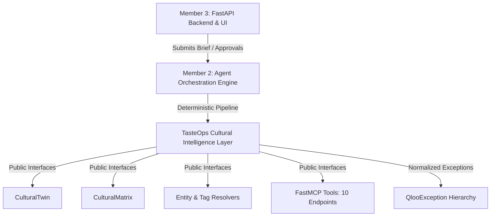

# TasteOps Downstream Integration Guide

**Audience:** Member 2 (Agent Orchestration & Workflow Engine) and Member 3 (FastAPI Backend, Persistence, UI/Frontend)  
**Package:** `tasteops`  
**Status:** Stable Public Interface Specification  

---

## 1. Overview & System Boundaries

The TasteOps Cultural Intelligence layer (`tasteops`) exposes a strictly typed, immutable public API. Downstream components (Member 2's deterministic agents and Member 3's FastAPI backend) interact with Cultural Intelligence **exclusively through stable public interfaces** without referencing internal HTTP transports, API key management, retry loops, or private methods.



---

## 2. Public Import Surface

Downstream consumers can import all core schemas, services, agents, and exceptions directly from the top-level `tasteops` package:

```python
from tasteops import (
    # Models
    PhysicalSpaceBrief,
    CulturalTwin,
    CulturalMatrix,
    CulturalRecommendation,
    CategoryQueryMetadata,
    CulturalMatrixEvidence,
    LocationInput,
    ResolvedEntity,
    ResolvedTag,
    EntityResolutionResult,
    TagResolutionResult,
    ResolutionEvidence,
    
    # Resolvers & Services
    EntityResolver,
    TagResolver,
    CulturalMatrixService,
    InsightsService,
    
    # Execution & Governance
    ExecutionPlan,
    ExecutionTask,
    TaskProvenance,
    ApprovalRecord,
    CulturalActivationPlan,
    
    # MCP Server & Adapter
    create_cultural_intelligence_mcp,
    CulturalIntelligenceMCPAdapter,
    
    # Exceptions
    QlooException,
    QlooAuthenticationError,
    QlooNotFoundError,
    QlooRateLimitError,
    QlooServerError,
    QlooTimeoutError,
    QlooValidationError,
)
```

---

## 3. Stable Public Data Models

### A. CulturalTwin

The foundational cultural identity model representing a physical space brief.

```python
from tasteops import CulturalTwin, LocationInput

twin = CulturalTwin(
    business_type="Vinyl Listening Bar & Natural Wine Lounge",
    target_audience="Audiophiles, design-conscious creatives, indie music community",
    positioning="Intimate acoustic sanctuary with Japanese minimalist aesthetic",
    desired_mood="Warm, analog, contemplative, low-lit",
    location=LocationInput(
        latitude=40.7182,
        longitude=-73.9881,
        radius_meters=3000,
    ),
    anchor_entities=["ent_four_tet_101", "ent_blue_bottle_102"],
    resolved_tags=["tag_kissa", "tag_japanese_minimalism"],
    exclusions=["commercial_edm", "loud_sports_bars"],
    confidence=0.92,
)

# Convenience property: returns verified string IDs from resolved_entities and anchor_entities
verified_ids: list[str] = twin.resolved_entity_ids
```

#### Fields & Types
| Field | Type | Description |
| :--- | :--- | :--- |
| `business_type` | `str` | Category of space (e.g. coffee lounge, boutique hotel). |
| `target_audience` | `str` | Target patron segment. |
| `positioning` | `str` | Cultural positioning narrative. |
| `desired_mood` | `str` | Ambient mood and atmosphere descriptor. |
| `location` | `LocationInput \| None` | Geolocation coordinates and radius (meters). |
| `anchor_entities` | `list[str]` | Seed Qloo entity IDs. |
| `resolved_entities` | `list[ResolvedEntity]` | Fully resolved anchor entities with metadata. |
| `resolved_tags` | `list[str]` | Verified taxonomy tag IDs. |
| `exclusions` | `list[str]` | Brand or cultural tags to exclude. |
| `confidence` | `float` | Overall cultural confidence score (0.0 to 1.0). |

---

### B. CulturalMatrix

A comprehensive multidimensional cultural affinity matrix generated for a `CulturalTwin`.

```python
from tasteops import CulturalMatrix, CulturalRecommendation

# Generated by CulturalMatrixService or MCP get_cultural_matrix tool
matrix: CulturalMatrix

# Category accessors
artists: list[CulturalRecommendation] = matrix.artists
books: list[CulturalRecommendation] = matrix.books
brands: list[CulturalRecommendation] = matrix.brands
places: list[CulturalRecommendation] = matrix.places
movies: list[CulturalRecommendation] = matrix.movies
destinations: list[CulturalRecommendation] = matrix.destinations

# Query metadata diagnostics and evidence
query_diagnostics = matrix.query_metadata  # list[CategoryQueryMetadata]
provenance_evidence = matrix.evidence     # list[CulturalMatrixEvidence]

# Helper properties
total_items: int = matrix.total_recommendations
has_content: bool = matrix.has_results
all_brands = matrix.get_category_recommendations("brand")
```

#### CulturalRecommendation Fields
| Field | Type | Description |
| :--- | :--- | :--- |
| `id` | `str` | Verified Qloo entity identifier. |
| `name` | `str` | Verified entity name. |
| `type` | `str` | Category (`artist`, `book`, `brand`, `place`, etc.). |
| `affinity` | `float` | Qloo cultural affinity score (0.0 to 1.0). |
| `evidence_id` | `str` | Deterministic evidence identifier. |
| `explainability` | `list[str]` | Human-readable explanation of cultural affinity. |
| `source_signal` | `dict[str, Any]` | Provenance trace of anchor entities, tags, and coordinates. |

---

## 4. Evidence and Provenance Models

TasteOps enforces that no external action or recommendation can exist without verified provenance.

### A. Resolution Evidence (`ResolutionEvidence`)

Attached to every entity and tag resolution output:

```python
class ResolutionEvidence(BaseModel):
    match_method: str       # "exact_match", "token_similarity", "rejected_below_confidence"
    raw_query: str          # Original input query string
    confidence_score: float # Match confidence score (0.0 to 1.0)
    candidates_evaluated: int # Number of upstream provider items evaluated
    timestamp: datetime     # Timestamp of resolution
```

### B. Task Provenance (`TaskProvenance`)

Required on every executable action item before execution:

```python
class TaskProvenance(BaseModel):
    source: str          # e.g. "qloo_insights"
    source_id: str       # Verified Qloo entity ID
    source_type: str     # Category e.g. "brand", "artist"
    query: str           # Tool or endpoint used
    task_id: str         # Target execution task ID
    plan_id: str         # Parent execution plan ID
    session_id: str      # Workflow session ID
    approved_by: str     # Authorizing curator ID
    approved_at: datetime # Approval timestamp
```

---

## 5. Entity & Tag Resolution Public Services

Downstream agents and API services resolve freeform user text into verified Qloo identifiers using [EntityResolver](file:///d:/TasteOps/src/tasteops/services/entity_resolver.py) and [TagResolver](file:///d:/TasteOps/src/tasteops/services/tag_resolver.py).

### Entity Resolution

```python
from tasteops import EntityResolver, QlooClient

async with QlooClient() as client:
    resolver = EntityResolver(client, min_confidence=0.50)
    
    # Single entity resolution
    result = await resolver.resolve_entity(query="Sey Coffee", entity_type="place")
    
    if result.resolved and result.entity:
        print(f"Resolved: {result.entity.name} (Qloo ID: {result.entity.qloo_id})")
        print(f"Confidence: {result.evidence.confidence_score} via {result.evidence.match_method}")
    else:
        print(f"Unresolved: {result.evidence.match_method}")
        # Raw candidates inspected for user clarification
        for cand in result.candidates:
            print(f" Candidate: {cand.name} (Score: {cand.similarity_score})")

    # Batch resolution
    results = await resolver.resolve_entities(["Sey Coffee", "Four Tet", "Muji"])
```

### Tag Resolution

```python
from tasteops import TagResolver, QlooClient

async with QlooClient() as client:
    resolver = TagResolver(client)
    
    result = await resolver.resolve_tag("japanese-minimalism")
    if result.resolved and result.tag:
        print(f"Tag ID: {result.tag.tag_id} | Path: {result.evidence.taxonomy_path}")
```

---

## 6. Model Context Protocol (MCP) Interface

Member 2 (Agents) and Member 3 (FastAPI/Sidecars) can interact with Cultural Intelligence over the FastMCP protocol using typed inputs and outputs.

### Available MCP Tools

| Tool Name | Input Schema | Output Schema | Purpose |
| :--- | :--- | :--- | :--- |
| `health_check` | `HealthCheckInput` | `HealthCheckOutput` | Probe server and Qloo API health. |
| `resolve_entity` | `ResolveEntityInput` | `ResolveEntityOutput` | Map search terms to verified Qloo entities. |
| `resolve_tag` | `ResolveTagInput` | `ResolveTagOutput` | Match concepts to cultural tag taxonomy. |
| `get_cultural_profile` | `GetCulturalProfileInput` | `GetCulturalProfileOutput` | Multidimensional affinity profile. |
| `get_related_artists` | `GetRelatedCategoryInput` | `CategoryRecommendationsOutput` | Sonic/artist recommendations. |
| `get_related_books` | `GetRelatedCategoryInput` | `CategoryRecommendationsOutput` | Editorial/reading identity. |
| `get_related_brands` | `GetRelatedCategoryInput` | `CategoryRecommendationsOutput` | Brand ecosystem & partner candidates. |
| `get_related_places` | `GetRelatedPlacesInput` | `CategoryRecommendationsOutput` | Spatial places with location bounds. |
| `get_related_movies` | `GetRelatedCategoryInput` | `CategoryRecommendationsOutput` | Cinematic & visual identity. |
| `get_cultural_matrix` | `GetCulturalMatrixInput` | `GetCulturalMatrixOutput` | Complete 6-domain Cultural Matrix. |

### Using the Python MCP Adapter

```python
from tasteops import CulturalIntelligenceMCPAdapter

adapter = CulturalIntelligenceMCPAdapter()

# 1. Resolve an entity
entity_resp = await adapter.resolve_entity("Four Tet", entity_type="artist")
if entity_resp.resolved and entity_resp.entity:
    artist_id = entity_resp.entity.qloo_id

# 2. Fetch full Cultural Matrix
matrix_resp = await adapter.get_cultural_matrix(
    anchor_entities=[artist_id],
    resolved_tags=["tag_lofi_beats"],
    latitude=40.7128,
    longitude=-74.0060,
    radius_meters=3000,
)
```

---

## 7. Normalized Error Hierarchy

All client and service operations raise normalized exceptions derived from `QlooException`. Downstream code should handle specific error types to drive UX states:

```python
from tasteops import (
    QlooException,
    QlooAuthenticationError,
    QlooNotFoundError,
    QlooRateLimitError,
    QlooServerError,
    QlooTimeoutError,
    QlooValidationError,
)

try:
    matrix = await matrix_service.generate_matrix(twin)
except QlooAuthenticationError as err:
    # HTTP 401/403: Critical configuration failure - notify operator immediately
    logger.critical("Invalid Qloo API credentials: %s", err)
except QlooRateLimitError as err:
    # HTTP 429: Throttling backoff - retry after err.retry_after seconds
    logger.warning("Rate limited. Retry after %0.1fs", err.retry_after or 5.0)
except QlooTimeoutError as err:
    # Downstream timeout - degrade gracefully or report transient delay
    logger.warning("Downstream timeout contacting Qloo: %s", err)
except QlooValidationError as err:
    # Bad request or malformed payload
    logger.error("Validation error: %s (Details: %s)", err.message, err.details)
except QlooException as err:
    # Generic catch-all
    logger.error("Cultural intelligence error: [%s] %s", err.status_code, err.message)
```

---

## 8. Downstream Integration Scenarios

### Scenario A: Member 2 (Agent Orchestration)

Member 2 builds agents that synthesize the [CulturalTwin](file:///d:/TasteOps/src/tasteops/models/cultural_matrix.py) and [CulturalMatrix](file:///d:/TasteOps/src/tasteops/models/cultural_matrix.py) into strategic activations:

1. **Cultural Strategist:** Converts `PhysicalSpaceBrief` into `CulturalTwin` via `EntityResolver` and `TagResolver`.
2. **Experience Architect:** Consumes `CulturalTwin` + `CulturalMatrix` to build sonic identity, reading library, and spatial guidelines.
3. **Partnership Agent:** Scores brand candidates (`0 to 100`) and generates outreach drafts.
4. **Governance Agent:** Audits plan provenance. Rejects any plan containing IDs not found in upstream Qloo evidence.

```python
# Member 2 Example: Running the full orchestrator
from tasteops import TasteOpsOrchestrator, PhysicalSpaceBrief

orchestrator = TasteOpsOrchestrator()
plan = await orchestrator.run(
    session_id="sess_123",
    brief=PhysicalSpaceBrief(
        business_type="Listening Cafe",
        location="Bushwick, Brooklyn, NY",
        target_audience="Vinyl lovers, specialty coffee enthusiasts",
        desired_mood="Warm, intimate, acoustic",
        budget="$$$",
        anchor_entities=["Blue Bottle Coffee", "Four Tet"],
        tags=["minimalism"],
    )
)
```

### Scenario B: Member 3 (FastAPI Backend & UI)

Member 3 consumes Pydantic models directly for FastAPI request/response validation:

```python
# Member 3 Example: FastAPI Route Implementation
from fastapi import APIRouter, HTTPException, Depends
from tasteops import TasteOpsOrchestrator, PhysicalSpaceBrief, CulturalActivationPlan, QlooException

router = APIRouter(prefix="/api/v1/plans", tags=["Plans"])

@router.post("/generate", response_model=CulturalActivationPlan)
async def generate_activation_plan(brief: PhysicalSpaceBrief):
    orchestrator = TasteOpsOrchestrator()
    try:
        plan = await orchestrator.run(session_id="session_fastapi", brief=brief)
        return plan
    except QlooException as err:
        raise HTTPException(
            status_code=err.status_code or 500,
            detail={"error": str(err), "details": err.details}
        )
```

---

## 9. Contract Stability & Invariant Guarantees

The Cultural Intelligence package guarantees the following invariants to all downstream consumers:

1. **Zero Hallucination:** No entity ID, tag ID, or affinity score is ever synthesized. If resolution or insight queries yield 0 results, the returned collections are strictly empty (`[]`).
2. **Deterministic Fallbacks:** Fallback queries broaden spatial radius or relax tags by a depth of at most 1, recording `fallback_applied` metadata in query diagnostics.
3. **Immutable Provenance:** Recommendations and execution tasks carry complete provenance traces linking them to their source Qloo responses.
4. **Non-Retryable Safety:** Retries are strictly bounded and non-transient errors (401, 403, 404, 422) fail immediately on attempt 1.
