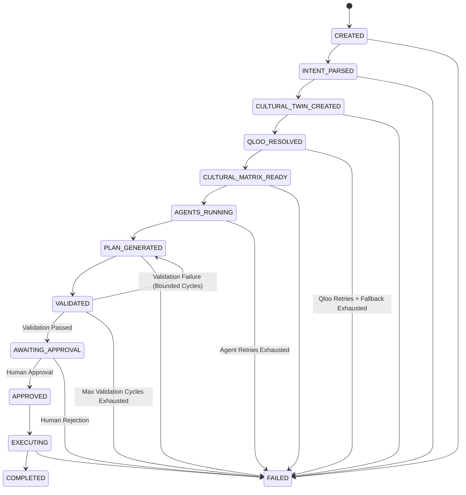

# TasteOps Cultural Intelligence — Integration Contract

**Document Version:** 1.0.0  
**Domain:** Cultural Intelligence Infrastructure (Developer 1)  
**Consumers:** Agent Orchestrator (Member 2), Music/Domain Integrations (Member 3), Backend Services  

---

## 1. Canonical Package Layout

```
TasteOps/
├── .env.example                      # Variable definitions (placeholder values only)
├── .gitignore                        # Secret & dataset exclusion rules
├── pyproject.toml                    # UV/PEP-621 build definition & script entry points
├── README.md                         # Package documentation
├── docs/
│   └── INTEGRATION_CONTRACT.md       # This integration specification
├── src/tasteops/
│   ├── __init__.py                   # Canonical public exports (including TasteOpsOrchestrator)
│   ├── config.py                     # QlooSettings configuration
│   ├── cache.py                      # AsyncTTLCache and CacheBackend protocol
│   ├── client.py                     # QlooClient async transport
│   ├── exceptions.py                 # Normalized application exception hierarchy
│   ├── models/
│   │   ├── __init__.py               # Model exports
│   │   ├── entity.py                 # QlooEntity
│   │   ├── tag.py                    # QlooTag
│   │   ├── insight.py                # QlooInsight
│   │   ├── error.py                  # QlooError
│   │   ├── params.py                 # SearchParams, TagParams, InsightParams
│   │   ├── resolution.py             # EntityResolutionResult, TagResolutionResult, ResolutionEvidence
│   │   └── cultural_matrix.py        # CulturalTwin, CulturalMatrix, CulturalRecommendation
│   ├── services/
│   │   ├── __init__.py               # Service exports
│   │   ├── entity_resolver.py        # EntityResolver
│   │   ├── tag_resolver.py           # TagResolver
│   │   ├── insights_service.py       # InsightsService (entity capability manager)
│   │   └── cultural_matrix_service.py# CulturalMatrixService (concurrent multi-domain matrix)
│   ├── mcp/
│   │   ├── __init__.py               # create_cultural_intelligence_mcp export
│   │   ├── schemas.py                # MCP tool input/output models
│   │   └── server.py                 # MCPServer tool registry and stdio entry point
│   ├── agents/
│   │   ├── base.py                   # BaseAgent protocol and metadata
│   │   ├── strategist.py             # CulturalStrategist agent
│   │   ├── architect.py              # ExperienceArchitect agent
│   │   ├── partnership.py            # PartnershipAgent agent
│   │   ├── governance.py             # GovernanceAgent with validation & idempotency
│   │   └── mcp_adapter.py            # CulturalIntelligenceMCPAdapter
│   └── workflows/
│       ├── __init__.py               # Workflow exports
│       ├── states.py                 # 13 explicit WorkflowStates
│       ├── schemas.py                # ExecutionPlan, ExecutionTask, ApprovalRecord, TaskProvenance
│       ├── context.py                # WorkflowContext and AgentResults
│       ├── persistence.py            # BaseStateStore, InMemoryStateStore, FileStateStore
│       ├── engine.py                 # WorkflowEngine state machine
│       └── orchestrator.py           # TasteOpsOrchestrator application service
└── tests/
    ├── conftest.py                   # Pytest fixtures and mock transport
    ├── fixtures/
    │   ├── __init__.py               # Fixture package
    │   └── demo_mumbai_boutique_hotel.py # Deterministic Mumbai Boutique Hotel fixture
    ├── unit/
    │   ├── test_agents.py            # Agent intelligence tests
    │   ├── test_cache.py             # Async TTL cache tests
    │   ├── test_cultural_matrix_service.py # Capability, concurrency & fallback tests
    │   ├── test_mcp_server.py        # MCP tools and protocol tests
    │   ├── test_qloo_client.py       # Client retry, timeout, and auth exclusion tests
    │   ├── test_resolvers.py         # Entity & tag resolution tests
    │   └── test_workflow.py          # State machine transitions & recovery tests
    └── integration/
        ├── __init__.py
        └── test_orchestrator.py      # 14 end-to-end integration test scenarios
```

---

## 2. Environment Variables

All variables are loaded automatically from the active environment or local `.env` file via `pydantic-settings`:

| Variable | Type | Default | Description |
| :--- | :--- | :--- | :--- |
| `QLOO_API_KEY` | `SecretStr` | **Required** | Hackathon Qloo API key (never logged or serialized) |
| `QLOO_BASE_URL` | `str` | `https://hackathon.api.qloo.com` | Base API gateway host |
| `QLOO_TIMEOUT_SECONDS` | `float` | `15.0` | HTTP transport request timeout |
| `QLOO_MAX_RETRIES` | `int` | `3` | Maximum retry attempts for transient errors (429, 5xx) |
| `QLOO_RETRY_BACKOFF_FACTOR` | `float` | `0.5` | Exponential backoff factor (seconds) |
| `QLOO_CACHE_ENABLED` | `bool` | `true` | In-memory asyncio-safe TTL cache |
| `QLOO_CACHE_TTL_SECONDS` | `int` | `3600` | TTL in seconds for cached GET responses |

---

## 3. Installation & Startup Commands

### Dependency Installation
```bash
# Clone the repository
git clone https://github.com/maitray-agrawal/TasteOps.git
cd TasteOps

# Install dependencies using uv
uv sync
```

### Running Test Suite & Linting
```bash
# Run all unit tests
uv run pytest -v

# Run linter
uv run ruff check src tests

# Run type checker
uv run mypy src
```

---

## 4. MCP Server Command & Transport

The MCP server communicates using standard **`stdio`** JSON-RPC protocol.

### CLI Launch Command
```bash
uv run tasteops-mcp
```

### Programmatic Setup (Python Orchestrator)
```python
from tasteops.mcp import create_cultural_intelligence_mcp

server = create_cultural_intelligence_mcp()
# Run directly or mount as needed
```

---

## 5. Registered MCP Tools & Strongly-Typed Schemas

The MCP server exposes 10 high-level cultural intelligence tools. Raw HTTP calls to Qloo (e.g. `call_qloo`) are strictly prohibited and not exposed. Every tool enforces:
1. **Typed Input & Output:** Strict Pydantic models in `tasteops.mcp.schemas`.
2. **Validation:** Parameter boundaries, length restrictions, geographic coordinate bounds, and threshold ranges.
3. **Deterministic Error Behavior:** Safe error trapping returning structured payloads with `request_id` and root-cause error descriptions rather than uncaught exceptions.
4. **Provenance:** Traceable evidence retained across entity resolution (`evidence`), tag taxonomy (`evidence`), and recommendations (`source_query`, `source_signal`, `explainability`).
5. **Request ID:** A unique UUID4 `request_id` on every tool execution.
6. **Confidence:** Explicit confidence scores `[0.0 - 1.0]` for resolutions and recommendations.

### 5.1. `health_check`
- **Description:** Performs health diagnostics on the Cultural Intelligence MCP server and configuration.
- **Input Schema:** `HealthCheckInput` (no arguments required).
- **Output Schema:** `HealthCheckOutput`
  - `request_id` (`str`): Unique UUID request identifier.
  - `status` (`str`): `"healthy"` or `"degraded"`.
  - `server` (`str`): `"tasteops-cultural-intelligence"`.
  - `version` (`str`): Semantic server version (`"1.0.0"`).
  - `base_url` (`str`): Configured Qloo API base URL.
  - `timestamp` (`str`): ISO-8601 UTC timestamp.
  - `latency_ms` (`float`): Execution latency in milliseconds.
  - `error` (`str | None`): Error details if degraded.

### 5.2. `resolve_entity`
- **Description:** Resolves natural language cultural anchor strings (venue, artist, brand) into verified Qloo entity IDs.
- **Input Schema:** `ResolveEntityInput`
  - `query` (`str`, required): Natural language anchor (min length 1, e.g. `"Blue Bottle"`, `"A24"`).
  - `expected_type` (`str | None`, optional): Domain hint (`"place"`, `"brand"`, `"artist"`).
  - `min_confidence` (`float`, default `0.5`, bounds `0.0` - `1.0`): Minimum score required to accept top match.
- **Output Schema:** `ResolveEntityOutput`
  - `request_id` (`str`): Unique UUID request identifier.
  - `is_resolved` (`bool`): `True` if top match exceeds `min_confidence`.
  - `input` (`str`): Normalized raw query.
  - `resolved_entity_id` (`str | None`): Verified Qloo entity ID (e.g. `"ent_a24_film"`).
  - `entity_name` (`str | None`): Standardized entity name.
  - `entity_type` (`str | None`): Domain category.
  - `confidence` (`float`): Match confidence score `[0.0 - 1.0]`.
  - `source` (`str`): Resolution source (`"qloo_search"`).
  - `evidence` (`dict`): Provenance dictionary (`source`, `raw_query`, `normalized_query`, `match_method`, `score`, `timestamp`).
  - `alternatives_count` (`int`): Count of candidate alternatives evaluated.
  - `alternatives` (`list[dict]`): Top candidate alternatives with individual scores and match reasons.
  - `latency_ms` (`float`): Execution latency.
  - `error` (`str | None`): Error description on failure.

### 5.3. `resolve_tag`
- **Description:** Resolves aesthetic motifs, vibes, or genre terms into verified Qloo taxonomy tags. Rejects unknown tags (zero tag fabrication).
- **Input Schema:** `ResolveTagInput`
  - `query` (`str`, required): Natural language motif (min length 1, e.g. `"Japanese minimalism"`, `"lo-fi beats"`).
  - `expected_category` (`str | None`, optional): Category hint (`"style"`, `"music"`, `"dining"`).
  - `min_confidence` (`float`, default `0.5`, bounds `0.0` - `1.0`): Minimum acceptance threshold.
- **Output Schema:** `ResolveTagOutput`
  - `request_id` (`str`): Unique UUID request identifier.
  - `is_resolved` (`bool`): `True` if tag verified in taxonomy.
  - `input` (`str`): Normalized raw query.
  - `resolved_tag_id` (`str | None`): Verified taxonomy tag ID (e.g. `"tag_jp_minimalism"`).
  - `tag_name` (`str | None`): Normalized tag title.
  - `category` (`str | None`): Taxonomy category.
  - `confidence` (`float`): Match score `[0.0 - 1.0]`.
  - `source` (`str`): Provenance source (`"qloo_tags"`).
  - `evidence` (`dict`): Provenance dictionary (`source`, `match_method`, `score`, `timestamp`).
  - `alternatives_count` (`int`): Count of candidate alternatives.
  - `latency_ms` (`float`): Execution latency.
  - `error` (`str | None`): Error description on failure.

### 5.4. `get_cultural_profile`
- **Description:** Produces an instant cross-domain taste profile for an anchor entity across music, brands, and spaces.
- **Input Schema:** `GetCulturalProfileInput`
  - `entity_id` (`str | None`, optional): Verified Qloo entity ID.
  - `entity_name` (`str | None`, optional): Natural language entity name (resolved automatically if `entity_id` omitted).
  - `take` (`int`, default `5`, bounds `1` - `20`): Recommendations per domain.
- **Validation:** Must provide at least one of `entity_id` or `entity_name`.
- **Output Schema:** `GetCulturalProfileOutput`
  - `request_id` (`str`): Unique UUID request identifier.
  - `entity_id` (`str | None`): Profiled Qloo entity ID.
  - `entity_name` (`str | None`): Display name.
  - `affinities` (`CulturalProfileAffinities`): Object containing `artists`, `brands`, and `places` lists with individual confidence and provenance.
  - `total_affinities` (`int`): Total recommendations count.
  - `latency_ms` (`float`): Execution latency.
  - `error` (`str | None`): Error description on failure.

### 5.5. Domain-Specific Affinity Tools
- **Tools:**
  - `get_related_artists` (music recommendations)
  - `get_related_books` (literature and monograph recommendations)
  - `get_related_brands` (lifestyle and equipment brand recommendations)
  - `get_related_places` (local venues and spatial synergies)
  - `get_related_movies` (cinematic and film movement recommendations)
- **Input Schemas:**
  - Non-spatial domains (`artists`, `books`, `brands`, `movies`): `GetRelatedCategoryInput`
    - `anchor_entities` (`list[str]`, default `[]`): Seed entity IDs.
    - `resolved_tags` (`list[str]`, default `[]`): Seed tag IDs.
    - `take` (`int`, default `10`, bounds `1` - `50`): Maximum recommendations.
  - Spatial domain (`places`): `GetRelatedPlacesInput`
    - `anchor_entities` (`list[str]`, default `[]`): Seed entity IDs.
    - `resolved_tags` (`list[str]`, default `[]`): Seed tag IDs.
    - `latitude` (`float | None`, bounds `-90.0` - `90.0`): Latitude for spatial bounding.
    - `longitude` (`float | None`, bounds `-180.0` - `180.0`): Longitude for spatial bounding.
    - `radius_meters` (`int`, default `5000`, bounds `100` - `50000`): Search radius in meters.
    - `take` (`int`, default `10`, bounds `1` - `50`): Maximum places.
- **Output Schema:** `CategoryRecommendationsOutput`
  - `request_id` (`str`): Unique UUID request identifier.
  - `category` (`str`): Target domain category name.
  - `recommendations` (`list[dict]`): List of recommendations, each containing `id`, `name`, `type`, `affinity`, `confidence`, `source_query`, `source_signal`, `explainability`.
  - `total_count` (`int`): Items returned.
  - `query_metadata` (`list[dict]`): Telemetry and query provenance.
  - `latency_ms` (`float`): Execution latency.
  - `error` (`str | None`): Error description on failure.

### 5.6. `get_cultural_matrix`
- **Description:** Assembles a holistic 6-domain CulturalMatrix for a physical space's `CulturalTwin` concurrently.
- **Input Schema:** `GetCulturalMatrixInput`
  - `cultural_twin` (`dict`, required): Object adhering to the [`CulturalTwin`](file:///d:/TasteOps/src/tasteops/models/cultural_matrix.py#L35-L53) schema (`business_type`, `mood`, `anchor_entities`, `resolved_tags`, `location`).
  - `take_per_category` (`int`, default `10`, bounds `1` - `30`): Recommendations per domain.
- **Output Schema:** `GetCulturalMatrixOutput`
  - `request_id` (`str`): Unique UUID request identifier.
  - `status` (`str`): `"success"` or `"error"`.
  - `cultural_matrix` (`dict | None`): Complete 6-domain payload (`artists`, `books`, `brands`, `places`, `movies`, `destinations`, `evidence`, `query_metadata`).
  - `total_recommendations` (`int`): Aggregate recommendation count.
  - `latency_ms` (`float`): Execution latency.
  - `error` (`str | None`): Error description on failure.

---

## 6. Return Schemas & Representative Sanitized Examples

### Example: `resolve_entity` Output
```json
{
  "request_id": "9b1deb4d-3b7d-4bad-9bdd-2b0d7b3dcb6d",
  "is_resolved": true,
  "input": "A24",
  "resolved_entity_id": "ent_a24_film",
  "entity_name": "A24",
  "entity_type": "brand",
  "confidence": 1.0,
  "source": "qloo_search",
  "evidence": {
    "source": "qloo_search",
    "raw_query": "A24",
    "normalized_query": "A24",
    "match_method": "exact_match",
    "score": 1.0,
    "timestamp": "2026-10-24T18:00:00Z",
    "metadata": {
      "candidate_count": 2,
      "top_candidate_name": "A24"
    }
  },
  "alternatives_count": 1,
  "alternatives": [
    {
      "entity": {
        "id": "ent_a24_music",
        "name": "A24 Music",
        "type": "brand"
      },
      "confidence": 0.82,
      "match_reason": "token_subset_match"
    }
  ],
  "latency_ms": 14.2,
  "error": null
}
```

### Example: `get_cultural_matrix` Output
```json
{
  "request_id": "4a2f8c12-32a1-432d-94bb-11a2f9c8e100",
  "status": "success",
  "total_recommendations": 12,
  "latency_ms": 112.5,
  "cultural_matrix": {
    "artists": [
      {
        "id": "ent_four_tet",
        "name": "Four Tet",
        "type": "artist",
        "affinity": 0.94,
        "score": 94.0,
        "confidence": 0.94,
        "source_query": "/v2/insights?filter.type=urn:entity:artist",
        "source_signal": {
          "anchor_entities": ["ent_blue_bottle_123"],
          "resolved_tags": ["tag_lofi_beats"]
        },
        "explainability": ["High audience overlap with Blue Bottle patrons"]
      }
    ],
    "books": [],
    "brands": [],
    "places": [],
    "movies": [],
    "destinations": [],
    "evidence": [
      {
        "category": "artist",
        "message": "Successfully retrieved recommendations using direct signals.",
        "timestamp": "2026-10-24T18:00:00Z",
        "signals_used": ["ent_blue_bottle_123", "tag_lofi_beats"]
      }
    ],
    "query_metadata": [
      {
        "category": "artist",
        "filter_type": "urn:entity:artist",
        "status": "success",
        "retries": 0,
        "items_count": 1,
        "latency_ms": 45.2,
        "params_used": {
          "filter.type": "urn:entity:artist",
          "signal.interests.entities": "ent_blue_bottle_123",
          "take": "10"
        }
      }
    ]
  },
  "error": null
}
```

---

## 7. Deterministic Error Envelope Format

When tool validation fails or an upstream query is unresolvable, tools return structured JSON error envelopes rather than uncaught exceptions:

```json
{
  "request_id": "00dfb59a-1b79-45ac-98a5-757ec1170ddf",
  "status": "error",
  "error": "Qloo authentication failed (HTTP 401): API key provided is invalid or expired.",
  "cultural_matrix": null
}
```


---

## 8. Consumer Guidelines

### For Member 2 (Agent Orchestrator)
1. **Never pass raw strings directly into recommendation engines**: Always call `resolve_entity` or `resolve_tag` first to acquire verified Qloo IDs.
2. **Respect `is_resolved`**: If `is_resolved == False`, the anchor was rejected or below threshold. Prompt the user for clarification rather than hallucinating an entity.
3. **Use `get_cultural_matrix` for spaces**: Pass a structured `CulturalTwin` containing resolved IDs. Inspect `query_metadata` to understand which categories required fallback.

### For Member 3 (Spotify & Media Integrations)
1. Use `matrix.artists` directly. Each artist recommendation retains the verified `id`, `name`, `affinity`, and `explainability`.
2. Map `artist.name` directly into the Spotify Search API (`/v1/search?q={artist.name}&type=artist`).
3. Leverage `affinity` scores to weight track selection or generate atmospheric playlist track counts.

---

## 9. Known Boundaries & Limitations

1. **Authentication Failures (401, 403)**: Are never retried automatically. The system raises `QlooAuthenticationError` immediately to avoid locking API keys.
2. **Spatial Filters Restricted**: Geographic location filters (`latitude`, `longitude`, `radius`) are only applied to `place` and `destination`. They are automatically omitted from queries for `artist`, `book`, `brand`, and `movie`.
3. **Deterministic Single-Retry**: If a category returns 0 items, the service applies one deterministic fallback (broadened radius or dropped tag constraints) and retries once. If results remain empty, it returns `[]` without fabricating data.

---

## 10. Agent Intelligence & Orchestration Architecture (Developer 2)

### 10.1. Workflow Philosophy & Boundaries
- **No Unrestricted Autonomous Loops**: Agents operate within deterministic workflow boundaries governed by `WorkflowEngine`.
- **Decoupled Transport**: Agents **NEVER** call Qloo REST APIs directly; all cultural intelligence is routed through `CulturalIntelligenceMCPAdapter` invoking the TasteOps Cultural Intelligence MCP Server.
- **Strict Provenance & Anti-Hallucination**: Every Qloo entity ID, tag, and cultural recommendation used in activations, spatial zones, or brand partnerships must match verified evidence from Qloo resolution and insights. Hallucinated IDs are flagged and rejected by the Governance Agent.
- **Human Approval Gate**: Execution cannot occur without explicit human approval at `AWAITING_APPROVAL`.

### 10.2. Explicit 13 Workflow States
The system strictly enforces valid state transitions:



### 10.2. State Transition & Failure Recovery Contracts

| State | Role & Responsibilities | Failure Transition & Recovery Path |
| :--- | :--- | :--- |
| `CREATED` | Session initialized with raw intent. | Invalid input format → `FAILED` |
| `INTENT_PARSED` | User intent decomposed into structured domain hints, venue type, and raw terms. | Unparseable intent → `FAILED` |
| `CULTURAL_TWIN_CREATED` | Structured `CulturalTwin` draft formed. | Brief validation error → `FAILED` |
| `QLOO_RESOLVED` | Raw terms and motifs resolved to verified Qloo entity IDs and tags via MCP tools. | Network/Qloo 5xx: `RETRY` (bounded `max_qloo_retries=2`) → `FALLBACK` (sanitized anchors) → `FAILED` |
| `CULTURAL_MATRIX_READY` | 6-domain CulturalMatrix fetched concurrently via MCP `get_cultural_matrix`. | Insights failure: `RETRY` (bounded `max_qloo_retries=2`) → `FALLBACK` (anchor-only profile) → `FAILED` |
| `AGENTS_RUNNING` | Specialized agents invoked concurrently (Strategist, Architect, Partnership). | Agent crash/timeout: `RETRY` (bounded `max_agent_retries=2`) → `FAILED` |
| `PLAN_GENERATED` | Agent outputs synthesized into unified `CulturalActivationPlan`. | Synthesis error → `FAILED` |
| `VALIDATED` | `GovernanceAgent` audits provenance, ensures 0 invented IDs, checks compliance. | **Validation Failure**: transitions back to `PLAN_GENERATED` for curatorial refinement (bounded by `max_validation_cycles=2`). If cycles exhausted → `FAILED`. |
| `AWAITING_APPROVAL` | Pipeline pauses; awaits human curator review. | Human curator rejects activation plan → `FAILED` |
| `APPROVED` | Human curator approves activation plan. | Non-reversible gate; immutable record of approver identity. |
| `EXECUTING` | Downstream physical space tasks dispatched with full provenance. | Action execution error → `FAILED` |
| `COMPLETED` | All execution tasks completed with verifiable provenance. | Terminal success state. |
| `FAILED` | Workflow halted; preserves audit event with detailed root-cause error. | Terminal failure state. |

### 10.3. Loop Prevention & Guardrail Guarantees
1. **Bounded Qloo Retries (`max_qloo_retries`)**: Network/API errors are retried at most 2 times before falling back to relaxed anchor queries. If fallback fails, state transitions to `FAILED`. Infinite network loops are strictly prohibited.
2. **Bounded Agent Retries (`max_agent_retries`)**: Specialized agent execution errors are retried at most 2 times. If failures persist, the workflow transitions directly to `FAILED`. Autonomous agent recursion is strictly prohibited.
3. **Bounded Validation Cycles (`max_validation_cycles`)**: Validation failure routes back from `VALIDATED` to `PLAN_GENERATED` for up to 2 corrective refinement cycles. If the plan remains invalid after 2 cycles, the workflow transitions to `FAILED`.
4. **State Persistence & Audit Trail (`AuditEvent`)**:
   - Every single transition emits an immutable `AuditEvent` (`event_id`, `session_id`, `from_state`, `to_state`, `timestamp`, `reason`, `metadata`, `error`).
   - Pluggable persistence via `BaseStateStore`:
     - `InMemoryStateStore`: In-memory storage for high-speed ephemeral execution.
     - `FileStateStore`: Production filesystem storage persisting append-only JSONL audit events (`audit_events.jsonl`) and full JSON context state snapshots (`context.json`).

### 10.4. The 4 Specialized Agents

1. **Cultural Strategist (`CulturalStrategist`)**:
   - **Purpose**: Transforms a user's physical-space brief (`PhysicalSpaceBrief`) into a structured, validated `CulturalTwin` that serves as the cultural foundation for all downstream agents.
   - **Input**:
     - `business_type`: Venue type (e.g. `"Analog Vinyl Listening Bar"`)
     - `location`: Geographic coordinates or WKT string
     - `target_audience`: Audience demographic & psychographic summary
     - `positioning`: Market positioning (e.g. `"Japanese-inspired craft audio sanctuary"`)
     - `desired_mood`: Atmospheric vibe and energy
     - `budget`: Budget tier or parameters
     - `constraints`: Operational and aesthetic guardrails
     - `anchor_entities`: Natural language anchors and aesthetic motifs
   - **Resolution & Provenance**:
     - Resolves natural language anchors and vibes strictly via Cultural Intelligence MCP tools (`resolve_entity` and `resolve_tag`).
     - **Zero Hallucination**: Never invents Qloo IDs or tags. Unknown terms are omitted from verified collections.
   - **Cultural Reasoning**:
     - Generates narrative explanations (`why_it_matters`) connecting each verified entity (brand, artist, place) and tag to the physical space.
   - **Output (`CulturalTwin`)**:
     - `audience_profile`: Synthesized demographic and psychographic profile
     - `cultural_themes`: Core cultural thematic axes
     - `mood_profile`: Detailed sonic, visual, and temporal mood breakdown
     - `anchor_entities`: Original input terms from brief
     - `resolved_entities`: List of `ResolvedEntity` models (id, name, type, confidence, why_it_matters)
     - `resolved_tags`: List of verified Qloo tag IDs
     - `cultural_constraints`: Concrete cultural guardrails
     - `exclusions`: Cultural anti-patterns to avoid
     - `confidence`: Overall profile confidence score
   - **Boundary**: Does **NOT** produce recommendations yet (recommendations are generated downstream via `get_cultural_matrix`).
   - **Downstream Strategy (`execute`)**: Synthesizes positioning statements and cultural pillars once `CulturalMatrix` is available.
2. **Experience Architect (`ExperienceArchitect`)**:
   - **Purpose**: Designs a coherent, multi-sensory cultural experience for the physical space based strictly on the `CulturalTwin` and `CulturalMatrix`.
   - **Input**:
     - `cultural_twin`: Structured cultural foundation containing audience profile, mood, constraints, and exclusions.
     - `cultural_matrix`: Verified 6-category candidate matrix from Qloo Insights.
   - **Curatorial Coherence Rules**:
     - **Affinity Thresholding**: Filters out candidate signals below affinity threshold (>= 0.50).
     - **Exclusion Filtering**: Prunes any entity matching items in `cultural_twin.exclusions`.
     - **Zero Hallucination**: Every recommendation is grounded in an actual `CulturalMatrix` entity with verifiable Qloo provenance.
   - **6 Cultural Experience Domains Generated**:
     1. **Sonic Identity (`SonicIdentity`)**: Acoustic profile, playback mediums (e.g. vinyl, reel-to-reel, hi-fi analog), sound system directives, curated recommendations, and daypart sequencing (morning, afternoon, evening, night).
     2. **Reading / Library Identity (`ReadingLibraryIdentity`)**: Curatorial themes, monograph/periodical selection, spatial display strategy, and book recommendations.
     3. **Brand Ecosystem (`BrandEcosystem`)**: Material palette, tactile brand pairings, curated amenities, and partnership criteria.
     4. **Local Experience Ecosystem (`LocalExperienceEcosystem`)**: Neighborhood context, third-place synergies, and curated community place recommendations.
     5. **Cultural Programming Ideas (`CulturalProgrammingIdeas`)**: Curatorial pillars, recurring activations (listening sessions, reading salons, panel discussions), and scheduling cadences.
     6. **Atmosphere Guidelines (`AtmosphereGuidelines`)**: Sonic parameters (dB thresholds, frequency weighting), lighting (color temperature, foot-candles), olfactory & thermal guidelines, hospitality tempo, spatial zoning, and sensory pairings.
   - **Mandatory Recommendation Contract (`ExperienceRecommendation`)**:
     Every curated recommendation across all domains strictly contains:
     - `recommendation`: Name and description of the recommended entity.
     - `qloo_evidence`: Exact Qloo entity ID, affinity score, query source, and explainability provenance.
     - `cultural_rationale`: Cultural analysis connecting the entity's aesthetics to the space's positioning.
     - `confidence`: Curatorial confidence score.
     - `expected_role`: Concrete spatial/functional deployment role in the venue.
3. **Partnership Agent (`PartnershipAgent`)**:
   - **Purpose**: Identifies, evaluates, and structures high-resonance brand partnership candidates for physical venues using evidence from Qloo and operational brief constraints.
   - **Input**:
     - `cultural_twin`: Structured audience profile, mood, cultural themes, constraints, and exclusions.
     - `cultural_matrix` / `brand_results`: Verified candidate brands from Qloo Insights.
     - `business_constraints`: Operational boundaries (e.g. acoustic caps, spatial limitations, no commercial banners).
     - `budget`: Operating tier or budget parameters.
   - **6-Dimensional Scoring Engine (0 to 100)**:
     For every candidate brand, computes:
     1. **`AudienceFit`**: Direct Qloo cross-affinity percentage.
     2. **`CulturalFit`**: Thematic and aesthetic alignment with cultural themes, mood, and positioning.
     3. **`BrandCompatibility`**: Industry and category synergy with the physical venue's business model.
     4. **`ContextFit`**: Physical space feasibility, spatial footprint, and operational integration.
     5. **`BudgetFit`**: Alignment with venue budget tier (e.g. consignment/loan vs. sponsorship fees).
     6. **`Novelty`**: Subcultural freshness and anti-generic appeal (penalizes mass-market retail ubiquity).
     - **Normalized Composite Score (`overall_score`)**: Weighted composite from 0.0 to 100.0.
   - **Candidate Return Schema (`BrandPartnershipCandidate`)**:
     - `brand`: Brand name and category.
     - `score`: Normalized score 0–100 with full 6-dimensional `score_breakdown`.
     - `supporting_qloo_evidence`: Immutable Qloo evidence (entity ID, affinity, query, explainability).
     - `partnership_concept`: Tailored physical collaboration blueprint (listening stations, tableware, amenities).
     - `estimated_effort`: Level (Low/Medium/High) and operational effort rationale.
     - `risk`: Objective risk assessment (brand dilution, operational complexity, mitigation).
     - `recommended_next_action`: Immediate pragmatic action step for management.
     - `outreach_draft` (`OutreachDraft`): Exploratory outreach communication (subject, opening hook referencing Qloo evidence, value proposition, call to action, disclaimer).
   - **Strict Guardrails**:
     - **No Claimed Partnerships**: `is_existing_partner = False` is enforced on all candidates.
     - **Drafts Only**: Outreach letters are strictly generated as exploratory drafts.
     - **Zero Hallucination**: 100% of candidate IDs and evidence trace directly to verified Qloo entities.
4. **Governance / Execution Agent (`GovernanceAgent`)**:
   - **Purpose**: Converts upstream cultural recommendations into an actionable, dependency-mapped `ExecutionPlan`, executes multi-point compliance validations, strictly enforces the Human-in-the-Loop approval gate, dispatches verified physical/digital execution tasks, and performs post-execution audits.
   - **Deterministic 5-Phase Workflow**:
     ```
     PLAN → VALIDATE → APPROVAL → EXECUTION → AUDIT
     ```
   - **Phase 1: PLAN (`ExecutionPlan`)**:
     Synthesizes recommendations into a structured blueprint prior to human approval:
     - `actions`: List of typed action items ([`ExecutionPlanAction`](file:///d:/TasteOps/src/tasteops/workflows/schemas.py)) covering sound system calibration, physical tableware procurement, exploratory partner outreach, atmosphere dayparting, and cultural programming.
     - `dependencies`: Explicit prerequisite mapping (e.g. `act_brand_01` requires `act_sonic_01`).
     - `estimated_cost`: Granular financial cost estimate and budget allocation.
     - `risks`: Operational, spatial, acoustic, and brand perception risks with concrete mitigations.
     - `approvals_required`: List of required sign-off roles (`["General Manager", "Cultural Curator", "Financial Controller"]`).
     - `evidence`: Supporting Qloo evidence items linking planned actions to cultural intelligence.
   - **Phase 2: VALIDATE (7-Point Audit Engine)**:
     Executes strict automated compliance checks before plan can enter the approval gate:
     1. **Missing Evidence Audit**: Verifies that 100% of recommendations, signals, and partner proposals carry supporting Qloo queries and explainability data.
     2. **Conflicting Recommendations Audit**: Audits against negative exclusions (prunes contradictory entities) and flags acoustic/atmospheric contradictions (e.g. excessive dB vs. quiet sanctuary).
     3. **Budget Violations Audit**: Verifies that capital expenditure requirements remain strictly within the venue's configured budget tier.
     4. **Invalid Entities Audit (Zero Hallucination)**: Audits every referenced entity ID against ground truth Qloo entities. Any unverified ID immediately fails validation.
     5. **Low Confidence Audit**: Confirms all recommendations satisfy the minimum affinity and confidence thresholds ($\ge 0.50$).
     6. **Duplicate Actions Audit**: Detects and eliminates redundant or duplicate action IDs and task targets.
     7. **Unsupported External Actions Audit**: Restricts execution to validated integrations (`spotify_audio_seed`, `partner_outreach_brief`, `spatial_design_spec`, `curatorial_programming`, `hospitality_training`). Blocks unauthorized external mutations.
   - **Phase 3: APPROVAL (Deterministic Human-in-the-Loop Gate)**:
     - **Strict Execution Boundary**: The agent must **NEVER** execute external actions before explicit human approval.
     - Attempts to execute an unapproved or invalid plan raise `UnapprovedExecutionError`.
     - Human approval (`approve_plan`) records curator identity, timestamp, and transitions state to `APPROVED`.
   - **Phase 4: EXECUTION (`ExecutionTask`)**:
     Dispatches concrete execution tasks once approved. Every task strictly contains:
     - `task_id`: Unique execution task identifier (e.g. `task_e24b7a1c`).
     - `action`: Concrete execution instruction.
     - `owner`: Designated human or operational role (e.g. `"Audio Curator"`, `"Spatial Designer"`).
     - `input`: Parameter dictionary for automated or staff execution.
     - `status`: Execution status (`"EXECUTED"`).
     - `timestamp`: UTC execution timestamp.
     - `provenance`: Traceability payload containing verified Qloo entity ID, plan ID, and curator approver.
   - **Phase 5: AUDIT (`AuditReport`)**:
     Produces a post-execution compliance audit certifying approval verification, zero provenance violations, and zero unauthorized action leaks.

### 10.5. Programmatic Workflow Example
```python
from tasteops.agents.mcp_adapter import CulturalIntelligenceMCPAdapter
from tasteops.workflows.engine import WorkflowEngine
from tasteops.workflows.states import WorkflowState

# Initialize engine with MCP adapter (no REST API calls)
adapter = CulturalIntelligenceMCPAdapter()
engine = WorkflowEngine(mcp_adapter=adapter)

# 1. Run pipeline up to human approval gate
ctx = await engine.run_pipeline_to_approval_gate(
    raw_intent="Open an analog vinyl listening cafe with Japanese minimalism in Chelsea",
    parsed_hints={
        "venue_name": "Kissa Chelsea",
        "raw_anchor_entities": ["Blue Bottle", "A24"],
        "raw_tags": ["Japanese minimalism", "audiophile"],
        "location": {"latitude": 40.7484, "longitude": -73.9857, "radius_meters": 2000},
    },
)

assert ctx.current_state == WorkflowState.AWAITING_APPROVAL
print(f"Validation passed: {ctx.plan.governance_report.validation_passed}")

# 2. Human Curator reviews & approves
await engine.approve_plan(ctx, approved_by="Curator: Maitray Agrawal")
assert ctx.current_state == WorkflowState.APPROVED

# 3. Execute downstream tasks
await engine.execute_plan(ctx)
assert ctx.current_state == WorkflowState.COMPLETED
print(f"Executed {ctx.plan.execution_summary.executed_tasks} physical tasks.")
```

---

## 11. Application & Frontend Integration Layer (Member 2 Final Orchestration Hardening)

### 11.1. TasteOpsOrchestrator Interface

`TasteOpsOrchestrator` provides a clean, unified application-facing service for FastAPI routes and frontend interaction. The API layer never needs to understand internal agent orchestration, state transitions, or retry policies.

```python
class TasteOpsOrchestrator:
    def __init__(
        self,
        mcp_adapter: CulturalIntelligenceMCPAdapter | None = None,
        state_store: BaseStateStore | None = None,
        config: WorkflowConfig | None = None,
    ) -> None: ...

    async def create_session(
        self,
        space_id: str,
        user_input: str,
        parsed_hints: dict[str, Any] | None = None,
    ) -> WorkflowContext: ...

    async def run_until_approval(self, session_id: str) -> WorkflowContext: ...

    async def approve_session(
        self,
        session_id: str,
        approver: str,
        plan_version: int = 1,
    ) -> WorkflowContext: ...

    async def reject_session(
        self,
        session_id: str,
        reason: str,
        reviewer: str,
    ) -> WorkflowContext: ...

    async def execute_approved_plan(self, session_id: str) -> WorkflowContext: ...

    async def get_session_state(self, session_id: str) -> WorkflowContext: ...

    async def get_audit_events(self, session_id: str) -> list[AuditEvent]: ...
```

### 11.2. Standardized WorkflowContext Model

The session context is strictly typed using Pydantic models with zero untyped dictionaries:

```python
class WorkflowContext(BaseModel):
    session_id: str
    space_id: str
    user_input: str
    cultural_twin: CulturalTwin | None = None
    cultural_matrix: CulturalMatrix | None = None
    agent_results: AgentResults | None = None
    execution_plan: ExecutionPlan | None = None
    validation_result: GovernanceValidationResult | None = None
    approval: ApprovalRecord | None = None
    execution_tasks: list[ExecutionTask] = Field(default_factory=list)
    current_state: WorkflowState = WorkflowState.CREATED
    audit_events: list[AuditEvent] = Field(default_factory=list)

    # Backward compatibility with existing pipeline components
    raw_intent: str = Field(...)
    plan: CulturalActivationPlan | None = None
```

#### Typed Agent Results Container (`AgentResults`)
```python
class AgentResults(BaseModel):
    strategist: CulturalStrategyOutput | None = None
    architect: ExperienceDesignOutput | None = None
    partnership: BrandPartnershipOutput | None = None
    governance: GovernanceValidationResult | None = None
```

### 11.3. Session Lifecycle & State Progression

```
[POST /sessions]
      │
      ▼
   CREATED
      │
[POST /sessions/{id}/run]
      │
      ├─► INTENT_PARSED
      ├─► CULTURAL_TWIN_CREATED
      ├─► QLOO_RESOLVED (entity & tag resolution via MCP)
      ├─► CULTURAL_MATRIX_READY (concurrent 6-domain insights via MCP)
      ├─► AGENTS_RUNNING (Strategist, Architect, Partnership concurrent execution)
      ├─► PLAN_GENERATED (synthesis into ExecutionPlan v1)
      ├─► VALIDATED (GovernanceAgent 7-point audit)
      │       │
      │       ├── (Validation Failure: bounded refinement loop)
      │       │
      ▼
AWAITING_APPROVAL ◄── PAUSE: Human curator review required
      │
      ├───────────────────────────────┐
      │ [POST /approve]               │ [POST /reject]
      ▼                               ▼
   APPROVED                         FAILED (Curator rejected)
      │
[POST /sessions/{id}/execute]
      │
      ├─► Cryptographic plan hash check
      ├─► Task provenance verification (all 11 fields)
      ├─► Idempotent task deduplication
      ▼
  EXECUTING
      │
      ▼
  COMPLETED ◄── Terminal success state
```

### 11.4. Approval Semantics & Cryptographic Plan Binding

The approval gate binds human curator authorization to an exact plan version and its cryptographic hash:

```python
class ApprovalRecord(BaseModel):
    session_id: str
    plan_id: str
    plan_version: int
    plan_hash: str                  # SHA-256 of the execution plan content
    approver: str                   # e.g., "Curator: Maitray Agrawal"
    approved_at: datetime = Field(default_factory=lambda: datetime.now(timezone.utc))
    is_valid: bool = True
```

#### Plan Mutation Invalidation Rule
- An approval for Plan v1 **never** authorizes Plan v2.
- Any mutation to the underlying `CulturalActivationPlan` or `ExecutionPlan` alters the computed SHA-256 hash.
- Upon calling `execute_approved_plan()`:
  - If `approval.plan_hash != plan.compute_hash()`, the approval is immediately invalidated (`is_valid = False`), state transitions to `FAILED`, and `UnapprovedExecutionError` is raised.

### 11.5. Execution Task Idempotency

To prevent accidental re-execution of physical space actions (e.g. double-booking an artist, duplicate tableware procurement, or duplicate Spotify seed injection), every execution task enforces idempotency:

```python
class ExecutionTask(BaseModel):
    task_id: str
    idempotency_key: str            # Deterministic: idem_{plan_id}_{owner}_{category}_{target_entity}
    action: str
    owner: str
    input: dict[str, Any]
    status: str = "PENDING"         # PENDING -> EXECUTED / FAILED
    timestamp: datetime = Field(default_factory=lambda: datetime.now(timezone.utc))
    provenance: dict[str, Any]      # Standardized TaskProvenance dictionary
    result: dict[str, Any] | None = None
```

- **Deduplication Store**: The `GovernanceAgent` maintains an execution task store keyed by `idempotency_key`.
- If an already-executed task is submitted again, the system skips re-execution and returns the cached task instance along with its original `result` and execution timestamp.

### 11.6. Audit Provenance Guarantee (11 Mandatory Fields)

Every recommendation and execution task must retain full provenance. Execution is strictly blocked if provenance validation fails:

```python
class TaskProvenance(BaseModel):
    # Minimum recommendation provenance (5 fields)
    source: str                     # e.g., "qloo_insights", "qloo_search"
    source_id: str                  # Verified Qloo Entity ID (e.g., "ent_a24_film")
    source_type: str                # "brand", "artist", "place", "movie", "book"
    query: str                      # e.g., "/v2/insights?filter.type=urn:entity:artist"
    timestamp: datetime

    # Execution provenance (6 fields)
    task_id: str                    # Unique execution task ID
    plan_id: str                    # Approved plan ID
    session_id: str                 # Workflow session ID
    approved_by: str                # Identity of approving curator
    approved_at: datetime           # Timestamp of human approval
    execution_status: str           # "EXECUTED" or "SKIPPED_IDEMPOTENT"
```

- Any task with a missing entity ID, a blank source ID, or an unverified prefix (`invalid_`, `unverified_`) fails provenance validation and raises `TaskProvenanceError`.

### 11.7. Deterministic Demo Fixture

A sanitized, non-mock-dependent fixture is available at `tests/fixtures/demo_mumbai_boutique_hotel.py`:

- **Business**: Boutique Hotel
- **Location**: Mumbai, Colaba (`latitude: 18.9220`, `longitude: 72.8347`)
- **Audience**: Affluent design-conscious professionals
- **Positioning**: Contemporary Indian luxury
- **Mood**: Sophisticated / intimate / creative
- **Cultural Anchors**:
  - Independent cinema (Whistling Woods, MAMI, Prithvi Theatre)
  - Alternative music (Peter Cat Recording Co., Lifafa, Parekh & Singh)
  - Contemporary Indian design (Raw Mango, Nicobar, Studio Lotus)
- **Sanitization**: All fixture IDs are prefixed with `test_fixture_*` to ensure deterministic isolation from real Qloo production queries.

### 11.8. Failure Behavior & Bounded Recovery

| Failure Scenario | State Transition | Recovery Policy |
| :--- | :--- | :--- |
| **Qloo API Unavailable / 5xx** | `QLOO_RESOLVED` → `RETRY` → `FALLBACK` → `FAILED` | Maximum 2 retries; 1 fallback query with relaxed constraints. Halts if exhausted. |
| **Agent Crash or Exception** | `AGENTS_RUNNING` → `RETRY` → `FAILED` | Maximum 2 bounded retries per agent. Prevents infinite agent execution loops. |
| **Validation Failure** | `VALIDATED` → `PLAN_GENERATED` → `FAILED` | Bounded refinement loop (max 2 cycles). If unresolvable, transitions to `FAILED`. |
| **Curator Rejection** | `AWAITING_APPROVAL` → `FAILED` | Terminal rejection state; captures curator rejection reason and timestamp in audit event. |
| **Plan Mutation Post-Approval** | `APPROVED` → `FAILED` | Immediate invalidation of approval. Raises `UnapprovedExecutionError`. |
| **Missing / Invalid Provenance** | `APPROVED` → `FAILED` | Halts before task dispatch. Raises `TaskProvenanceError`. |

### 11.9. FastAPI Integration Example

```python
from fastapi import FastAPI, HTTPException
from pydantic import BaseModel
from tasteops.workflows.orchestrator import TasteOpsOrchestrator

app = FastAPI(title="TasteOps Orchestration API")
orchestrator = TasteOpsOrchestrator()

class CreateSessionRequest(BaseModel):
    space_id: str
    user_input: str

class ApprovalRequest(BaseModel):
    approver: str
    plan_version: int = 1

class RejectionRequest(BaseModel):
    reason: str
    reviewer: str

@app.post("/sessions")
async def create_session(req: CreateSessionRequest):
    ctx = await orchestrator.create_session(space_id=req.space_id, user_input=req.user_input)
    return {"session_id": ctx.session_id, "state": ctx.current_state.value}

@app.post("/sessions/{session_id}/run")
async def run_until_approval(session_id: str):
    ctx = await orchestrator.run_until_approval(session_id=session_id)
    return {
        "session_id": ctx.session_id,
        "state": ctx.current_state.value,
        "execution_plan": ctx.execution_plan,
        "validation_passed": ctx.validation_result.validation_passed if ctx.validation_result else False,
    }

@app.post("/sessions/{session_id}/approve")
async def approve_session(session_id: str, req: ApprovalRequest):
    ctx = await orchestrator.approve_session(
        session_id=session_id, approver=req.approver, plan_version=req.plan_version
    )
    return {"session_id": ctx.session_id, "state": ctx.current_state.value, "approval": ctx.approval}

@app.post("/sessions/{session_id}/reject")
async def reject_session(session_id: str, req: RejectionRequest):
    ctx = await orchestrator.reject_session(session_id=session_id, reason=req.reason, reviewer=req.reviewer)
    return {"session_id": ctx.session_id, "state": ctx.current_state.value}

@app.post("/sessions/{session_id}/execute")
async def execute_approved_plan(session_id: str):
    ctx = await orchestrator.execute_approved_plan(session_id=session_id)
    return {
        "session_id": ctx.session_id,
        "state": ctx.current_state.value,
        "tasks_executed": len(ctx.execution_tasks),
        "tasks": ctx.execution_tasks,
    }

@app.get("/sessions/{session_id}")
async def get_session(session_id: str):
    ctx = await orchestrator.get_session_state(session_id=session_id)
    return ctx

@app.get("/sessions/{session_id}/audit")
async def get_audit(session_id: str):
    events = await orchestrator.get_audit_events(session_id=session_id)
    return {"session_id": session_id, "events": events}
```
