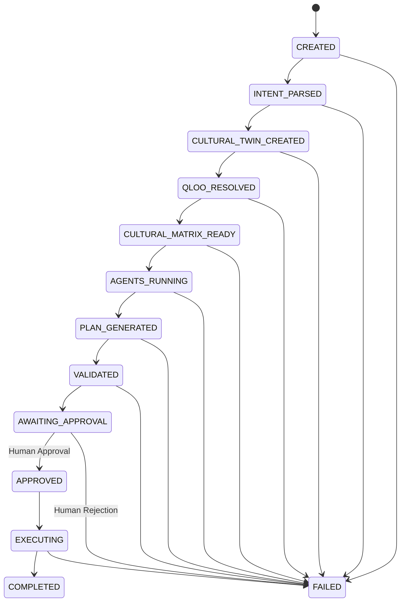

# TasteOps Cultural Intelligence — Integration Contract

**Document Version:** 1.0.0  
**Domain:** Cultural Intelligence Infrastructure (Developer 1)  
**Consumers:** Agent Orchestrator (Member 2), Music/Domain Integrations (Member 3), Backend Services  

---

## 1. Canonical Package Layout

```
TasteOps/
├── .env.example                      # Variable definitions (placeholder values only)
├── .gitignore                        # Secret & dataset exclusion rules
├── pyproject.toml                    # UV/PEP-621 build definition & script entry points
├── README.md                         # Package documentation
├── docs/
│   └── INTEGRATION_CONTRACT.md       # This integration specification
├── src/tasteops/
│   ├── __init__.py                   # Canonical public exports
│   ├── config.py                     # QlooSettings configuration
│   ├── cache.py                      # AsyncTTLCache and CacheBackend protocol
│   ├── client.py                     # QlooClient async transport
│   ├── exceptions.py                 # Normalized application exception hierarchy
│   ├── models/
│   │   ├── __init__.py               # Model exports
│   │   ├── entity.py                 # QlooEntity
│   │   ├── tag.py                    # QlooTag
│   │   ├── insight.py                # QlooInsight
│   │   ├── error.py                  # QlooError
│   │   ├── params.py                 # SearchParams, TagParams, InsightParams
│   │   ├── resolution.py             # EntityResolutionResult, TagResolutionResult, ResolutionEvidence
│   │   └── cultural_matrix.py        # CulturalTwin, CulturalMatrix, CulturalRecommendation
│   ├── services/
│   │   ├── __init__.py               # Service exports
│   │   ├── entity_resolver.py        # EntityResolver
│   │   ├── tag_resolver.py           # TagResolver
│   │   ├── insights_service.py       # InsightsService (entity capability manager)
│   │   └── cultural_matrix_service.py# CulturalMatrixService (concurrent multi-domain matrix)
│   └── mcp/
│       ├── __init__.py               # create_cultural_intelligence_mcp export
│       ├── schemas.py                # MCP tool input/output models
│       └── server.py                 # MCPServer tool registry and stdio entry point
└── tests/
    ├── conftest.py                   # Pytest fixtures and mock transport
    └── unit/
        ├── test_cache.py             # Async TTL cache tests
        ├── test_cultural_matrix_service.py # Capability, concurrency & fallback tests
        ├── test_mcp_server.py        # MCP tools and protocol tests
        ├── test_qloo_client.py       # Client retry, timeout, and auth exclusion tests
        └── test_resolvers.py         # Entity & tag resolution tests
```

---

## 2. Environment Variables

All variables are loaded automatically from the active environment or local `.env` file via `pydantic-settings`:

| Variable | Type | Default | Description |
| :--- | :--- | :--- | :--- |
| `QLOO_API_KEY` | `SecretStr` | **Required** | Hackathon Qloo API key (never logged or serialized) |
| `QLOO_BASE_URL` | `str` | `https://hackathon.api.qloo.com` | Base API gateway host |
| `QLOO_TIMEOUT_SECONDS` | `float` | `15.0` | HTTP transport request timeout |
| `QLOO_MAX_RETRIES` | `int` | `3` | Maximum retry attempts for transient errors (429, 5xx) |
| `QLOO_RETRY_BACKOFF_FACTOR` | `float` | `0.5` | Exponential backoff factor (seconds) |
| `QLOO_CACHE_ENABLED` | `bool` | `true` | In-memory asyncio-safe TTL cache |
| `QLOO_CACHE_TTL_SECONDS` | `int` | `3600` | TTL in seconds for cached GET responses |

---

## 3. Installation & Startup Commands

### Dependency Installation
```bash
# Clone the repository
git clone https://github.com/maitray-agrawal/TasteOps.git
cd TasteOps

# Install dependencies using uv
uv sync
```

### Running Test Suite & Linting
```bash
# Run all unit tests
uv run pytest -v

# Run linter
uv run ruff check src tests

# Run type checker
uv run mypy src
```

---

## 4. MCP Server Command & Transport

The MCP server communicates using standard **`stdio`** JSON-RPC protocol.

### CLI Launch Command
```bash
uv run tasteops-mcp
```

### Programmatic Setup (Python Orchestrator)
```python
from tasteops.mcp import create_cultural_intelligence_mcp

server = create_cultural_intelligence_mcp()
# Run directly or mount as needed
```

---

## 5. Registered MCP Tools & Argument Schemas

The MCP server exposes 10 high-level tools. Raw HTTP calls to Qloo (e.g. `call_qloo`) are strictly prohibited and not exposed.

### 5.1. `health_check`
- **Description:** Verifies server readiness, Qloo base URL configuration, and returns diagnostic metrics.
- **Arguments:** None.

### 5.2. `resolve_entity`
- **Description:** Resolves natural language cultural anchor strings (venue, artist, brand) into verified Qloo entity IDs.
- **Arguments:**
  - `query` (`str`, required): Natural language anchor (e.g. `"Blue Bottle"`, `"A24"`).
  - `expected_type` (`str | None`, optional): Domain hint (`"place"`, `"brand"`, `"artist"`).
  - `min_confidence` (`float`, default `0.5`): Minimum score `[0.0 - 1.0]` required to accept match.

### 5.3. `resolve_tag`
- **Description:** Resolves aesthetic motifs, vibes, or genre terms into verified Qloo taxonomy tags. Rejects unknown tags.
- **Arguments:**
  - `query` (`str`, required): Natural language motif (e.g. `"Japanese minimalism"`, `"lo-fi beats"`).
  - `expected_category` (`str | None`, optional): Category hint (`"style"`, `"music"`, `"dining"`).
  - `min_confidence` (`float`, default `0.5`): Minimum acceptance threshold.

### 5.4. `get_cultural_profile`
- **Description:** Produces an instant cross-domain taste profile for an anchor entity.
- **Arguments:**
  - `entity_id` (`str | None`): Verified Qloo entity ID.
  - `entity_name` (`str | None`): Alternative entity name (resolved automatically if `entity_id` omitted).
  - `take` (`int`, default `5`): Recommendations per domain.

### 5.5. Domain-Specific Affinity Tools
- **`get_related_artists`**: `anchor_entities: list[str]`, `resolved_tags: list[str]`, `take: int = 10`
- **`get_related_books`**: `anchor_entities: list[str]`, `resolved_tags: list[str]`, `take: int = 10`
- **`get_related_brands`**: `anchor_entities: list[str]`, `resolved_tags: list[str]`, `take: int = 10`
- **`get_related_places`**: `anchor_entities: list[str]`, `resolved_tags: list[str]`, `latitude: float | None`, `longitude: float | None`, `radius_meters: int = 5000`, `take: int = 10`
- **`get_related_movies`**: `anchor_entities: list[str]`, `resolved_tags: list[str]`, `take: int = 10`

### 5.6. `get_cultural_matrix`
- **Description:** Assembles a holistic 6-domain CulturalMatrix for a physical space's `CulturalTwin` concurrently.
- **Arguments:**
  - `cultural_twin` (`dict`, required): Object adhering to the [`CulturalTwin`](file:///d:/TasteOps/src/tasteops/models/cultural_matrix.py#L35-L53) schema.
  - `take_per_category` (`int`, default `10`): Max items per category.

---

## 6. Return Schemas & Representative Sanitized Examples

### Example: `resolve_entity` Output
```json
{
  "request_id": "9b1deb4d-3b7d-4bad-9bdd-2b0d7b3dcb6d",
  "is_resolved": true,
  "input": "A24",
  "resolved_entity_id": "ent_a24_film",
  "entity_name": "A24",
  "entity_type": "brand",
  "confidence": 1.0,
  "source": "qloo_search",
  "evidence": {
    "source": "qloo_search",
    "raw_query": "A24",
    "normalized_query": "A24",
    "match_method": "exact_match",
    "score": 1.0,
    "timestamp": "2026-10-24T18:00:00Z",
    "metadata": {
      "candidate_count": 2,
      "top_candidate_name": "A24"
    }
  },
  "alternatives_count": 1,
  "alternatives": [
    {
      "entity": {
        "id": "ent_a24_music",
        "name": "A24 Music",
        "type": "brand"
      },
      "confidence": 0.82,
      "match_reason": "token_subset_match"
    }
  ],
  "latency_ms": 14.2
}
```

### Example: `get_cultural_matrix` Output
```json
{
  "request_id": "4a2f8c12-32a1-432d-94bb-11a2f9c8e100",
  "status": "success",
  "total_recommendations": 12,
  "latency_ms": 112.5,
  "cultural_matrix": {
    "artists": [
      {
        "id": "ent_four_tet",
        "name": "Four Tet",
        "type": "artist",
        "affinity": 0.94,
        "score": 94.0,
        "confidence": 0.94,
        "source_query": "/v2/insights?filter.type=urn:entity:artist",
        "source_signal": {
          "anchor_entities": ["ent_blue_bottle_123"],
          "resolved_tags": ["tag_lofi_beats"]
        },
        "explainability": ["High audience overlap with Blue Bottle patrons"]
      }
    ],
    "books": [],
    "brands": [],
    "places": [],
    "movies": [],
    "destinations": [],
    "evidence": [
      {
        "category": "artist",
        "message": "Successfully retrieved recommendations using direct signals.",
        "timestamp": "2026-10-24T18:00:00Z",
        "signals_used": ["ent_blue_bottle_123", "tag_lofi_beats"]
      }
    ],
    "query_metadata": [
      {
        "category": "artist",
        "filter_type": "urn:entity:artist",
        "status": "success",
        "retries": 0,
        "items_count": 1,
        "latency_ms": 45.2,
        "params_used": {
          "filter.type": "urn:entity:artist",
          "signal.interests.entities": "ent_blue_bottle_123",
          "take": "10"
        }
      }
    ]
  }
}
```

---

## 7. Error Envelope Format

Tool executions return structured JSON error envelopes rather than raw exceptions:

```json
{
  "request_id": "00dfb59a-1b79-45ac-98a5-757ec1170ddf",
  "status": "error",
  "error": "Qloo authentication failed (HTTP 401): API key provided is invalid or expired.",
  "cultural_matrix": null
}
```

---

## 8. Consumer Guidelines

### For Member 2 (Agent Orchestrator)
1. **Never pass raw strings directly into recommendation engines**: Always call `resolve_entity` or `resolve_tag` first to acquire verified Qloo IDs.
2. **Respect `is_resolved`**: If `is_resolved == False`, the anchor was rejected or below threshold. Prompt the user for clarification rather than hallucinating an entity.
3. **Use `get_cultural_matrix` for spaces**: Pass a structured `CulturalTwin` containing resolved IDs. Inspect `query_metadata` to understand which categories required fallback.

### For Member 3 (Spotify & Media Integrations)
1. Use `matrix.artists` directly. Each artist recommendation retains the verified `id`, `name`, `affinity`, and `explainability`.
2. Map `artist.name` directly into the Spotify Search API (`/v1/search?q={artist.name}&type=artist`).
3. Leverage `affinity` scores to weight track selection or generate atmospheric playlist track counts.

---

## 9. Known Boundaries & Limitations

1. **Authentication Failures (401, 403)**: Are never retried automatically. The system raises `QlooAuthenticationError` immediately to avoid locking API keys.
2. **Spatial Filters Restricted**: Geographic location filters (`latitude`, `longitude`, `radius`) are only applied to `place` and `destination`. They are automatically omitted from queries for `artist`, `book`, `brand`, and `movie`.
3. **Deterministic Single-Retry**: If a category returns 0 items, the service applies one deterministic fallback (broadened radius or dropped tag constraints) and retries once. If results remain empty, it returns `[]` without fabricating data.

---

## 10. Agent Intelligence & Orchestration Architecture (Developer 2)

### 10.1. Workflow Philosophy & Boundaries
- **No Unrestricted Autonomous Loops**: Agents operate within deterministic workflow boundaries governed by `WorkflowEngine`.
- **Decoupled Transport**: Agents **NEVER** call Qloo REST APIs directly; all cultural intelligence is routed through `CulturalIntelligenceMCPAdapter` invoking the TasteOps Cultural Intelligence MCP Server.
- **Strict Provenance & Anti-Hallucination**: Every Qloo entity ID, tag, and cultural recommendation used in activations, spatial zones, or brand partnerships must match verified evidence from Qloo resolution and insights. Hallucinated IDs are flagged and rejected by the Governance Agent.
- **Human Approval Gate**: Execution cannot occur without explicit human approval at `AWAITING_APPROVAL`.

### 10.2. Explicit 13 Workflow States
The system strictly enforces valid state transitions:



| State | Role & Responsibilities |
| :--- | :--- |
| `CREATED` | Session initialized with raw intent. |
| `INTENT_PARSED` | User intent decomposed into structured domain hints, venue type, and raw terms. |
| `CULTURAL_TWIN_CREATED` | Structured `CulturalTwin` draft formed. |
| `QLOO_RESOLVED` | Raw terms and motifs resolved to verified Qloo entity IDs and tags via MCP tools. |
| `CULTURAL_MATRIX_READY` | 6-domain CulturalMatrix fetched concurrently via MCP `get_cultural_matrix`. |
| `AGENTS_RUNNING` | Specialized agents invoked concurrently (Strategist, Architect, Partnership). |
| `PLAN_GENERATED` | Agent outputs synthesized into unified `CulturalActivationPlan`. |
| `VALIDATED` | `GovernanceAgent` audits provenance, ensures 0 invented IDs, checks compliance. |
| `AWAITING_APPROVAL` | Pipeline pauses; awaits human curator review. |
| `APPROVED` | Human curator approves activation plan. |
| `EXECUTING` | Downstream physical space tasks executed (Spotify playlists, lighting cues, signage). |
| `COMPLETED` | All execution tasks completed with verifiable provenance. |
| `FAILED` | Workflow halted due to validation failure or curator rejection. |

### 10.3. The 4 Specialized Agents

1. **Cultural Strategist (`CulturalStrategist`)**:
   - Synthesizes space positioning statements and cultural pillars.
   - Anchors pillars to verified Qloo entity IDs with cross-domain justification.
2. **Experience Architect (`ExperienceArchitect`)**:
   - Designs sonic identities, morning/afternoon/evening daypart programs, and spatial zoning (e.g., Main Bar, Listening Room).
   - Pairs sensory atmosphere (lighting, audio, scent) with verified Qloo artists.
3. **Partnership Agent (`PartnershipAgent`)**:
   - Formulates commercial and residency brand activations with high affinity scores.
   - Requires verified Qloo brand/place IDs with affinity-backed provenance.
4. **Governance / Execution Agent (`GovernanceAgent`)**:
   - **Audit Phase**: Audits all proposed entity IDs against verified Qloo IDs. Fails validation if hallucinated IDs are detected.
   - **Approval Phase**: Enforces human gate at `AWAITING_APPROVAL`.
   - **Execution Phase**: Generates concrete hardware/software tasks (Spotify playlist, signage, staff briefings) with provenance logs.

### 10.4. Programmatic Workflow Example
```python
from tasteops.agents.mcp_adapter import CulturalIntelligenceMCPAdapter
from tasteops.workflows.engine import WorkflowEngine
from tasteops.workflows.states import WorkflowState

# Initialize engine with MCP adapter (no REST API calls)
adapter = CulturalIntelligenceMCPAdapter()
engine = WorkflowEngine(mcp_adapter=adapter)

# 1. Run pipeline up to human approval gate
ctx = await engine.run_pipeline_to_approval_gate(
    raw_intent="Open an analog vinyl listening cafe with Japanese minimalism in Chelsea",
    parsed_hints={
        "venue_name": "Kissa Chelsea",
        "raw_anchor_entities": ["Blue Bottle", "A24"],
        "raw_tags": ["Japanese minimalism", "audiophile"],
        "location": {"latitude": 40.7484, "longitude": -73.9857, "radius_meters": 2000},
    },
)

assert ctx.current_state == WorkflowState.AWAITING_APPROVAL
print(f"Validation passed: {ctx.plan.governance_report.validation_passed}")

# 2. Human Curator reviews & approves
await engine.approve_plan(ctx, approved_by="Curator: Maitray Agrawal")
assert ctx.current_state == WorkflowState.APPROVED

# 3. Execute downstream tasks
await engine.execute_plan(ctx)
assert ctx.current_state == WorkflowState.COMPLETED
print(f"Executed {ctx.plan.execution_summary.executed_tasks} physical tasks.")
```

