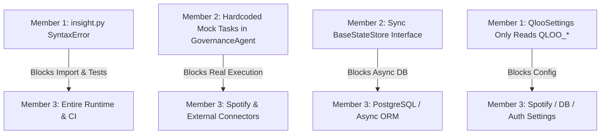
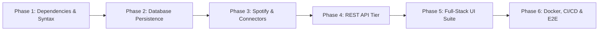

# Member 3 Gap Audit & Architecture Readiness Report

**Project:** TasteOps — Cultural Intelligence Operating System for Physical Spaces  
**Audit Target:** Member 3 Scope (Full-Stack Delivery, REST API, Database Integration, UI Suite, External Execution Connectors, Docker, CI/CD, Integration & E2E Testing)  
**Repository State:** `TasteOps-feature-cultural-intelligence-core`  
**Date of Audit:** October 2026  
**Auditor:** Autonomous Systems Auditor  

---

## 1. Executive Summary

This audit evaluates the TasteOps codebase specifically through the lens of **Member 3's responsibilities**: delivering the client-facing application, REST API layer, relational/persistent database integration, human approval and execution user interfaces, real external execution connectors (notably Spotify and partner outreach), Dockerization, CI/CD pipelines, integration/E2E test suites, and system documentation.

The codebase represents work delivered by **Member 1** (Qloo Cultural Intelligence Infrastructure, models, and MCP server) and **Member 2** (Agent Orchestration, 13-state deterministic workflow engine, and Governance Agent). 

### High-Level Status Summary

| Area | Status | Key Findings |
| :--- | :--- | :--- |
| **1. API** | `MISSING` | No REST/GraphQL API framework (FastAPI/Starlette) installed or implemented. Only stdio MCP JSON-RPC exists. |
| **2. Application / Service Layer** | `PARTIALLY IMPLEMENTED` | Member 1/2 domain and agent services exist, but Member 3 execution dispatchers, music/audio services, and API controllers are absent. |
| **3. Database Integration** | `PARTIALLY IMPLEMENTED` | Only in-memory (`InMemoryStateStore`) and filesystem JSON/JSONL (`FileStateStore`) exist. No relational database, ORM, or migrations. |
| **4. Frontend** | `MISSING` | Zero frontend files, packages (`package.json`), or web assets exist in the workspace. |
| **5. Approval UI** | `MISSING` | Backend state transitions (`AWAITING_APPROVAL` -> `APPROVED`/`FAILED`) exist, but no visual interface or human curation portal exists. |
| **6. Execution UI** | `MISSING` | Backend task models (`ExecutionTask`, `ExecutionSummary`) exist, but no real-time task runner or progress UI exists. |
| **7. Audit / Decision Ledger UI** | `MISSING` | Append-only `audit_events.jsonl` and `AuditEvent` exist in backend, but no visual audit trail or timeline ledger exists. |
| **8. External Execution Connectors** | `PARTIALLY IMPLEMENTED` | `GovernanceAgent` emits mock strings (`spotify://seed_artist/...`). No real Spotify API, Sonos, or email/CRM connectors exist. |
| **9. Integration Tests** | `MISSING` | All existing tests are unit tests using `respx` in-memory HTTP mocking. No live API, DB, or cross-service integration tests exist. |
| **10. E2E Tests** | `MISSING` | Zero browser E2E tests (Playwright/Cypress) or full multi-tier execution tests exist. |
| **11. Security** | `PARTIALLY IMPLEMENTED` | Qloo API key masking is implemented; API auth, JWT/OAuth2, RBAC, CORS, and external credential management are missing. |
| **12. Docker** | `MISSING` | No `Dockerfile`, `docker-compose.yml`, or `.dockerignore` exist anywhere in the repository. |
| **13. CI** | `MISSING` | No `.github/workflows/` or any CI configuration exists. |
| **14. CD** | `MISSING` | No deployment pipelines, container registries, or hosting configurations exist. |
| **15. Documentation** | `PARTIALLY IMPLEMENTED` | Member 1/2 integration contract is comprehensive; Member 3 API, frontend, deployment, and connector docs are missing. |

### Critical Blockers & Showstoppers Identified

1. **`SyntaxError` in Member 1 Codebase (`src/tasteops/models/insight.py:64, 77`) — BLOCKED BY MEMBER 1 CONTRACT**:
   - Lines 64 and 77 use Python 2 syntax: `except ValueError, TypeError:`.
   - In Python 3 (including Python 3.13/3.14), this raises an immediate `SyntaxError: multiple exception types must be parenthesized`.
   - Because `tasteops/__init__.py` imports `tasteops.agents`, which imports `architect`, which imports `cultural_matrix`, which imports `models`, which imports `insight`, **the entire package fails on import**. Any attempt to run `pytest` or import `tasteops` crashes.
2. **Hardcoded Mock Dispatch in Member 2 `GovernanceAgent` — BLOCKED BY MEMBER 2 CONTRACT**:
   - `GovernanceAgent.execute_plan()` directly synthesizes mock tasks and marks them `"EXECUTED"` with dummy URI strings like `spotify://seed_artist/{lead_artist.id}`.
   - There is no pluggable `ExecutionDispatcher` or connector registry allowing Member 3 to intercept and route execution tasks to real Spotify/hardware APIs without monkeypatching or modifying Member 2 code.
3. **Synchronous Persistence Contract (`BaseStateStore`) — BLOCKED BY MEMBER 2 CONTRACT**:
   - `BaseStateStore.save_transition()` is synchronous. Production async database drivers (`asyncpg`, `SQLAlchemy[asyncio]`) cannot be awaited without bridging hacks or thread pools unless an asynchronous interface is provided.

---

## 2. Repository Architecture & Inspection Inventory

The workspace was inspected across all files, configuration manifests, and directories:

```
TasteOps/
└── TasteOps-feature-cultural-intelligence-core/
    ├── .env.example
    ├── .gitignore
    ├── .python-version
    ├── README.md
    ├── pyproject.toml
    ├── uv.lock
    ├── docs/
    │   └── INTEGRATION_CONTRACT.md
    ├── src/tasteops/
    │   ├── __init__.py
    │   ├── cache.py
    │   ├── client.py
    │   ├── config.py
    │   ├── exceptions.py
    │   ├── py.typed
    │   ├── agents/
    │   │   ├── __init__.py
    │   │   ├── architect.py
    │   │   ├── governance.py
    │   │   ├── mcp_adapter.py
    │   │   ├── partnership.py
    │   │   └── strategist.py
    │   ├── mcp/
    │   │   ├── __init__.py
    │   │   ├── schemas.py
    │   │   └── server.py
    │   ├── models/
    │   │   ├── __init__.py
    │   │   ├── cultural_matrix.py
    │   │   ├── entity.py
    │   │   ├── error.py
    │   │   ├── insight.py        <-- Contains Python 2 SyntaxError (lines 64 & 77)
    │   │   ├── params.py
    │   │   ├── resolution.py
    │   │   └── tag.py
    │   ├── services/
    │   │   ├── __init__.py
    │   │   ├── cultural_matrix_service.py
    │   │   ├── entity_resolver.py
    │   │   ├── insights_service.py
    │   │   └── tag_resolver.py
    │   └── workflows/
    │       ├── __init__.py
    │       ├── context.py
    │       ├── engine.py
    │       ├── persistence.py
    │       ├── schemas.py
    │       └── states.py
    └── tests/
        ├── conftest.py
        └── unit/
            ├── test_agents.py
            ├── test_cache.py
            ├── test_cultural_matrix_service.py
            ├── test_mcp_server.py
            ├── test_qloo_client.py
            ├── test_resolvers.py
            └── test_workflow.py
```

### Manifest & Environment Findings
- **Git State:** No `.git` metadata folder exists in the directory. The folder name `TasteOps-feature-cultural-intelligence-core` indicates an unpacked source archive from branch `feature/cultural-intelligence-core`.
- **Package Configuration (`pyproject.toml`):**
  - Declared dependencies: `httpx>=0.28.1`, `mcp>=2.3.0`, `pydantic>=2.14.1`, `pydantic-settings>=2.16.1`.
  - Declared dev dependencies: `mypy>=2.4.0`, `pytest>=9.1.1`, `pytest-asyncio>=1.4.0`, `respx>=0.23.1`, `ruff>=0.17.2`.
  - Entry points: Only `tasteops-mcp = "tasteops.mcp.server:main"`.
  - **Missing Dependencies for Member 3:** No web framework (`fastapi`, `uvicorn`), no database driver/ORM (`sqlalchemy`, `asyncpg`, `aiosqlite`, `alembic`), no media/music client (`spotipy`, `tekore`), no auth/security packages (`python-jose`, `passlib`, `pyjwt`).
- **Frontend Configuration:** Total absence of `package.json`, `tsconfig.json`, `vite.config.*`, or web templates.
- **Docker & CI/CD:** Total absence of `Dockerfile`, `docker-compose.yml`, `.dockerignore`, or `.github/workflows/`.

---

## 3. Detailed Audit by Area (1 to 15)

---

### Area 1: API
- **Status:** `MISSING`
- **What Already Exists:**
  - An MCP stdio JSON-RPC server ([server.py](file:///c:/Users/Admin/Desktop/Tasteops/TasteOps-feature-cultural-intelligence-core/src/tasteops/mcp/server.py)) exposing 10 tools (`health_check`, `resolve_entity`, `resolve_tag`, `get_cultural_profile`, `get_related_artists`, `get_related_books`, `get_related_brands`, `get_related_places`, `get_related_movies`, `get_cultural_matrix`).
  - `httpx` is in `pyproject.toml`, but only used as an outbound HTTP client for Qloo.
- **What is Missing:**
  - No HTTP REST API or GraphQL API server.
  - No web framework dependency (`fastapi`, `starlette`, `uvicorn`, `litestar`) declared in `pyproject.toml`.
  - No API routing layer (`routers/`, `api/`, `controllers/`).
  - No REST endpoints for:
    - Initiating physical space sessions (`POST /api/v1/sessions`).
    - Fetching current workflow state snapshot (`GET /api/v1/sessions/{id}`).
    - Submitting human approval / rejection decisions (`POST /api/v1/sessions/{id}/approve`, `POST /api/v1/sessions/{id}/reject`).
    - Polling or streaming task execution progress (`GET /api/v1/sessions/{id}/tasks`, `WS /api/v1/sessions/{id}/stream`).
    - Fetching the immutable audit ledger (`GET /api/v1/sessions/{id}/audit`).
  - No OpenAPI / Swagger documentation endpoint.
- **Tests & Verification:**
  - Zero API tests exist. All tests mock Qloo HTTP via `respx` inside Python functions.
- **Contract & Blockers:**
  - Member 1 and Member 2 provided direct Python classes (`WorkflowEngine`, `CulturalTwin`), but no HTTP wrapper. Member 3 must implement the entire FastAPI application tier.

---

### Area 2: Application / Service Layer
- **Status:** `PARTIALLY IMPLEMENTED`
- **What Already Exists:**
  - Cultural intelligence core services ([src/tasteops/services/](file:///c:/Users/Admin/Desktop/Tasteops/TasteOps-feature-cultural-intelligence-core/src/tasteops/services/)): `EntityResolver`, `TagResolver`, `InsightsService`, `CulturalMatrixService`.
  - Agent services ([src/tasteops/agents/](file:///c:/Users/Admin/Desktop/Tasteops/TasteOps-feature-cultural-intelligence-core/src/tasteops/agents/)): `CulturalStrategist`, `ExperienceArchitect`, `PartnershipAgent`, `GovernanceAgent`.
  - Workflow orchestrator ([src/tasteops/workflows/engine.py](file:///c:/Users/Admin/Desktop/Tasteops/TasteOps-feature-cultural-intelligence-core/src/tasteops/workflows/engine.py)): `WorkflowEngine` managing the 13 states.
- **What is Missing:**
  - **Member 3 Application Services**:
    - **Execution Dispatch Service**: Service that takes `ExecutionTask` payloads post-approval and delegates to real external execution connectors.
    - **Music & Media Curation Service**: Service consuming `matrix.artists` and `ExperienceArchitect.sonic_identity` to search Spotify, query audio features (danceability, energy, acousticness), filter tracks according to daypart decibel and mood specifications, and generate actual Spotify playlists.
    - **Partner Outreach Service**: Service consuming `BrandPartnershipCandidate.outreach_draft` to format, export, and dispatch collaboration proposals.
    - **Spatial Spec Generation Service**: Service generating production-ready acoustic/lighting specification sheets from `SpatialZone` and `AtmosphereGuidelines`.
    - **Session Coordination Service**: High-level application service coordinating state persistence, background workflow dispatch, and frontend client notifications.
- **Tests & Verification:**
  - Domain services have unit tests in `tests/unit/test_resolvers.py` and `tests/unit/test_cultural_matrix_service.py`. Execution and media services have zero implementations and zero tests.
- **Contract & Blockers:**
  - Blocked by `GovernanceAgent.execute_plan()` hardcoding task generation internally rather than delegating to an injectable `ExecutionDispatcher`.

---

### Area 3: Database Integration
- **Status:** `PARTIALLY IMPLEMENTED`
- **What Already Exists:**
  - [persistence.py](file:///c:/Users/Admin/Desktop/Tasteops/TasteOps-feature-cultural-intelligence-core/src/tasteops/workflows/persistence.py) provides:
    - `BaseStateStore`: Abstract interface with `save_transition`, `save_context`, `load_context`, `get_audit_events`.
    - `InMemoryStateStore`: In-memory dictionary store for tests.
    - `FileStateStore`: Writes `workflow_state.json` and append-only `audit_events.jsonl` under `storage/workflows/{session_id}/`.
  - [cache.py](file:///c:/Users/Admin/Desktop/Tasteops/TasteOps-feature-cultural-intelligence-core/src/tasteops/cache.py): `AsyncTTLCache` in-memory TTL cache.
- **What is Missing:**
  - No relational database (PostgreSQL, SQLite) integration.
  - No ORM or query builder (`SQLAlchemy`, `SQLModel`, `asyncpg`, `tortoise-orm`).
  - No database migration tool (`Alembic`).
  - No database models for:
    - `SessionModel` (session ID, intent, current state, timestamps).
    - `CulturalTwinModel`, `CulturalMatrixModel`.
    - `PlanModel` (activation plan, strategy, experience, partnerships, governance).
    - `ExecutionTaskModel` (task ID, category, status, input, output reference, provenance).
    - `AuditEventModel` (event ID, session ID, from/to state, approver, reason, timestamp).
  - File-based persistence cannot support concurrent web queries, filtering, indexing, or ACID transactions.
- **Tests & Verification:**
  - `test_workflow_persists_audit_events_and_transitions` in `test_workflow.py` tests `FileStateStore`. No database tests exist.
- **Contract & Blockers:**
  - **BLOCKED BY MEMBER 2 CONTRACT**: `BaseStateStore.save_transition` and `BaseStateStore.save_context` are synchronous:
    ```python
    def save_transition(self, event: AuditEvent, ctx: WorkflowContext) -> None:
    ```
    To support async database engines (`asyncpg` / `SQLAlchemy[asyncio]`), `BaseStateStore` must support `async def` or Member 3 must wrap DB calls in sync runners or provide an `AsyncBaseStateStore`.

---

### Area 4: Frontend
- **Status:** `MISSING`
- **What Already Exists:**
  - Zero frontend code, markup, or styling exists.
- **What is Missing:**
  - Single Page Application (SPA) or Web Application (Next.js, Vite + React, or Vanilla HTML/CSS/JS).
  - Modern design system reflecting the aesthetic caliber of TasteOps (curated color tokens, dark mode, typography, glassmorphism, micro-animations).
  - Client state management and API communication layer (fetching sessions, streaming workflow state changes).
  - Physical space brief entry form (venue type, location, target audience, mood, budget, natural language anchors).
  - Interactive cultural twin and cultural matrix visualization (artists, books, brands, places).
- **Tests & Verification:**
  - Zero UI tests or snapshots exist.
- **Contract & Blockers:**
  - None directly from contracts; purely missing implementation assigned to Member 3.

---

### Area 5: Approval UI
- **Status:** `MISSING`
- **What Already Exists:**
  - Member 2 backend models:
    - State machine gate: `WorkflowState.AWAITING_APPROVAL` ([states.py](file:///c:/Users/Admin/Desktop/Tasteops/TasteOps-feature-cultural-intelligence-core/src/tasteops/workflows/states.py)).
    - Engine methods: `engine.approve_plan(ctx, approver=...)`, `engine.reject_plan(ctx, reason=...)` ([engine.py](file:///c:/Users/Admin/Desktop/Tasteops/TasteOps-feature-cultural-intelligence-core/src/tasteops/workflows/engine.py)).
    - Structured compliance report: `GovernanceValidationOutput` with `is_valid`, `provenance_verified`, `compliance_checks`, `risk_flags`, and `readiness_score` ([schemas.py](file:///c:/Users/Admin/Desktop/Tasteops/TasteOps-feature-cultural-intelligence-core/src/tasteops/workflows/schemas.py)).
- **What is Missing:**
  - Human curator approval interface:
    - Review dashboard rendering the synthesized `CulturalActivationPlan`.
    - Visual display of the 7-point compliance checklist (showing green/red status for evidence audit, conflicting recommendations, budget violations, zero-hallucination provenance, confidence thresholds, duplicate actions, and unsupported actions).
    - Budget breakdown display ($12,500 total, with granular allocation for audio, tableware, outreach, hospitality, programming).
    - Sign-off modal capturing curator name/role and cryptographic or timestamped approval signature.
    - Curatorial rejection modal capturing structured feedback that triggers the bounded loop back to `PLAN_GENERATED`.
- **Tests & Verification:**
  - Backend rejection and approval states are tested in `tests/unit/test_workflow.py` (`test_human_rejection_at_approval_gate`, `test_full_workflow_to_completion`), but zero UI tests exist.
- **Contract & Blockers:**
  - Fully defined in Member 2 schemas; awaiting Member 3 UI construction.

---

### Area 6: Execution UI
- **Status:** `MISSING`
- **What Already Exists:**
  - Backend states: `WorkflowState.EXECUTING` and `WorkflowState.COMPLETED`.
  - Backend schemas: `ExecutionPlanAction`, `ExecutionPlan`, `ExecutionTask`, `ExecutionSummary` ([schemas.py](file:///c:/Users/Admin/Desktop/Tasteops/TasteOps-feature-cultural-intelligence-core/src/tasteops/workflows/schemas.py)).
- **What is Missing:**
  - Real-time execution dashboard:
    - Visual timeline of action items (`act_sonic_01`, `act_brand_01`, `act_partner_01`, `act_hospitality_01`, `act_prog_01`).
    - Dependency graph rendering showing prerequisites (e.g. `act_brand_01` waiting on `act_sonic_01`).
    - Task execution cards displaying status (`PENDING`, `EXECUTING`, `EXECUTED`, `FAILED`), assigned owner (`Audio Curator`, `Spatial Designer`, `Partnership Director`), and live execution timestamps.
    - Clickable output references: Direct links to the generated Spotify playlist URL, outreach email draft modal, and spatial design spec card.
- **Tests & Verification:**
  - Zero UI execution tests.
- **Contract & Blockers:**
  - Dependent on Member 3 building the WebSocket/SSE stream and frontend task view.

---

### Area 7: Audit / Decision Ledger UI
- **Status:** `MISSING`
- **What Already Exists:**
  - Backend models: `AuditEvent` (`event_id`, `session_id`, `from_state`, `to_state`, `timestamp`, `reason`, `metadata`, `error`), `StateTransitionRecord`, and `AuditReport` ([schemas.py](file:///c:/Users/Admin/Desktop/Tasteops/TasteOps-feature-cultural-intelligence-core/src/tasteops/workflows/schemas.py), [persistence.py](file:///c:/Users/Admin/Desktop/Tasteops/TasteOps-feature-cultural-intelligence-core/src/tasteops/workflows/persistence.py)).
  - Disk storage: `FileStateStore` writing append-only `audit_events.jsonl`.
- **What is Missing:**
  - Audit Ledger UI:
    - Interactive chronological timeline tracing every step from `CREATED` through `COMPLETED`.
    - Detailed event inspector showing state transition metadata, reason, timestamp, and approver identity.
    - Provenance verification drawer showing Qloo entity IDs (`ent_...`), affinity scores, raw query endpoints, and explainability strings proving zero hallucinated data.
    - Post-execution compliance badge (`COMPLIANT` vs `FLAGGED`) displaying the results of the post-execution audit.
    - Search and filter controls by session ID, state, or timestamp.
- **Tests & Verification:**
  - Unit tests verify backend audit creation in `test_agents.py` (`test_governance_agent_executes_tasks_with_provenance_and_audit`), but no UI exists.
- **Contract & Blockers:**
  - None; backend audit schemas and file persistence are ready to be consumed by Member 3.

---

### Area 8: External Execution Connectors
- **Status:** `PARTIALLY IMPLEMENTED`
- **What Already Exists:**
  - `GovernanceAgent.SUPPORTED_CATEGORIES`: Defines 5 authorized external categories:
    `{"spotify_audio_seed", "partner_outreach_brief", "spatial_design_spec", "curatorial_programming", "hospitality_training"}`.
  - In `GovernanceAgent.execute_plan()` ([governance.py:518-610](file:///c:/Users/Admin/Desktop/Tasteops/TasteOps-feature-cultural-intelligence-core/src/tasteops/agents/governance.py#L518-L610)), mock execution tasks are created with simulated output strings (`spotify://seed_artist/{lead_artist.id}`, `brief://partner/{partner_id}`, `spec://zone/{zone_name}`).
  - `INTEGRATION_CONTRACT.md` (Section 8.2) defines the intended contract:
    - Map `matrix.artists[i].name` to Spotify Search API (`/v1/search?q={name}&type=artist`).
    - Use `affinity` score to weight track selection or generate atmospheric playlist track counts.
- **What is Missing:**
  - **Real External Connectors**:
    1. **Spotify Web API Connector**:
       - OAuth2 authentication (Client Credentials flow for public artist/track metadata; Authorization Code with PKCE or refresh token for user playlist creation).
       - Artist search and catalog resolution (`/v1/search`, `/v1/artists/{id}/top-tracks`).
       - Audio features analysis (`/v1/audio-features`) to match energy, acousticness, tempo, and valence to `SonicIdentity` and daypart requirements.
       - Playlist generator creating a named physical-space playlist (e.g. *"Kissa Chelsea — Evening Focus"*) and populating track URIs.
    2. **Hardware / Sound System Connector**:
       - Integration stub or client for Sonos API, Wiim, or analog playback controllers.
    3. **Partner Outreach Connector**:
       - Dispatcher for exploratory outreach drafts via email (SendGrid, Resend, SMTP) or CRM/Notion webhook.
    4. **Spatial Spec Exporter**:
       - Exporter compiling spatial zoning, lighting color temperature (2400K), and acoustic decibel ceilings into formatted markdown/PDF briefs.
- **Tests & Verification:**
  - Only mock task synthesis is tested in `test_agents.py`. No external API tests or mocked integration tests for Spotify exist.
- **Contract & Blockers:**
  - **BLOCKED BY MEMBER 2 CONTRACT**: `GovernanceAgent` directly instantiates `ExecutionTask` inside `execute_plan` without an extensible interface for external connectors. Member 3 needs an `ExecutionDispatcher` pattern to plug in real API connectors.

---

### Area 9: Integration Tests
- **Status:** `MISSING`
- **What Already Exists:**
  - Unit tests under `tests/unit/`:
    - `test_qloo_client.py`: Client retry, timeout, and 401 auth exclusion tests with `respx`.
    - `test_resolvers.py`: Entity and tag resolution logic with `respx`.
    - `test_cultural_matrix_service.py`: Matrix assembly and fallback logic with `respx`.
    - `test_mcp_server.py`: MCP tool protocol calls with `respx`.
    - `test_agents.py`: Four specialized agents with `respx`.
    - `test_workflow.py`: Workflow state machine transitions with `respx`.
    - `test_cache.py`: TTL cache behavior.
- **What is Missing:**
  - **No Live / Staging Integration Tests**: Zero tests verify behavior against live Qloo or live Spotify endpoints.
  - **No API Integration Tests**: No tests verifying HTTP requests against a FastAPI test client (`httpx.AsyncClient(app=...)`).
  - **No Database Integration Tests**: No tests verifying persistence, queries, rollbacks, and transactions against a real SQLite/PostgreSQL database.
  - **No Connector Integration Tests**: No tests simulating Spotify OAuth token refreshes, rate limits (429), or track addition failures.
- **Execution Blocker:**
  - Running `python -m pytest` currently fails catastrophically with `SyntaxError` in `src/tasteops/models/insight.py` (lines 64 & 77).
- **Contract & Blockers:**
  - Blocked by Member 1 syntax error; must be resolved before any integration test suite can execute.

---

### Area 10: E2E Tests
- **Status:** `MISSING`
- **What Already Exists:**
  - In-memory workflow test `test_full_workflow_to_completion` in `test_workflow.py`, but this is a pure unit test with mocked HTTP responses and in-memory state.
- **What is Missing:**
  - Browser-driven End-to-End tests (Playwright, Cypress) testing:
    - User entering venue brief in frontend form.
    - System displaying resolved cultural anchors and matrix.
    - System halting at `AWAITING_APPROVAL` with the human approval gate.
    - User reviewing the 7-point governance checklist and clicking "Approve".
    - System transitioning to `EXECUTING` and rendering live progress cards.
    - System completing execution with verified Spotify playlist links.
    - User inspecting the immutable audit ledger.
  - Multi-service Dockerized E2E test harness.
- **Tests & Verification:**
  - None.
- **Contract & Blockers:**
  - Awaits Member 3's frontend and API implementation.

---

### Area 11: Security
- **Status:** `PARTIALLY IMPLEMENTED`
- **What Already Exists:**
  - `QlooSettings` in `src/tasteops/config.py`: Uses `pydantic.SecretStr` for `QLOO_API_KEY`, masking keys as `***REDACTED***` in `__repr__`.
  - `QlooClient` in `src/tasteops/client.py`: Request logging strips headers containing API keys.
  - `.gitignore`: Specifically excludes `.env`, `.env.*`, and cached datasets.
  - `GovernanceAgent`: Blocks unapproved execution with `UnapprovedExecutionError` and rejects any hallucinated entity IDs not traceable to Qloo.
- **What is Missing for Member 3:**
  - **Authentication & Authorization**:
    - No user authentication system (OAuth2, JWT bearer tokens, session cookies).
    - No Role-Based Access Control (RBAC) to enforce that only users with the "Curator" or "Manager" role can approve plans.
  - **External API Credential Security**:
    - No configuration models for `SPOTIFY_CLIENT_ID`, `SPOTIFY_CLIENT_SECRET`, or Spotify access/refresh tokens.
  - **Web Security**:
    - No CORS (Cross-Origin Resource Sharing) middleware configured for web clients.
    - No Content Security Policy (CSP), rate limiting, or security headers.
- **Tests & Verification:**
  - Unit tests verify secret masking and unapproved execution rejection. Web security and authentication are completely untested.
- **Contract & Blockers:**
  - Member 3 must implement auth middleware, token signing, and secret settings.

---

### Area 12: Docker
- **Status:** `MISSING`
- **What Already Exists:**
  - None.
- **What is Missing:**
  - `Dockerfile.api`: Container definition for TasteOps backend API.
  - `Dockerfile.mcp`: Container definition for TasteOps MCP server (`tasteops-mcp`).
  - `Dockerfile.frontend`: Container definition for frontend application (or multi-stage build).
  - `docker-compose.yml`: Multi-container local orchestration configuring:
    - `api`: FastAPI backend service with live reload and volume mount.
    - `mcp`: MCP stdio or SSE server service.
    - `db`: PostgreSQL database with health check and persistent volume.
    - `frontend`: Vite/Next.js frontend development server.
  - `.dockerignore`: Optimizing container build context and preventing secret leaks.
- **Tests & Verification:**
  - None.
- **Contract & Blockers:**
  - None; purely infrastructure delivery for Member 3.

---

### Area 13: CI (Continuous Integration)
- **Status:** `MISSING`
- **What Already Exists:**
  - None. No `.github/` folder exists.
- **What is Missing:**
  - GitHub Actions workflow (`.github/workflows/ci.yml`) configuring:
    - Code linting with `ruff check src tests`.
    - Code formatting check with `ruff format --check src tests`.
    - Static type checking with `mypy src`.
    - Automated test execution with `pytest tests/unit/ -v`.
    - Integration test execution against test databases.
    - Docker container build and vulnerability scanning.
- **Tests & Verification:**
  - None.
- **Contract & Blockers:**
  - CI execution is currently blocked by the syntax error in `insight.py`.

---

### Area 14: CD (Continuous Deployment)
- **Status:** `MISSING`
- **What Already Exists:**
  - None.
- **What is Missing:**
  - GitHub Actions deployment workflow (`.github/workflows/cd.yml`).
  - Container registry publishing (GitHub Container Registry / Docker Hub).
  - Cloud deployment configurations (Kubernetes manifests, Terraform, or PaaS configurations for AWS ECS, GCP Cloud Run, Fly.io, or Render).
  - Automated database migration execution (`alembic upgrade head`) on deployment.
  - Health check ping and automated rollback on failure.
- **Tests & Verification:**
  - None.
- **Contract & Blockers:**
  - Awaits containerization and deployment target selection.

---

### Area 15: Documentation
- **Status:** `PARTIALLY IMPLEMENTED`
- **What Already Exists:**
  - [README.md](file:///c:/Users/Admin/Desktop/Tasteops/TasteOps-feature-cultural-intelligence-core/README.md): Architecture overview, MCP tools table, and test running instructions.
  - [docs/INTEGRATION_CONTRACT.md](file:///c:/Users/Admin/Desktop/Tasteops/TasteOps-feature-cultural-intelligence-core/docs/INTEGRATION_CONTRACT.md): Comprehensive 500-line specification detailing Member 1's Qloo infrastructure and Member 2's Agent Orchestration (13 states, 4 agents, governance checks, loop bounds, MCP schemas).
  - Section 8.2 of `INTEGRATION_CONTRACT.md` gives consumer guidelines for Member 3 (Spotify & Media Integrations).
- **What is Missing for Member 3:**
  - Member 3 Full-Stack Architecture specification.
  - REST API documentation (endpoints, request/response models, error codes).
  - Database schema diagrams and entity relationship documentation.
  - Spotify integration setup guide (Spotify Developer Dashboard, Client ID/Secret, redirect URIs, required OAuth scopes).
  - Frontend user manual and component guide.
  - Docker deployment and local setup guide.
- **Tests & Verification:**
  - Documentation exists for Members 1 and 2, but Member 3 technical documentation is missing.
- **Contract & Blockers:**
  - None.

---

## 4. Member 1 & Member 2 Contract Blocker Analysis

The audit uncovered several structural blockers in the existing Member 1 and Member 2 contracts that impact Member 3:



### Blocker 1: Python 2 SyntaxError in Member 1 Model
- **File:** `src/tasteops/models/insight.py`
- **Lines:** 64 and 77
- **Code:**
  ```python
  63:             else:
  64:                 data["affinity"] = 1.0
  65:             except ValueError, TypeError:
  66:                 data["affinity"] = 0.0
  ```
- **Impact:** Python 3 requires parenthesized tuples for multiple exceptions: `except (ValueError, TypeError):`. In its current form, **Python cannot compile or import `insight.py`**. Because `tasteops/__init__.py` imports the full agent and model suite, importing `tasteops` immediately raises:
  `SyntaxError: multiple exception types must be parenthesized`.
  This breaks `pytest` execution, FastAPI imports, and CLI execution.
- **Resolution Required:** Parenthesize exception tuples in lines 64 and 77:
  ```python
  except (ValueError, TypeError):
  ```

### Blocker 2: Hardcoded Mock Execution Dispatch in Member 2 Governance Agent
- **File:** `src/tasteops/agents/governance.py`
- **Lines:** 518–610
- **Code:**
  ```python
  # 1. Spotify Audio Seeding Task
  if plan.cultural_matrix.artists:
      lead_artist = plan.cultural_matrix.artists[0]
      task_id = f"task_{uuid.uuid4().hex[:8]}"
      tasks.append(
          ExecutionTask(
              task_id=task_id,
              action=f"Export seed artist '{lead_artist.name}' to Spotify audio engine pipeline",
              ...,
              status="EXECUTED",
              output_reference=f"spotify://seed_artist/{lead_artist.id}",
          )
      )
  ```
- **Impact:** `GovernanceAgent.execute_plan()` manufactures mock tasks and marks them `"EXECUTED"` with dummy URI schemes (`spotify://...`, `brief://...`, `spec://...`). It does not invoke an external handler, nor does it provide a registry or plugin hook for Member 3 to attach real Spotify API calls or outreach dispatchers.
- **Resolution Required:** Introduce an `ExecutionDispatcher` protocol into `GovernanceAgent` (or allow an external dispatcher to be injected into `WorkflowEngine.execute_plan(ctx, dispatcher=...)`), so Member 3 can execute actual external tasks while preserving the governance audit trail.

### Blocker 3: Synchronous State Store Interface
- **File:** `src/tasteops/workflows/persistence.py`
- **Lines:** 40–58
- **Code:**
  ```python
  class BaseStateStore(ABC):
      @abstractmethod
      def save_transition(self, event: AuditEvent, ctx: WorkflowContext) -> None: ...
      @abstractmethod
      def save_context(self, ctx: WorkflowContext) -> None: ...
      @abstractmethod
      def load_context(self, session_id: str) -> WorkflowContext | None: ...
  ```
- **Impact:** Production database drivers in Python (e.g., `asyncpg`, `SQLAlchemy[asyncio]`, `Motor`) are asynchronous. `WorkflowEngine` methods are `async def`, but `_record_and_persist` calls synchronous `self.store.save_transition(event, ctx)`. Member 3 cannot natively `await db.commit()` within the existing synchronous contract.
- **Resolution Required:** Support an `AsyncBaseStateStore` or allow `save_transition` to return an awaitable / execute asynchronously.

### Blocker 4: Configuration Isolation
- **File:** `src/tasteops/config.py`
- **Impact:** `QlooSettings` only loads `QLOO_*` variables. Member 3 requires a centralized `AppSettings` or dedicated `SpotifySettings`, `DatabaseSettings`, and `SecuritySettings` loading `DATABASE_URL`, `SPOTIFY_CLIENT_ID`, `SPOTIFY_CLIENT_SECRET`, `JWT_SECRET`, and `CORS_ORIGINS`.

---

## 5. Member 3 Implementation Blueprint & Roadmap

To bridge all 15 audit areas from their current state to a complete, production-grade delivery, Member 3 should execute the following 6 phases:



### Phase 1: Dependencies & Contract Hygiene
1. Fix the Python 2 `SyntaxError` in `src/tasteops/models/insight.py` (parenthesize `except (ValueError, TypeError):`).
2. Add Member 3 dependencies to `pyproject.toml`:
   - Web API: `fastapi>=0.115.0`, `uvicorn[standard]>=0.30.0`
   - Database: `sqlalchemy>=2.0.0`, `asyncpg>=0.29.0`, `aiosqlite>=0.20.0`, `alembic>=1.13.0`
   - Media & Connectors: `spotipy>=2.24.0` (or async Spotify client)
   - Security: `pyjwt>=2.9.0`, `passlib[bcrypt]>=1.7.4`
3. Expand `src/tasteops/config.py` with `SpotifySettings`, `DatabaseSettings`, and `AppSettings`.

### Phase 2: Relational Database & State Persistence
1. Implement `AsyncBaseStateStore` in `persistence.py` or create `SQLAlchemyStateStore`.
2. Define database tables via SQLAlchemy:
   - `sessions` (id, intent, current_state, created_at, updated_at)
   - `audit_events` (event_id, session_id, from_state, to_state, approver, reason, timestamp, metadata)
   - `activation_plans` (plan_id, session_id, full_json, compliance_status)
   - `execution_tasks` (task_id, session_id, category, status, input, output_reference, timestamp)
3. Set up Alembic migrations under `alembic/`.

### Phase 3: Real Spotify & External Execution Connectors
1. Implement `SpotifyConnector` (`src/tasteops/connectors/spotify.py`):
   - Authenticate with Spotify Client Credentials / User OAuth.
   - Resolve `matrix.artists` to Spotify Artist entities.
   - Query top tracks and audio features matching the venue's acoustic profile (e.g. acousticness > 0.6 for coffee/reading zones, energy < 0.5 for morning dayparts).
   - Create Spotify playlist via API and populate with track URIs.
2. Implement `OutreachConnector` (`src/tasteops/connectors/outreach.py`):
   - Generate formatted partner collaboration briefs from `BrandPartnershipCandidate`.
3. Implement `ExecutionDispatcher` interfacing between `GovernanceAgent` and connectors, updating `ExecutionTask` with real URLs and payloads.

### Phase 4: REST API Layer (FastAPI)
1. Create `src/tasteops/api/`:
   - `app.py`: FastAPI application factory with CORS middleware and error handling.
   - `routes/sessions.py`: Session CRUD and intent parsing endpoints.
   - `routes/approval.py`: `POST /sessions/{id}/approve` and `POST /sessions/{id}/reject`.
   - `routes/execution.py`: Task trigger and progress endpoints.
   - `routes/audit.py`: Audit ledger query endpoints.
   - `routes/spotify.py`: Spotify auth callback and playlist preview endpoints.
2. Add CLI entry point in `pyproject.toml`: `tasteops-api = "tasteops.api.app:main"`.

### Phase 5: User Interface Suite
1. Create frontend application (`web/` or `frontend/`):
   - **Brief Input Page**: Interactive form for venue brief, anchors, and acoustic constraints.
   - **Cultural Matrix & Strategy View**: Visualizing multidimensional recommendations (artists, books, brands, places).
   - **Approval Portal**: Visualizing the 7-point compliance checklist, budget summary ($12,500), and sign-off / rejection controls.
   - **Live Execution Monitor**: Real-time progress tracker with live badges for audio seeding, tableware, and partner outreach.
   - **Decision Ledger & Provenance Explorer**: Interactive timeline of all 13 states with Qloo query evidence inspector.

### Phase 6: DevOps, Testing & CI/CD
1. Create `Dockerfile` (multi-stage backend + frontend) and `docker-compose.yml` (API, PostgreSQL, Frontend, MCP).
2. Create GitHub Actions workflows:
   - `.github/workflows/ci.yml`: Ruff lint, MyPy type check, pytest unit & integration tests.
   - `.github/workflows/cd.yml`: Container build, migration run, and deployment.
3. Write API integration tests (`tests/integration/test_api.py`) and E2E tests (`tests/e2e/`).

---

## 6. Audit Verdict & Sign-Off

| Metric | Evaluation |
| :--- | :--- |
| **Member 1 Infrastructure** | High quality, but contains 1 critical syntax error (`insight.py`). |
| **Member 2 Orchestration** | Robust deterministic state machine (13 states, 4 agents), but tightly coupled mock execution. |
| **Member 3 Readiness** | **0% implemented**. All 15 areas require Member 3 construction. |
| **Implementation Risk** | **Low to Moderate**, provided syntax error and execution dispatcher contract are resolved. |

This audit serves as the definitive requirements baseline for Member 3 full-stack development and integration.
