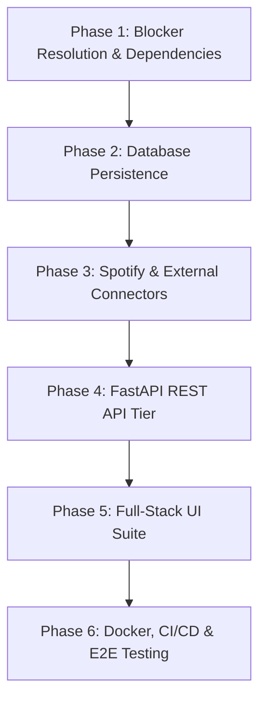

# Member 3 Gap Audit & Architecture Readiness Report

**Project:** TasteOps — Cultural Intelligence Operating System for Physical Spaces  
**Audit Target:** Member 3 Scope (Full-Stack Delivery, REST API, Database Integration, UI Suite, External Execution Connectors, Docker, CI/CD, Integration & E2E Testing)  
**Repository Branch:** `feature/member-3-tasks` (tracking `origin/feature/member-3-tasks`)  
**Base Commit:** `d6697c1` (includes Member 1 Infrastructure and Member 2 PR #2 Orchestration merge)  
**Date of Audit:** October 2026  
**Auditor:** Autonomous Systems Auditor  

---

## 1. Executive Summary

This comprehensive audit evaluates the current state of the TasteOps repository following the merge of Pull Request #2 (`feature/agent-orchestration-layer` into `feature/cultural-intelligence-core` at commit `d6697c1`). It focuses exclusively on the responsibilities assigned to **Member 3**:
1. REST API Layer (FastAPI application, routers, schemas, middleware)
2. Application & External Service Layer (Execution dispatcher, Spotify & audio media services, partner outreach mailer)
3. Persistent Database Integration (PostgreSQL/SQLite, SQLAlchemy models, Alembic migrations)
4. Frontend Architecture (Web UI / SPA for physical space brief entry, cultural twin/matrix visualization)
5. Human-in-the-Loop Approval UI (Interactive curator sign-off, 7-point compliance checklist, budget review)
6. Real-Time Execution UI (Task dispatch monitor, dependency visualizer, live status badges)
7. Audit & Decision Ledger UI (Timeline explorer, cryptographic hash verification, Qloo provenance inspector)
8. External Execution Connectors (Live Spotify Web API, audio hardware/Sonos client, partner email/Notion dispatch)
9. Integration Tests (Live/staging API tests, database transaction tests, external connector mocks)
10. E2E Tests (Playwright/Cypress browser user journey tests)
11. Security (JWT/OAuth2 auth, RBAC, CORS middleware, Spotify API key security)
12. Docker (Multi-stage Dockerfiles for API, MCP, and Frontend; `docker-compose.yml`)
13. CI (GitHub Actions CI workflow for linting, typing, unit and integration tests)
14. CD (Automated staging/production deployment and container publishing)
15. Documentation (Member 3 API documentation, database schemas, Spotify integration manual, deployment guides)

### Master Status Matrix

| Area | Status | Key Evaluation & Current State |
| :--- | :--- | :--- |
| **1. API** | `MISSING` | No web framework (`FastAPI`, `Uvicorn`) declared in [`pyproject.toml`](file:///c:/Users/Admin/Desktop/Tasteops/TasteOps-feature-cultural-intelligence-core/pyproject.toml). Only stdio JSON-RPC MCP server exists ([`server.py`](file:///c:/Users/Admin/Desktop/Tasteops/TasteOps-feature-cultural-intelligence-core/src/tasteops/mcp/server.py)). |
| **2. Application / Service Layer** | `PARTIALLY IMPLEMENTED` | Member 2 added [`TasteOpsOrchestrator`](file:///c:/Users/Admin/Desktop/Tasteops/TasteOps-feature-cultural-intelligence-core/src/tasteops/workflows/orchestrator.py) as an in-memory facade. Member 3 execution dispatchers, Spotify playlist generators, and outreach mailers are missing. |
| **3. Database Integration** | `PARTIALLY IMPLEMENTED` | File-based [`FileStateStore`](file:///c:/Users/Admin/Desktop/Tasteops/TasteOps-feature-cultural-intelligence-core/src/tasteops/workflows/persistence.py#L83-L165) writes `workflow_state.json` and `audit_events.jsonl`. No relational database (PostgreSQL/SQLite), ORM (`SQLAlchemy`), or `Alembic` migrations exist. |
| **4. Frontend** | `MISSING` | Zero frontend code, package manifests (`package.json`), or web assets exist in the workspace. |
| **5. Approval UI** | `MISSING` | Backend approval gate with cryptographic plan hashing exists in [`engine.py`](file:///c:/Users/Admin/Desktop/Tasteops/TasteOps-feature-cultural-intelligence-core/src/tasteops/workflows/engine.py#L573-L605) and [`governance.py`](file:///c:/Users/Admin/Desktop/Tasteops/TasteOps-feature-cultural-intelligence-core/src/tasteops/agents/governance.py#L544-L609), but no visual UI or curator portal exists. |
| **6. Execution UI** | `MISSING` | Backend [`ExecutionTask`](file:///c:/Users/Admin/Desktop/Tasteops/TasteOps-feature-cultural-intelligence-core/src/tasteops/workflows/schemas.py#L614-L653) models exist, but no real-time execution dashboard or WebSocket stream exists. |
| **7. Audit / Decision Ledger UI** | `MISSING` | Append-only [`AuditEvent`](file:///c:/Users/Admin/Desktop/Tasteops/TasteOps-feature-cultural-intelligence-core/src/tasteops/workflows/persistence.py#L27-L38) records exist in backend, but no visual timeline, ledger, or provenance inspection UI exists. |
| **8. External Execution Connectors** | `PARTIALLY IMPLEMENTED` | `GovernanceAgent` synthesizes mock tasks with dummy URI strings (`spotify://seed_artist/...`). Real Spotify API, Sonos, and email/CRM connectors are missing. |
| **9. Integration Tests** | `PARTIALLY IMPLEMENTED` | Member 2 added 14 in-memory orchestration tests ([`test_orchestrator.py`](file:///c:/Users/Admin/Desktop/Tasteops/TasteOps-feature-cultural-intelligence-core/tests/integration/test_orchestrator.py)) using `respx`. Real API, database, and live connector tests are missing. Suite fails to execute due to a syntax error. |
| **10. E2E Tests** | `MISSING` | Zero browser E2E tests (Playwright/Cypress) or cross-tier execution tests exist. |
| **11. Security** | `PARTIALLY IMPLEMENTED` | SecretStr masking, cryptographic plan hash binding, and unapproved execution blocks are implemented. API auth, JWT/OAuth2, RBAC, CORS, and Spotify secret management are missing. |
| **12. Docker** | `MISSING` | No `Dockerfile`, `docker-compose.yml`, or `.dockerignore` exist in the repository. |
| **13. CI** | `MISSING` | No `.github/workflows/` directory or automated CI pipelines exist. |
| **14. CD** | `MISSING` | No automated deployment or release pipeline exists. |
| **15. Documentation** | `PARTIALLY IMPLEMENTED` | Extensive Member 1 & 2 documentation exists ([`INTEGRATION_CONTRACT.md`](file:///c:/Users/Admin/Desktop/Tasteops/TasteOps-feature-cultural-intelligence-core/docs/INTEGRATION_CONTRACT.md), [`DOWNSTREAM_INTEGRATION_GUIDE.md`](file:///c:/Users/Admin/Desktop/Tasteops/TasteOps-feature-cultural-intelligence-core/docs/DOWNSTREAM_INTEGRATION_GUIDE.md)). Member 3 API, database, Spotify, and frontend guides are missing. |

---

## 2. Critical Blockers from Member 1 & 2 Contracts

### Blocker 1: Python 2 SyntaxError in Member 1 Codebase — `BLOCKED BY MEMBER 1 CONTRACT`
- **File:** [`src/tasteops/models/insight.py`](file:///c:/Users/Admin/Desktop/Tasteops/TasteOps-feature-cultural-intelligence-core/src/tasteops/models/insight.py#L64-L78)
- **Lines:** 64 and 77
- **Code:**
  ```python
  63:             else:
  64:                 data["affinity"] = 1.0
  65:             except ValueError, TypeError:
  66:                 data["affinity"] = 0.0
  ...
  76:             except ValueError, TypeError:
  77:                 data["affinity"] = 0.0
  ```
- **Technical Impact:** Python 3 requires parenthesized tuples for catching multiple exceptions: `except (ValueError, TypeError):`. In Python 3 (including 3.13 and 3.14), this raises an unhandled `SyntaxError: multiple exception types must be parenthesized`.
- **Systemic Consequence:** Because [`tasteops/__init__.py`](file:///c:/Users/Admin/Desktop/Tasteops/TasteOps-feature-cultural-intelligence-core/src/tasteops/__init__.py) imports all agents and models, **the entire package fails immediately on import**. Running `pytest` or importing `TasteOpsOrchestrator` inside a FastAPI application crashes at runtime.
- **Resolution Required:** Parenthesize exception tuples in lines 64 and 77 of `src/tasteops/models/insight.py`.

### Blocker 2: Hardcoded Mock Execution Dispatch in Member 2 Governance Agent — `BLOCKED BY MEMBER 2 CONTRACT`
- **File:** [`src/tasteops/agents/governance.py`](file:///c:/Users/Admin/Desktop/Tasteops/TasteOps-feature-cultural-intelligence-core/src/tasteops/agents/governance.py#L638-L670)
- **Code:**
  ```python
  # 1. Spotify Audio Seeding Task
  if plan.cultural_matrix.artists:
      lead_artist = plan.cultural_matrix.artists[0]
      task = ExecutionTask(
          task_id=task_id,
          action=f"Export seed artist '{lead_artist.name}' to Spotify audio engine pipeline",
          ...,
          status="EXECUTED",
          output_reference=f"spotify://seed_artist/{lead_artist.id}",
      )
      tasks.append(task)
  ```
- **Technical Impact:** `GovernanceAgent.execute_plan()` directly synthesizes mock tasks and marks them `"EXECUTED"` with simulated URI strings (`spotify://seed_artist/...`, `brief://partner/...`, `spec://zone/...`).
- **Systemic Consequence:** There is no pluggable `ExecutionDispatcher` interface or connector hook. Member 3 cannot invoke real Spotify Web API calls or outreach mailers during execution without monkeypatching or modifying Member 2's `GovernanceAgent`.
- **Resolution Required:** Introduce an injectable `ExecutionDispatcher` protocol into `GovernanceAgent` and `WorkflowEngine.execute_plan()`.

### Blocker 3: Synchronous StateStore Contract — `BLOCKED BY MEMBER 2 CONTRACT`
- **File:** [`src/tasteops/workflows/persistence.py`](file:///c:/Users/Admin/Desktop/Tasteops/TasteOps-feature-cultural-intelligence-core/src/tasteops/workflows/persistence.py#L40-L59)
- **Code:**
  ```python
  class BaseStateStore(ABC):
      @abstractmethod
      def save_transition(self, event: AuditEvent, ctx: WorkflowContext) -> None: ...
      @abstractmethod
      def save_context(self, ctx: WorkflowContext) -> None: ...
      @abstractmethod
      def load_context(self, session_id: str) -> WorkflowContext | None: ...
  ```
- **Technical Impact:** `save_transition` and `save_context` are synchronous methods.
- **Systemic Consequence:** Modern asynchronous database drivers in Python (`asyncpg`, `SQLAlchemy[asyncio]`, `aiosqlite`) require `await` expressions. Because `_record_and_persist` in `engine.py` calls `self.store.save_transition()` synchronously, Member 3 cannot natively persist state to an async database without wrapping calls in thread pools or event loop workarounds.
- **Resolution Required:** Provide an `AsyncBaseStateStore` or allow `save_transition` to be an async coroutine.

### Blocker 4: Configuration Isolation — `BLOCKED BY MEMBER 1 CONTRACT`
- **File:** [`src/tasteops/config.py`](file:///c:/Users/Admin/Desktop/Tasteops/TasteOps-feature-cultural-intelligence-core/src/tasteops/config.py)
- **Technical Impact:** `QlooSettings` only reads `QLOO_*` environment variables.
- **Systemic Consequence:** There is no centralized configuration for `DATABASE_URL`, `SPOTIFY_CLIENT_ID`, `SPOTIFY_CLIENT_SECRET`, `JWT_SECRET_KEY`, or `CORS_ORIGINS`.
- **Resolution Required:** Extend configuration with an `AppSettings` class loading database, security, and connector settings.

---

## 3. Comprehensive Area-by-Area Gap Audit

---

### Area 1: API
- **Classification:** `MISSING`
- **What Already Exists:**
  - FastMCP stdio server in [`src/tasteops/mcp/server.py`](file:///c:/Users/Admin/Desktop/Tasteops/TasteOps-feature-cultural-intelligence-core/src/tasteops/mcp/server.py) exposing 10 cultural intelligence tools (`health_check`, `resolve_entity`, `resolve_tag`, `get_cultural_profile`, `get_related_artists`, `get_related_books`, `get_related_brands`, `get_related_places`, `get_related_movies`, `get_cultural_matrix`).
  - `TasteOpsOrchestrator` in [`src/tasteops/workflows/orchestrator.py`](file:///c:/Users/Admin/Desktop/Tasteops/TasteOps-feature-cultural-intelligence-core/src/tasteops/workflows/orchestrator.py) provides a high-level application facade.
  - Integration guide in [`docs/DOWNSTREAM_INTEGRATION_GUIDE.md`](file:///c:/Users/Admin/Desktop/Tasteops/TasteOps-feature-cultural-intelligence-core/docs/DOWNSTREAM_INTEGRATION_GUIDE.md#L350-L373) outlines recommended FastAPI route signatures.
- **What is Missing:**
  - Web framework dependency (`fastapi`, `uvicorn[standard]`) in `pyproject.toml`.
  - HTTP application entry point (`src/tasteops/api/app.py`).
  - REST API Routers:
    - `POST /api/v1/sessions`: Create activation session from brief.
    - `POST /api/v1/sessions/{id}/advance`: Run workflow pipeline to approval gate.
    - `GET /api/v1/sessions/{id}`: Fetch session state, cultural twin, and matrix.
    - `POST /api/v1/sessions/{id}/approve`: Submit human curator approval with sign-off credentials.
    - `POST /api/v1/sessions/{id}/reject`: Reject activation plan with feedback.
    - `POST /api/v1/sessions/{id}/execute`: Trigger approved downstream task dispatch.
    - `GET /api/v1/sessions/{id}/audit`: Fetch immutable audit trail and provenance report.
    - `WS /api/v1/sessions/{id}/ws`: WebSocket connection for real-time state and task streaming.
  - Middleware: CORS middleware, request ID injection, global exception handlers mapping `QlooException` to HTTP status codes.
- **Tests & Verification:** Zero HTTP API tests exist.

---

### Area 2: Application / Service Layer
- **Classification:** `PARTIALLY IMPLEMENTED`
- **What Already Exists:**
  - Cultural intelligence services: [`EntityResolver`](file:///c:/Users/Admin/Desktop/Tasteops/TasteOps-feature-cultural-intelligence-core/src/tasteops/services/entity_resolver.py), [`TagResolver`](file:///c:/Users/Admin/Desktop/Tasteops/TasteOps-feature-cultural-intelligence-core/src/tasteops/services/tag_resolver.py), [`InsightsService`](file:///c:/Users/Admin/Desktop/Tasteops/TasteOps-feature-cultural-intelligence-core/src/tasteops/services/insights_service.py), [`CulturalMatrixService`](file:///c:/Users/Admin/Desktop/Tasteops/TasteOps-feature-cultural-intelligence-core/src/tasteops/services/cultural_matrix_service.py).
  - 4 specialized agents: [`CulturalStrategist`](file:///c:/Users/Admin/Desktop/Tasteops/TasteOps-feature-cultural-intelligence-core/src/tasteops/agents/strategist.py), [`ExperienceArchitect`](file:///c:/Users/Admin/Desktop/Tasteops/TasteOps-feature-cultural-intelligence-core/src/tasteops/agents/architect.py), [`PartnershipAgent`](file:///c:/Users/Admin/Desktop/Tasteops/TasteOps-feature-cultural-intelligence-core/src/tasteops/agents/partnership.py), [`GovernanceAgent`](file:///c:/Users/Admin/Desktop/Tasteops/TasteOps-feature-cultural-intelligence-core/src/tasteops/agents/governance.py).
  - Application Orchestration Facade: [`TasteOpsOrchestrator`](file:///c:/Users/Admin/Desktop/Tasteops/TasteOps-feature-cultural-intelligence-core/src/tasteops/workflows/orchestrator.py).
- **What is Missing:**
  - **Execution Dispatcher Service**: Pluggable router delegating `ExecutionTask` payloads to external execution adapters.
  - **Spotify Curation & Media Service**: Translating `matrix.artists` and `ExperienceArchitect.sonic_identity` into track audio feature queries (filtering energy, acousticness, tempo) and generating real Spotify playlists.
  - **Partner Outreach Service**: Formats and dispatches exploratory outreach proposals generated by `PartnershipAgent`.
  - **Spatial Design Service**: Compiles physical space parameters into printable/exportable architectural specification briefs.
- **Tests & Verification:** Domain services and agent workflows are thoroughly tested, but external execution and media services have zero tests.

---

### Area 3: Database Integration
- **Classification:** `PARTIALLY IMPLEMENTED`
- **What Already Exists:**
  - [`BaseStateStore`](file:///c:/Users/Admin/Desktop/Tasteops/TasteOps-feature-cultural-intelligence-core/src/tasteops/workflows/persistence.py#L40-L59): Storage interface.
  - [`InMemoryStateStore`](file:///c:/Users/Admin/Desktop/Tasteops/TasteOps-feature-cultural-intelligence-core/src/tasteops/workflows/persistence.py#L61-L81): Ephemeral in-memory dictionary store.
  - [`FileStateStore`](file:///c:/Users/Admin/Desktop/Tasteops/TasteOps-feature-cultural-intelligence-core/src/tasteops/workflows/persistence.py#L83-L165): Filesystem JSON/JSONL persistence under `storage/workflows/{session_id}/`.
- **What is Missing:**
  - Relational database integration (PostgreSQL for production, SQLite for local testing).
  - ORM dependencies (`sqlalchemy>=2.0.0`, `asyncpg`, `aiosqlite`).
  - Relational Table Schemas:
    - `sessions`: Session ID, space ID, intent, current state, created/updated timestamps.
    - `audit_events`: Event ID, session ID, from state, to state, approver, reason, metadata, error.
    - `cultural_twins`: Raw anchors, resolved entities, tags, audience profile, mood.
    - `activation_plans`: Plan ID, session ID, version, plan hash, strategy, experience, partnerships.
    - `execution_tasks`: Task ID, plan ID, category, status, idempotency key, input, output reference, provenance.
  - Database migration framework (`Alembic`) with initial migration scripts.
- **Tests & Verification:** Only file and in-memory persistence are tested. Database engines are untested.

---

### Area 4: Frontend
- **Classification:** `MISSING`
- **What Already Exists:** None.
- **What is Missing:**
  - Modern web application (Next.js, Vite + React, or Vanilla HTML/CSS/JS).
  - Complete Design System: Premium dark-mode aesthetic, typography (Inter/Outfit), glassmorphic card containers, and micro-animations.
  - Core Views:
    1. **Physical Space Brief Studio**: Form capturing venue type, location, target demographic, vibe/mood, budget, and cultural anchors.
    2. **Cultural Twin & Matrix Explorer**: Interactive cards visualizing resolved Qloo entities, tags, and 6-domain recommendations.
    3. **Curator Approval Portal**: Highlighting compliance audits, budget breakdown, and sign-off controls.
    4. **Live Execution Runner**: Showing real-time task progress, status badges, and output reference links.
    5. **Immutable Decision Ledger**: Interactive chronological state transition timeline.
- **Tests & Verification:** Zero frontend unit or component tests exist.

---

### Area 5: Approval UI
- **Classification:** `MISSING`
- **What Already Exists:**
  - Backend state gate: `WorkflowState.AWAITING_APPROVAL` $\rightarrow$ `APPROVED` or `FAILED`.
  - Cryptographic plan hash binding (`ApprovalRecord.plan_hash == plan.compute_hash()`).
  - Governance audit results: 7 compliance checks, readiness score, and risk flags.
- **What is Missing:**
  - Curator Review Portal:
    - 7-point compliance checklist widget with visual indicators (green checks / red warnings).
    - Granular cost breakdown widget ($12,500 budget itemization).
    - Sign-off modal capturing curator name, role, and generating cryptographic approval payload.
    - Rejection modal capturing curatorial feedback and triggering bounded refinement loop.
- **Tests & Verification:** Backend gate is tested in [`test_approval_gate.py`](file:///c:/Users/Admin/Desktop/Tasteops/TasteOps-feature-cultural-intelligence-core/tests/unit/test_approval_gate.py). Zero UI tests exist.

---

### Area 6: Execution UI
- **Classification:** `MISSING`
- **What Already Exists:**
  - Backend states: `WorkflowState.EXECUTING` and `WorkflowState.COMPLETED`.
  - Backend task schemas: `ExecutionPlanAction`, `ExecutionTask`, `ExecutionSummary`.
  - Idempotency key tracking and deduplication in `GovernanceAgent`.
- **What is Missing:**
  - Execution Dashboard:
    - Action item dependency graph visualizer (e.g. `act_brand_01` waiting on `act_sonic_01`).
    - Real-time task progress tracker displaying status badges (`PENDING`, `EXECUTING`, `EXECUTED`, `FAILED`).
    - Output links: Clickable Spotify playlist URLs, partner outreach PDF previews, and spatial specs.
- **Tests & Verification:** Zero UI execution tests exist.

---

### Area 7: Audit / Decision Ledger UI
- **Classification:** `MISSING`
- **What Already Exists:**
  - Backend `AuditEvent` model and `audit_events.jsonl` append-only storage.
  - Provenance validation rules certifying zero hallucinated entity IDs.
- **What is Missing:**
  - Decision Ledger UI:
    - Visual timeline tracing the 13 states from `CREATED` to `COMPLETED`.
    - Event inspector displaying transition timestamps, reasons, and approver identity.
    - Provenance verification drawer showing Qloo entity IDs (`ent_...`), affinity scores, raw query endpoints, and explainability strings.
    - Post-execution audit status badge (`COMPLIANT` vs `FLAGGED`).
- **Tests & Verification:** Zero UI ledger tests exist.

---

### Area 8: External Execution Connectors
- **Classification:** `PARTIALLY IMPLEMENTED`
- **What Already Exists:**
  - Supported category whitelist: `{"spotify_audio_seed", "partner_outreach_brief", "spatial_design_spec", "curatorial_programming", "hospitality_training"}`.
  - Mock task synthesis in `GovernanceAgent.execute_plan()`.
- **What is Missing:**
  - **Live Spotify Connector**:
    - OAuth2 authentication (Client Credentials and User Authorization Code flow).
    - Artist resolution and catalog top-tracks query.
    - Audio features filtering (acousticness, energy, tempo matching daypart guidelines).
    - Playlist creation and track population.
  - **Hardware / Audio System Connector**: Sonos / Wiim / Bluesound playback integration.
  - **Outreach Dispatcher**: SMTP / SendGrid / Notion integration for collaboration briefs.
  - **Spatial Spec Exporter**: Markdown / PDF brief generator.
- **Tests & Verification:** Only mock tasks are tested in unit tests. Live connector tests are missing.

---

### Area 9: Integration Tests
- **Classification:** `PARTIALLY IMPLEMENTED`
- **What Already Exists:**
  - [`tests/integration/test_orchestrator.py`](file:///c:/Users/Admin/Desktop/Tasteops/TasteOps-feature-cultural-intelligence-core/tests/integration/test_orchestrator.py): 14 in-memory orchestration tests using `respx` HTTP mocking.
- **What is Missing:**
  - Live/staging API integration tests.
  - FastAPI HTTP endpoint integration tests (`httpx.AsyncClient(app=...)`).
  - Database transaction and rollback integration tests.
  - Real/mocked Spotify Web API integration tests.
- **Execution Blocker:** Running `pytest` currently fails due to the `SyntaxError` in `insight.py`.

---

### Area 10: E2E Tests
- **Classification:** `MISSING`
- **What Already Exists:** None.
- **What is Missing:**
  - Browser-driven End-to-End tests (Playwright, Cypress) testing:
    - User entering venue brief in frontend form.
    - System displaying resolved cultural anchors and matrix.
    - System halting at `AWAITING_APPROVAL` with the human approval gate.
    - User reviewing the 7-point governance checklist and clicking "Approve".
    - System transitioning to `EXECUTING` and rendering live progress cards.
    - System completing execution with verified Spotify playlist links.
    - User inspecting the immutable audit ledger.
  - Multi-container Dockerized E2E test harness.

---

### Area 11: Security
- **Classification:** `PARTIALLY IMPLEMENTED`
- **What Already Exists:**
  - `SecretStr` masking for `QLOO_API_KEY` in [`config.py`](file:///c:/Users/Admin/Desktop/Tasteops/TasteOps-feature-cultural-intelligence-core/src/tasteops/config.py).
  - Cryptographic plan hash validation in [`GovernanceAgent`](file:///c:/Users/Admin/Desktop/Tasteops/TasteOps-feature-cultural-intelligence-core/src/tasteops/agents/governance.py#L591-L599).
  - Unapproved execution enforcement with [`UnapprovedExecutionError`](file:///c:/Users/Admin/Desktop/Tasteops/TasteOps-feature-cultural-intelligence-core/src/tasteops/agents/governance.py#L30-L33).
  - Provenance validation rejecting unverified entity IDs.
- **What is Missing for Member 3:**
  - User authentication (JWT tokens, OAuth2).
  - Role-Based Access Control (RBAC) ensuring only authorized curators can approve plans.
  - CORS middleware configuration for web clients.
  - Spotify Client ID / Secret secure configuration.
  - Rate limiting and security headers (CSP, HSTS).
- **Tests & Verification:** Backend gate security is tested; API and web security are untested.

---

### Area 12: Docker
- **Classification:** `MISSING`
- **What Already Exists:** None.
- **What is Missing:**
  - `Dockerfile.api`: FastAPI backend container.
  - `Dockerfile.mcp`: TasteOps MCP server container.
  - `Dockerfile.frontend`: Web UI container.
  - `docker-compose.yml`: Multi-container local orchestration (API, MCP, PostgreSQL, Frontend).
  - `.dockerignore`: Preventing build context bloat and secret leakage.

---

### Area 13: CI (Continuous Integration)
- **Classification:** `MISSING`
- **What Already Exists:** None. No `.github/` folder exists.
- **What is Missing:**
  - GitHub Actions workflow (`.github/workflows/ci.yml`) configuring:
    - Code linting (`ruff check src tests`).
    - Code formatting check (`ruff format --check src tests`).
    - Static type checking (`mypy src`).
    - Unit test suite (`pytest tests/unit/ -v`).
    - Integration test suite (`pytest tests/integration/ -v`).
    - Container build validation.

---

### Area 14: CD (Continuous Deployment)
- **Classification:** `MISSING`
- **What Already Exists:** None.
- **What is Missing:**
  - GitHub Actions deployment workflow (`.github/workflows/cd.yml`).
  - Container publishing to GitHub Container Registry (GHCR).
  - Automated deployment configuration (Fly.io, Render, AWS ECS, or GCP Cloud Run).
  - Automated database migration execution (`alembic upgrade head`) on deploy.

---

### Area 15: Documentation
- **Classification:** `PARTIALLY IMPLEMENTED`
- **What Already Exists:**
  - [`README.md`](file:///c:/Users/Admin/Desktop/Tasteops/TasteOps-feature-cultural-intelligence-core/README.md): Architecture overview and MCP tools.
  - [`docs/INTEGRATION_CONTRACT.md`](file:///c:/Users/Admin/Desktop/Tasteops/TasteOps-feature-cultural-intelligence-core/docs/INTEGRATION_CONTRACT.md): Comprehensive specification for Members 1 and 2.
  - [`docs/DOWNSTREAM_INTEGRATION_GUIDE.md`](file:///c:/Users/Admin/Desktop/Tasteops/TasteOps-feature-cultural-intelligence-core/docs/DOWNSTREAM_INTEGRATION_GUIDE.md): Stable import surface and FastAPI examples.
  - [`docs/APPROVAL_GATE_AUDIT.md`](file:///c:/Users/Admin/Desktop/Tasteops/TasteOps-feature-cultural-intelligence-core/docs/APPROVAL_GATE_AUDIT.md): Cryptographic gate audit.
- **What is Missing for Member 3:**
  - REST API OpenAPI / Swagger documentation.
  - Database entity-relationship diagram and schema guide.
  - Spotify Web API integration and setup guide.
  - Frontend user manual and component documentation.
  - Docker deployment and operational runbook.

---

## 4. Git Branch Inventory

| Branch | Tracking Remote | Tip Commit | Description |
| :--- | :--- | :--- | :--- |
| `feature/cultural-intelligence-core` | `origin/feature/cultural-intelligence-core` | `d6697c1` | Main integration branch containing Member 1 and Member 2 code. |
| `feature/agent-orchestration-layer` | `origin/feature/agent-orchestration-layer` | `4acb51b` | Member 2 feature branch (merged into base via PR #2). |
| `feature/member-3-tasks` | `origin/feature/member-3-tasks` | `d6697c1` | **Active working branch for Member 3 tasks.** |

---

## 5. Member 3 Implementation Roadmap



1. **Phase 1: Blocker Resolution & Dependencies**: Fix `insight.py` syntax error, add `fastapi`, `uvicorn`, `sqlalchemy`, `spotipy`, and `alembic` to `pyproject.toml`.
2. **Phase 2: Database Persistence**: Implement `SQLAlchemyStateStore` with tables for sessions, audit events, plans, and tasks.
3. **Phase 3: Spotify & External Connectors**: Implement live Spotify connector with audio feature weighting and playlist creation.
4. **Phase 4: FastAPI REST API Tier**: Implement API routers for sessions, approval, execution, and audit queries.
5. **Phase 5: Full-Stack UI Suite**: Build modern web interface with Brief Studio, Approval Portal, Live Task Monitor, and Audit Ledger.
6. **Phase 6: Docker, CI/CD & E2E Testing**: Add Dockerfiles, docker-compose, GitHub Actions CI/CD pipelines, and Playwright E2E tests.
